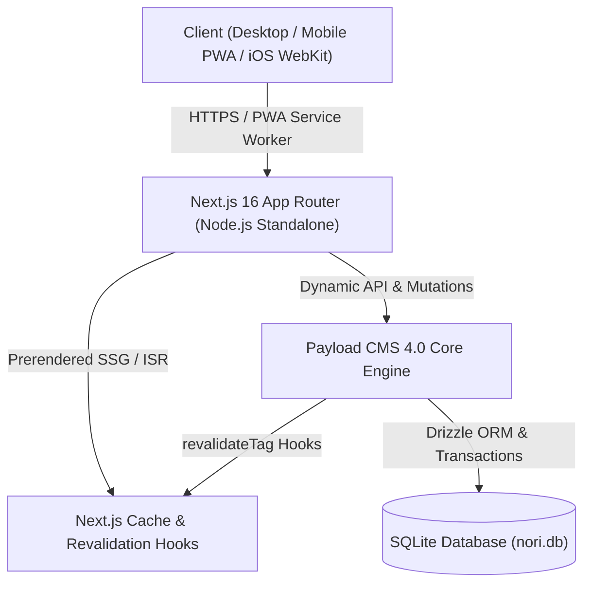

# NORI — Nền Tảng Cho Thuê Xe Linh Hoạt & Tư Vấn Mua Xe Toàn Diện

> **Dự án**: NORI Vehicle Rental (`nori-vehicle-rental`)<br />
> **Kiến trúc**: Next.js 16.4.6 (App Router), React 19.3.1, Payload CMS 4.0.0-beta.8, SQLite via `@payloadcms/db-sqlite`, Tailwind CSS v4.<br />
> **Repository chính thức**: [https://github.com/nquocthinh06/nori-vehicle-rental](https://github.com/nquocthinh06/nori-vehicle-rental)<br />
> **Nhánh chính**: `main`

---

## 1. Giới thiệu dự án

**NORI** là nền tảng số hóa dịch vụ cho thuê phương tiện tự lái (Ô tô, Xe máy, Xe bán tải) và hỗ trợ khách hàng tìm mua phương tiện tự tin tại Việt Nam.

Dự án được định hướng phát triển theo tiêu chuẩn công nghệ hiện đại:

- **Mobile-First & PWA**: Trải nghiệm mượt mà trên mọi thiết bị di động, tối ưu tương tác chạm vuốt, hỗ trợ cài đặt ứng dụng màn hình chính và hoạt động ngoại tuyến.
- **Dữ liệu Thời Gian Thực (Real-Time Integrity)**: Tách bạch rõ ràng giữa catalogue hiển thị tĩnh (SSG/ISR tối ưu SEO) và các giao dịch đặt xe, thanh toán, khóa ngày theo thời gian thực (Request-time & SQLite Transactions).
- **Phân Quyền Tập Trung & Đa Chi Nhánh (Branch-Scoped RBAC)**: Bảo vệ toàn diện **21 phân hệ quản trị** (bao gồm 8 phân hệ đa chi nhánh, kho xe, điểm giao nhận, nhân sự, điều chuyển, giao nhận tận nơi, định giá theo địa điểm và báo cáo chi nhánh) dành riêng cho nhân sự (`admins`), cách ly hoàn toàn với tài khoản khách hàng (`users`).
- **Khả Năng Tiếp Cận Cao**: Đạt chuẩn WCAG 2.2 AA (0 lỗi vi phạm khi kiểm thử tự động).

---

## 2. Các chức năng chính

### 2.1. Phía Khách Hàng (Customer Experience)

- **Catalogue & Tìm kiếm Thông minh**:
  - Quản lý danh mục 21 dòng xe thuộc 3 nhóm chính: ô tô phổ thông & hạng sang, xe máy & xe máy điện, xe bán tải địa hình.
  - Lọc đa tiêu chí: Nhóm xe, hãng sản xuất, khoảng giá thuê theo ngày, loại nhiên liệu, số chỗ ngồi.
  - Tìm kiếm tiếng Việt không dấu, chuyển đổi linh hoạt chế độ xem lưới (Grid) hoặc danh sách (List).
- **Hero Carousel Phương Tiện Quản Trị Từ CMS**:
  - 5 slide phương tiện sắc nét quản trị trực tiếp từ `/dashboard/content`, tự động chuyển mượt mà, hỗ trợ vuốt chạm di động, tạm dừng/tiếp tục và bảo toàn dữ liệu thanh tìm kiếm `<SearchBar />`.
- **Chi tiết Xe & Tính Giá Tự Động**:
  - Chuyển đổi minh bạch giữa nguồn ảnh Catalogue (`"Ảnh Catalogue – không phải hình ảnh của cá thể xe đang cho thuê."`) và ảnh cá thể xe thực tế; tự động ẩn bộ lọc `"Nội thất"` trên xe máy và ẩn thông số đốt trong trên xe thuần điện.
  - Thông số kỹ thuật chuẩn hóa, chọn phiên bản và màu sắc.
  - Lịch kiểm tra xe trống theo thời gian thực (`/nori-api/availability`).
  - Động cơ tính giá thuê tự động: Chiết khấu tuần (5%), chiết khấu tháng (12%), phụ phí cuối tuần và ngày lễ, cộng phí dịch vụ bổ sung (bảo hiểm, ghế trẻ em, thiết bị định vị).
- **Quy trình Đặt Xe, Chỉnh Sửa Đơn Chờ Duyệt & Thông Báo Sau Duyệt**:
  - Cho phép khách hàng chỉnh sửa trực tiếp đơn đang chờ duyệt (`PENDING`) tại `/my-bookings` kèm bảng đối chiếu chi phí Trước / Sau, hoán đổi ngày khóa nguyên tử và khóa Optimistic Locking (`revision`) chống ghi đè khi Admin duyệt đồng thời.
  - Tự động hiển thị Popup xác nhận đơn thuê (1 lần/sự kiện duyệt, xem lại qua Chuông thông báo trên Header) kèm ngày dự kiến nhân viên liên hệ tư vấn theo khung giờ hành chính và ngày lễ.
- **Tư vấn Mua Xe & Đặt Lịch Lái Thử**:
  - Biểu mẫu đăng ký tư vấn mua xe hoặc hẹn lịch lái thử xe trong kho.
  - Khách hàng theo dõi phản hồi trực tiếp trong trang quản lý tài khoản (`/account`).
- **Đánh Giá & Nhận Xét Đã Xác Minh**:
  - Chỉ cho phép khách hàng đã hoàn thành đơn thuê của chính dòng xe đó gửi đánh giá xếp hạng sao và nhận xét thực tế.
- **Trải Nghiệm Ứng Dụng Di Động (PWA)**:
  - Thanh điều hướng Bottom Navigation 5 mục tiện lợi trên màn hình nhỏ.
  - Bộ lọc tìm kiếm dạng Bottom Sheet có hỗ trợ thao tác vuốt chạm.
  - Lưu trữ danh sách xe yêu thích (Favorites) bền vững bằng LocalStorage.
  - Trang thông báo ngoại tuyến chuyên biệt (`/offline`) khi mất kết nối mạng.

### 2.2. Phía Quản Trị Viên (Admin Center — 21 Phân hệ `/dashboard/*`)

- **13 Phân hệ Vận hành & CMS Cốt lõi**: Tổng quan (`/dashboard`), Đơn thuê (`/dashboard/bookings`), Phương tiện (`/dashboard/vehicles`), Dòng xe (`/dashboard/models`), Yêu cầu mua xe (`/dashboard/inquiries`), Khách hàng & Đánh giá (`/dashboard/customers`), Bảo dưỡng (`/dashboard/maintenance`), Thanh toán & Hoàn tiền (`/dashboard/payments`), Khuyến mãi (`/dashboard/promotions`), Nội dung CMS (`/dashboard/content`), Bài viết (`/dashboard/posts`), Báo cáo tổng hợp (`/dashboard/reports`), Quản trị viên & Đồng bộ hệ thống (`/dashboard/admins`, `/dashboard/system`).
- **8 Phân hệ Đa Chi Nhánh & Đa Địa Điểm (Module 3.7 — `v2.7.0`)**:
  1. **Quản lý Chi nhánh (`/dashboard/branches`)**: Trạng thái nghiệp vụ (`ACTIVE` / `INACTIVE` / `TEMPORARILY_CLOSED` / `ARCHIVED`), giờ hoạt động, ngày nghỉ, giao nhận tận nơi, chặn xóa cứng khi có dữ liệu phát sinh.
  2. **Quản lý Kho xe & Tồn kho (`/dashboard/warehouses`)**: Showroom/bãi đỗ/kho lưu trữ/trung tâm bảo dưỡng, sức chứa thực tế và phân bổ hàng loạt xe chưa gắn chi nhánh (`UNALLOCATED`) — tuyệt đối không nhân bản bản ghi phương tiện.
  3. **Điểm Nhận & Trả xe (`/dashboard/locations`)**: Địa điểm xác minh (`verified = true`), phân loại loại phương tiện phục vụ, phụ phí địa điểm.
  4. **Nhân sự & Phân quyền Chi nhánh (`/dashboard/staff`)**: 8 vai trò chức danh (`SUPER_ADMIN`, `SYSTEM_ADMIN`, `BRANCH_MANAGER`, `RENTAL_STAFF`, `WAREHOUSE_STAFF`, `DELIVERY_STAFF`, `ACCOUNTANT`, `OPERATOR`), phân công 1..N chi nhánh, chống leo thang quyền và thu hồi quyền tức thì (`REVOKED`).
  5. **Điều chuyển Phương tiện (`/dashboard/transfers`)**: Quy trình 9 trạng thái nguyên tử (`DRAFT → PENDING_APPROVAL → APPROVED → IN_TRANSIT → ARRIVED → COMPLETED` + `EXCEPTION`), khóa lịch toàn cục `rental_days`, Optimistic Locking (`revision`) và nhật ký vị trí (`VehicleLocationHistory`).
  6. **Giao & Thu hồi Xe Tận nơi (`/dashboard/deliveries`)**: Khu vực & biểu phí giao nhận (`DeliveryZones`), điều phối nhiệm vụ (`DeliveryJobs`), chặn trùng khung giờ nhân viên giao nhận (`409`).
  7. **Định giá Địa điểm & Thuê Một Chiều (`/dashboard/location-pricing`)**: Phân cấp giá 5 tầng (`VEHICLE_BRANCH > MODEL_BRANCH > VEHICLE_BASE > BRANCH_DEFAULT > GLOBAL_DEFAULT`), quy tắc tuyến `A → B` và tỷ lệ chia doanh thu một chiều.
  8. **Báo cáo & Xuất CSV Đa Chi Nhánh (`/dashboard/branch-reports`)**: Tổng hợp doanh thu không cộng trùng (`sum(branch) + unassigned === systemTotal`), tách biệt cọc tài sản, xuất CSV UTF-8 BOM theo phạm vi chi nhánh.
- **Hệ thống Ghi Nhật Ký Kiểm Toán (Audit Logs)**: Ghi vết toàn bộ hành vi quan trọng của nhân viên quản trị kèm `actorRole`, `branchId`, `outcome`.

---

## 3. Kiến trúc hệ thống



- **Frontend Layer**: Next.js App Router kết hợp Server Components để dựng sẵn trang tĩnh (SSG/ISR) và Client Components cho các tương tác giỏ hàng, bộ lọc, popup.
- **Business Rule Engine (`src/lib/rental-rules.ts`)**: Độc lập hoàn toàn, xác thực tính hợp lệ của ngày thuê, công thức tính giá theo múi giờ Việt Nam (`Asia/Ho_Chi_Minh`), phụ phí cuối tuần/lễ Tết, ma trận chuyển đổi 9 trạng thái.
- **Data Persistence Layer**: SQLite cục bộ (`nori.db`) với chế độ WAL (Write-Ahead Logging), thực thi giao dịch ACID đảm bảo không xảy ra tình trạng đặt trùng xe hoặc lặp thanh toán.
- **Cache Invalidation Lifecycle**: Khi quản trị viên thay đổi thông tin dòng xe, giá hoặc ảnh, Payload hooks kích hoạt `revalidateTag` bóc tách tag cache tương ứng (`nori-model-${slug}`, `nori-catalogue-v3`) để cập nhật ngay lập tức giao diện khách hàng mà không cần build lại server.

---

## 4. Công nghệ sử dụng

| Lĩnh vực                | Công nghệ               | Phiên bản            | Vai trò                                                                      |
| :---------------------- | :---------------------- | :------------------- | :--------------------------------------------------------------------------- |
| **Framework**           | Next.js                 | 16.4.6               | App Router, Turbopack, Standalone deployment                                 |
| **UI Library**          | React                   | 19.3.1               | Giao diện tương tác người dùng                                               |
| **Styling**             | Tailwind CSS            | 4.0.0                | Hệ thống semantic tokens, CSS biến thể mới                                   |
| **Headless CMS**        | Payload CMS             | 4.0.0-beta.8         | Quản trị dữ liệu, phân quyền và API cốt lõi                                  |
| **Database**            | SQLite                  | 3.x                  | Lưu trữ dữ liệu quan hệ, transaction toàn vẹn                                |
| **Database Adapter**    | `@payloadcms/db-sqlite` | 4.0.0-beta.8         | Kết nối SQLite & Drizzle ORM                                                 |
| **Runtime & Toolchain** | Node.js / pnpm          | >=24.22.1 / pnpm 10+ | Môi trường thực thi và quản lý gói phụ thuộc                                 |
| **Testing Engine**      | Node Test Runner        | Node.js built-in     | Thực thi 322 Unit, Integration, Payment, Multi-Branch, Migration & LAN tests |
| **E2E Testing**         | Playwright              | 1.65.1               | 106 kịch bản E2E cô lập DB + Media (Chromium, LAN & Mobile WebKit)           |
| **A11y Testing**        | Axe Core                | 4.14.0               | Kiểm tra chuẩn tiếp cận WCAG 2.2 AA                                          |
| **Linter & Formatter**  | oxfmt & Custom AST      | 0.73.0               | Chuẩn hóa định dạng và quét bảo mật tĩnh                                     |

---

## 5. Hướng dẫn cài đặt và khởi chạy

### 5.1. Yêu cầu môi trường

- **Node.js**: Phiên bản `>= 24.22.1` (khuyến nghị Node 24 LTS).
- **Package Manager**: `pnpm` (phiên bản 9, 10 hoặc 11).
- **Trình duyệt**: Google Chrome, Microsoft Edge hoặc Safari.

### 5.2. Các bước cài đặt

1. **Clone mã nguồn từ GitHub**:

   ```bash
   git clone https://github.com/nquocthinh06/nori-vehicle-rental.git
   cd nori-vehicle-rental
   ```

2. **Cài đặt gói phụ thuộc**:

   ```bash
   pnpm install
   ```

3. **Thiết lập biến môi trường**:
   Sao chép tệp mẫu `.env.example` thành `.env`:

   ```bash
   cp .env.example .env
   ```

   Chỉnh sửa tệp `.env` nếu cần thay đổi cổng hoặc secret:

   ```env
   DATABASE_URI=file:./nori.db
   PAYLOAD_SECRET=your-secure-random-payload-secret-at-least-32-chars-long
   NEXT_PUBLIC_SITE_URL=http://localhost:3000
   PORT=3000
   ```

4. **Khởi tạo Database, Đồng bộ Snapshot & Khởi chạy Dev Server**:
   ```bash
   # Kiểm tra trạng thái tương thích schema CSDL & pending migrations
   pnpm db:check

   # Khởi tạo cấu trúc 109 bảng SQLite + composite indexes (lũy kế an toàn, không mất dữ liệu)
   pnpm db:migrate:safe

   # Nhập bộ dữ liệu mẫu và hình ảnh mới nhất từ Snapshot
   pnpm data:import

   # Khởi tạo tài khoản Admin cục bộ an toàn
   pnpm seed:admin -- --init-env

   # Khởi chạy máy chủ phát triển (chỉ localhost, tích hợp Preflight Guard)
   pnpm dev

   # Hoặc khởi chạy LAN Server cho phép điện thoại Android / iPhone / Laptop cùng Wi-Fi truy cập
   pnpm dev:lan
   ```
   Truy cập cục bộ tại: `http://localhost:3000` (hoặc địa chỉ `Network: http://<LAN_IP>:3000` hiển thị khi chạy `pnpm dev:lan`; Quản trị viên: `/dashboard` và `/dashboard/system`). Chi tiết mở cổng Firewall & kiểm thử đa thiết bị xem tại [docs/LAN_SETUP.md](docs/LAN_SETUP.md).

---

## 6. Cấu hình cơ sở dữ liệu (Database)

Dự án sử dụng **SQLite** làm cơ sở dữ liệu mặc định (`./nori.db`), mang lại các ưu điểm:

- Không yêu cầu cài đặt máy chủ CSDL cồng kềnh (MySQL/PostgreSQL), không phụ thuộc vào hạ tầng đám mây bên ngoài.
- Hỗ trợ đầy đủ quan hệ bảng, chỉ mục (Unique Index) và khóa ngoại (Foreign Keys).
- Hỗ trợ thao tác đồng thời an toàn với chế độ WAL (Write-Ahead Logging).
- Toàn bộ lược đồ (schema) và quan hệ được khởi tạo và đồng bộ tự động bởi Payload CMS qua Drizzle ORM.

---

## 7. Khởi tạo dữ liệu DEMO và tài khoản Admin an toàn

Dự án đã tích hợp sẵn tập dữ liệu DEMO bao gồm:

- **20 dòng xe** phủ khắp 3 danh mục kèm **63 hình ảnh** bản quyền mở đã chuẩn hóa trong `public/seed-media/`.
- **21 xe thực tế minh họa** (`isDemo: true`, gắn nhãn `DEMO`).
- Cấu hình thông tin thương hiệu, hotline, địa chỉ showroom tại `NoriSite`.

### Tạo tài khoản Quản trị viên (Admin)

Chạy script khởi tạo quản trị viên an toàn:

```bash
pnpm seed:admin
```

- Mật khẩu được mã hóa an toàn bằng thuật toán chuẩn `PBKDF2-SHA256` với salt ngẫu nhiên 32 bytes (100,000 lượt lặp).
- Hoạt động theo cơ chế lũy kế (Idempotent): nếu tài khoản đã tồn tại, script sẽ kiểm tra toàn vẹn mà không ghi đè dữ liệu.
- Tài khoản quản trị mặc định: `admin@nori.vn` (mật khẩu được in an toàn trong console hoặc đọc từ biến môi trường `NORI_ADMIN_PASSWORD`).

Đăng nhập quản trị tại: `http://localhost:3000/login` hoặc phân hệ CMS tại `http://localhost:3000/admin`.

---

## 8. Hướng dẫn kiểm thử (Testing Suite)

Dự án thiết lập hệ thống kiểm thử tự động toàn diện với **429 Automated Tests** (**322** Unit, Integration, Payment Resilience, Multi-Branch, Migration Regression & LAN Network + **1** Isolated Admin Test + **106** Playwright E2E trên DB & Media cô lập, **100% PASS**):

```bash
# 1. Kiểm tra định dạng mã nguồn
pnpm format:check

# 2. Phân tích cú pháp tĩnh & rà soát bảo mật (Linter)
pnpm lint

# 3. Kiểm tra kiểu dữ liệu TypeScript nghiêm ngặt
pnpm typecheck

# 4. Kiểm tra tương thích CSDL & Pending Migrations (Preflight Guard)
pnpm db:check

# 5. Kiểm toán tính toàn vẹn Media & Snapshot
pnpm media:audit
pnpm data:validate

# 6. Chạy toàn bộ 322 Unit, Integration, Payment Resilience, Multi-Branch, Migration & LAN Network Tests
pnpm test

# 7. Kiểm thử DB cô lập Admin
pnpm test:admin

# 8. Chạy toàn bộ 106 Playwright E2E Tests trên DB & Media cô lập (Bảo vệ 100% nori.db & media/)
pnpm test:e2e:isolated

# 9. Chạy kiểm thử E2E qua địa chỉ LAN IPv4 thực tế trên DB & Media cô lập
pnpm test:e2e:lan

# 10. Chạy Load / Stress / SQLite WAL Write Concurrency Test (1–100 VUs, cô lập hoàn toàn)
pnpm perf:load

# 11. Chạy Benchmark Mở rộng Đa Chi Nhánh (10/50/100 CN, 100/1k/10k Xe, 10k/50k/100k Đơn — DB cô lập)
pnpm perf:multi-branch
```

---

## 9. Hướng dẫn Production Build & Standalone

Để đóng gói và chạy ứng dụng ở chế độ sản xuất (khuyến nghị dùng `pnpm start:standalone`, tự động đồng bộ `.next/static`, `public/`, `libvips*.dll` trên Windows và neo đúng `nori.db` & `media/` ở thư mục gốc):

```bash
# 1. Thực hiện biên dịch và sinh trang tĩnh
pnpm build

# 2. Khởi chạy máy chủ sản xuất (Next.js Standalone mode)
pnpm start:standalone
```

Sau khi biên dịch thành công (`v2.7.0`):

- **104/104 tuyến đường tĩnh/SSG** được prerender thành công (`○ Static` / `● SSG`, giữ `0` route công khai bị `ƒ (Dynamic)`), `0` cảnh báo Turbopack, `0` lỗi TypeScript.
- **Benchmark Đa Chi Nhánh (`pnpm perf:multi-branch`, SQLite WAL cô lập)**: ở quy mô lớn nhất **100 chi nhánh / 10,000 xe / 100,000 đơn thuê (82.25 MB)**, truy vấn tra cứu đội xe chi nhánh đạt `0.086 ms` trung bình, kiểm tra lịch khả dụng timeline `0.044 ms`, báo cáo tổng hợp chi nhánh `5.541 ms`, thông lượng ghi giao dịch `5,974 tx/s` (`0` full table scan).
- Đo lường Lab Metrics trên Production Build cô lập (5 lượt đo/route; Field RUM p75 chưa khả dụng do chưa có traffic thật):
  - **Desktop `/`**: LCP `252 ms`, CLS `0.0026`, TBT `0 ms`, Images `332.2 KB` (`-78.4%`).
  - **Desktop `/vehicles`**: LCP `332 ms`, CLS `0.0005`, Doc `14.2 KB` (`-60.4%`), Images `670.8 KB` (`-77.3%`).
  - **Mobile `/vehicles/toyota-fortuner` (375px, Slow 4G, 4× CPU)**: LCP `1,876 ms` (`-41.1%`), CLS `0`, Images `85.1 KB` (`-73.7%`).
  - **Load Test Standalone (`100 VUs`)**: `669.5 req/s`, `314.3 ms p95`, `0.00%` lỗi, `0` `SQLITE_BUSY`.

---

## 10. Hướng dẫn Đồng bộ Dữ liệu Nhóm, Sao lưu và Phục hồi (Data Sync, Backup & Restore)

Dự án trang bị bộ công cụ đồng bộ dữ liệu nhóm (`data/snapshots/`, `media/seed/`) và sao lưu nhất quán (`backups/`):

```bash
# Kiểm tra trạng thái đồng bộ giữa Database cục bộ và Git Snapshot
pnpm data:status

# Xuất dữ liệu công khai & hình ảnh mới từ Admin ra Snapshot để chia sẻ qua GitHub
pnpm data:export

# Kiểm tra tính toàn vẹn JSON, khóa ngoại, checksum ảnh và quét chặn dữ liệu nhạy cảm
pnpm data:validate
pnpm media:audit

# Xem trước thay đổi (Dry Run) và nhập dữ liệu từ Snapshot sau khi git pull
pnpm data:import -- --dry-run
pnpm data:sync

# Sao lưu nhất quán (SQLite VACUUM INTO + Media files + SHA-256 Manifest)
pnpm data:backup

# Khôi phục Database & Media từ bản sao lưu
pnpm data:restore
```

Quản trị viên cấp cao (`SUPER_ADMIN`) cũng có thể theo dõi trạng thái đồng bộ, kiểm tra toàn vẹn, xuất/nhập Snapshot và tạo/khôi phục bản sao lưu trực tiếp trên giao diện **Quản trị hệ thống → Đồng bộ & Sao lưu dữ liệu** (`/dashboard/system`).

---

## 11. Các giới hạn hiện tại

1. **Dữ liệu Xe Minh Họa & Chi Nhánh Thực Tế**: Toàn bộ 21 cá thể xe trong kho hiện được gắn nhãn `DEMO` (`isDemo: true`, `allocationStatus: 'UNALLOCATED'`) để phục vụ kiểm thử và không bịa đặt địa chỉ chi nhánh thật. Doanh nghiệp cần tạo chi nhánh/kho thực tế tại `/dashboard/branches` & `/dashboard/warehouses` và phân bổ phương tiện trước khi khai thác thương mại.
2. **Cổng Thanh Toán Trực Tuyến (`SePay + VietQR`)**: Đã tích hợp hoàn chỉnh Payment Adapter Pattern, Webhook idempotency, đối soát và hoàn tiền trên môi trường `MOCK` (mặc định khóa `PRODUCTION`). Trước khi mở thanh toán tiền thật cần cấu hình credentials SePay Merchant thật, domain HTTPS công khai và bật `PAYMENT_PRODUCTION_APPROVED=true`.
3. **Dịch Vụ SMS / Email**: Các thông báo thay đổi trạng thái đơn thuê hiện được hiển thị trực tiếp trên giao diện thông báo của tài khoản khách hàng (`/account`, `/my-bookings`), chưa kết nối nhà cung cấp dịch vụ SMS OTP / SendGrid thực tế.
4. **Figma Make CLI**: Lệnh `figma make verify-deploy` phụ thuộc vào môi trường runtime do Figma Make cung cấp trên nền tảng đám mây; trên máy tính phát triển cục bộ lệnh kiểm định chính thức là `pnpm build` và bộ kiểm thử `pnpm test:e2e`.

---

## 12. Danh mục tài liệu kỹ thuật liên quan

Hệ thống tài liệu đầy đủ của dự án được lưu trữ trong thư mục `docs/`:

- [DESIGN.md](DESIGN.md) — Quy chuẩn Design System NORI, Semantic Tokens, Typography, Bảng màu và Components.
- [SKILL.md](SKILL.md) — Kỹ năng triển khai & nguyên tắc xây dựng giao diện WCAG 2.2 AA.
- [.agents/skills/nori-performance/SKILL.md](.agents/skills/nori-performance/SKILL.md) — Skill bắt buộc về hiệu năng, tối giản mã nguồn, tối ưu media và release gate.
- [docs/MULTI_BRANCH_MANAGEMENT.md](docs/MULTI_BRANCH_MANAGEMENT.md) — Kiến trúc Đa Chi Nhánh & Đa Địa Điểm (Module 3.7, `v2.7.0`), Use Case, ERD, Sequence & P0 Timeline Engine.
- [docs/VEHICLE_TRANSFER_WORKFLOW.md](docs/VEHICLE_TRANSFER_WORKFLOW.md) — Máy trạng thái 9 bước và giao dịch điều chuyển phương tiện nguyên tử.
- [docs/BRANCH_RBAC_MATRIX.md](docs/BRANCH_RBAC_MATRIX.md) — Ma trận phân quyền 8 vai trò × 20 phân hệ × phạm vi chi nhánh, chống leo thang quyền & IDOR.
- [docs/LOCATION_PRICING_RULES.md](docs/LOCATION_PRICING_RULES.md) — Phân cấp định giá 5 tầng, tuyến thuê một chiều, phân bổ doanh thu & bất biến snapshot giá.
- [docs/DATABASE_MIGRATION.md](docs/DATABASE_MIGRATION.md) — Migration additive-only `20261120_020000_multi_branch_management` (`88 → 109` bảng) & rollback an toàn.
- [docs/DATA_SYNC_GUIDE.md](docs/DATA_SYNC_GUIDE.md) — Đồng bộ dữ liệu đa chi nhánh qua Git Snapshot & danh sách chặn dữ liệu nhạy cảm.
- [docs/BRANCH_OPERATIONS_GUIDE.md](docs/BRANCH_OPERATIONS_GUIDE.md) — Sổ tay vận hành Đa chi nhánh, Kho xe, Điều chuyển & Giao nhận tận nơi.
- [docs/LAN_SETUP.md](docs/LAN_SETUP.md) — Hướng dẫn cấu hình Local Network Server (LAN), tự động nhận diện IPv4, Windows Firewall & kiểm thử đa thiết bị.
- [docs/LAN_TEST_REPORT.md](docs/LAN_TEST_REPORT.md) — Báo cáo nghiệm thu kết nối LAN, Authentication/Cookie/Session và đồng bộ dữ liệu đa thiết bị.
- [docs/PERFORMANCE_AUDIT.md](docs/PERFORMANCE_AUDIT.md) — Báo cáo kiểm toán hiệu năng Before/After, Root Cause Registry, Media Audit & Load Test.
- [docs/CODE_QUALITY.md](docs/CODE_QUALITY.md) — Báo cáo chất lượng mã nguồn, kiểm toán dependency & chuẩn hóa kiến trúc.
- [docs/SPEC.md](docs/SPEC.md) — Đặc tả yêu cầu hệ thống chi tiết (16 nhóm yêu cầu kỹ thuật & nghiệp vụ).
- [docs/ARCHITECTURE.md](docs/ARCHITECTURE.md) — Bản vẽ kiến trúc toàn diện, sơ đồ thực thể ERD, máy trạng thái UML.
- [docs/API.md](docs/API.md) — Tài liệu đặc tả 19 API endpoints (Public, Customer và Protected Admin Dashboard).
- [docs/TEST_CASES.md](docs/TEST_CASES.md) — Ma trận 268 kịch bản kiểm thử tự động chi tiết.
- [docs/TEST_REPORT.md](docs/TEST_REPORT.md) — Báo cáo nghiệm thu kết quả kiểm thử và đo lường Web Vitals thực tế.
- [docs/PROJECT_STATUS.md](docs/PROJECT_STATUS.md) — Tình trạng dự án, tỷ lệ hoàn thiện các module và kế hoạch tiếp theo.
- [docs/CHANGELOG.md](docs/CHANGELOG.md) — Lịch sử cập nhật và nâng cấp qua các phiên bản.
- [docs/PWA.md](docs/PWA.md) — Hướng dẫn chi tiết về cấu hình, kiểm thử và cài đặt Progressive Web App.
- [docs/DATA-SYNC.md](docs/DATA-SYNC.md) — Kiến trúc chuẩn hóa Data Persistence, Data Snapshot và Media Synchronization.
- [docs/TEAM-WORKFLOW.md](docs/TEAM-WORKFLOW.md) — Quy trình làm việc nhóm qua GitHub khi thay đổi code, dữ liệu và hình ảnh.
- [docs/BACKUP-RESTORE.md](docs/BACKUP-RESTORE.md) — Quy trình sao lưu nhất quán (Database + Media) và khôi phục sau sự cố.
- [docs/DATABASE.md](docs/DATABASE.md) — Kiểm kê lưu trữ dữ liệu (Data Storage Inventory) và kiến trúc 84 bảng SQLite.
- [docs/DEPLOYMENT.md](docs/DEPLOYMENT.md) — Phân tách 4 môi trường (Local, Test, Shared Staging, Production) và hướng dẫn triển khai VPS.
