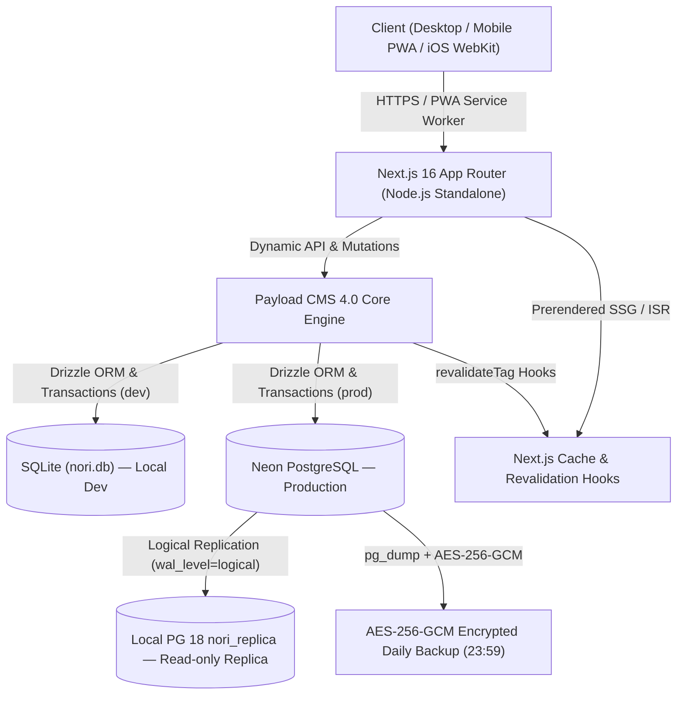

# NORI — Nền Tảng Cho Thuê Xe Linh Hoạt & Tư Vấn Mua Xe Toàn Diện

> **Dự án**: NORI Vehicle Rental (`nori-vehicle-rental`)<br />
> **Kiến trúc**: Next.js 16.4.6 (App Router), React 19.3.1, Payload CMS 4.0.0-beta.8, SQLite via `@payloadcms/db-sqlite`, Tailwind CSS v4.<br />
> **Repository chính thức**: [https://github.com/nquocthinh06/nori-vehicle-rental](https://github.com/nquocthinh06/nori-vehicle-rental)<br />
> **Nhánh chính**: `main`

---

## 1. Giới thiệu dự án

**NORI** là nền tảng số hóa dịch vụ cho thuê phương tiện tự lái (Ô tô, Xe máy, Xe bán tải) và hỗ trợ khách hàng tìm mua phương tiện tự tin tại Việt Nam.

Dự án được định hướng phát triển theo tiêu chuẩn công nghệ hiện đại:

- **Mobile-First & PWA**: Trải nghiệm mượt mà trên mọi thiết bị di động, tối ưu tương tác chạm vuốt, hỗ trợ cài đặt ứng dụng màn hình chính và hoạt động ngoại tuyến.
- **Dữ liệu Thời Gian Thực (Real-Time Integrity)**: Tách bạch rõ ràng giữa catalogue hiển thị tĩnh (SSG/ISR tối ưu SEO) và các giao dịch đặt xe, thanh toán, khóa ngày theo thời gian thực (Request-time & SQLite Transactions).
- **Phân Quyền Tập Trung & Đa Chi Nhánh (Branch-Scoped RBAC)**: Bảo vệ toàn diện **22 phân hệ quản trị** (bao gồm 8 phân hệ đa chi nhánh, kho xe, điểm giao nhận, nhân sự, điều chuyển, giao nhận tận nơi, định giá theo địa điểm, báo cáo chi nhánh và **Trung tâm Quản trị Trợ lý AI `/dashboard/ai`**) dành riêng cho nhân sự (`admins`), cách ly hoàn toàn với tài khoản khách hàng (`users`).
- **NORI AI Assistant (Google Gemini Free Tier + Rule-based Fallback Engine)**: Trợ lý tư vấn phương tiện tiếng Việt dùng SDK `@google/genai` (mặc định `gemini-3.5-flash-lite`, chính sách `NORI_AI_FREE_TIER_ONLY=true`), tích hợp Function Calling (9 công cụ nghiệp vụ có kiểm soát), thuật toán đề xuất lai minh bạch (Hard Filtering + Weighted Scoring 35/25/20/10/10), RAG chính sách từ Payload CMS, bảo mật đa lớp và tự động chuyển sang **Rule-based Recommendation Engine** khi thiếu key hoặc hết quota Free Tier.
- **Khả Năng Tiếp Cận Cao**: Đạt chuẩn WCAG 2.2 AA (0 lỗi vi phạm khi kiểm thử tự động).

---

## 2. Các chức năng chính

### 2.1. Phía Khách Hàng (Customer Experience)

- **Catalogue & Tìm kiếm Thông minh**:
  - Quản lý danh mục 21 dòng xe thuộc 3 nhóm chính: ô tô phổ thông & hạng sang, xe máy & xe máy điện, xe bán tải địa hình.
  - Lọc đa tiêu chí: Nhóm xe, hãng sản xuất, khoảng giá thuê theo ngày, loại nhiên liệu, số chỗ ngồi.
  - Tìm kiếm tiếng Việt không dấu, chuyển đổi linh hoạt chế độ xem lưới (Grid) hoặc danh sách (List).
- **Hero Carousel Phương Tiện Quản Trị Từ CMS**:
  - 5 slide phương tiện sắc nét quản trị trực tiếp từ `/dashboard/content`, tự động chuyển mượt mà, hỗ trợ vuốt chạm di động, tạm dừng/tiếp tục và bảo toàn dữ liệu thanh tìm kiếm `<SearchBar />`.
- **Chi tiết Xe & Tính Giá Tự Động**:
  - Chuyển đổi minh bạch giữa nguồn ảnh Catalogue (`"Ảnh Catalogue – không phải hình ảnh của cá thể xe đang cho thuê."`) và ảnh cá thể xe thực tế; tự động ẩn bộ lọc `"Nội thất"` trên xe máy và ẩn thông số đốt trong trên xe thuần điện.
  - Thông số kỹ thuật chuẩn hóa, chọn phiên bản và màu sắc.
  - Lịch kiểm tra xe trống theo thời gian thực (`/nori-api/availability`).
  - Động cơ tính giá thuê tự động: Chiết khấu tuần (5%), chiết khấu tháng (12%), phụ phí cuối tuần và ngày lễ, cộng phí dịch vụ bổ sung (bảo hiểm, ghế trẻ em, thiết bị định vị).
- **Quy trình Đặt Xe, Chỉnh Sửa Đơn Chờ Duyệt & Thông Báo Sau Duyệt**:
  - Cho phép khách hàng chỉnh sửa trực tiếp đơn đang chờ duyệt (`PENDING`) tại `/my-bookings` kèm bảng đối chiếu chi phí Trước / Sau, hoán đổi ngày khóa nguyên tử và khóa Optimistic Locking (`revision`) chống ghi đè khi Admin duyệt đồng thời.
  - Tự động hiển thị Popup xác nhận đơn thuê (1 lần/sự kiện duyệt, xem lại qua Chuông thông báo trên Header) kèm ngày dự kiến nhân viên liên hệ tư vấn theo khung giờ hành chính và ngày lễ.
- **Tư vấn Mua Xe & Đặt Lịch Lái Thử**:
  - Biểu mẫu đăng ký tư vấn mua xe hoặc hẹn lịch lái thử xe trong kho.
  - Khách hàng theo dõi phản hồi trực tiếp trong trang quản lý tài khoản (`/account`).
- **Đánh Giá & Nhận Xét Đã Xác Minh**:
  - Chỉ cho phép khách hàng đã hoàn thành đơn thuê của chính dòng xe đó gửi đánh giá xếp hạng sao và nhận xét thực tế.
- **Trợ Lý AI NORI (NORI AI Assistant)**:
  - Nút mở nổi tải lười (lazy-loaded), giao diện panel thu gọn/mở rộng trên Desktop và full-screen sheet tối ưu bàn phím/safe-area trên Mobile & PWA (không xung đột với Mobile Bottom Navigation, Sticky Booking Bar hay Checkout CTA).
  - Hiểu nhu cầu tiếng Việt tự nhiên (có dấu & không dấu), truy vấn trực tiếp dữ liệu thật qua 9 Function Calling tools (`searchVehicles`, `getVehicleDetails`, `checkAvailability`, `calculateRentalPrice`, `getActivePromotions`, `compareVehicles`, `getRentalPolicy`, `recommendVehicles`, `prepareBooking`).
  - Hiển thị **Vehicle Recommendation Cards** tương tác (ảnh thật, giá thuê, lý do đề xuất minh bạch, nhãn `DEMO`, nút **Xem chi tiết / Chọn thuê / So sánh xe**), bảng so sánh xe, báo giá khớp tuyệt đối Business Rule Engine và điều hướng sang Checkout giữ nguyên phiên đăng nhập.
- **Trải Nghiệm Ứng Dụng Di Động (PWA)**:
  - Thanh điều hướng Bottom Navigation 5 mục tiện lợi trên màn hình nhỏ.
  - Bộ lọc tìm kiếm dạng Bottom Sheet có hỗ trợ thao tác vuốt chạm.
  - Lưu trữ danh sách xe yêu thích (Favorites) bền vững bằng LocalStorage.
  - Trang thông báo ngoại tuyến chuyên biệt (`/offline`) khi mất kết nối mạng.

### 2.2. Phía Quản Trị Viên (Admin Center — 22 Phân hệ `/dashboard/*`)

- **14 Phân hệ Vận hành, CMS & AI Cốt lõi**: Tổng quan (`/dashboard`), Đơn thuê (`/dashboard/bookings`), Phương tiện (`/dashboard/vehicles`), Dòng xe (`/dashboard/models`), Yêu cầu mua xe (`/dashboard/inquiries`), Khách hàng & Đánh giá (`/dashboard/customers`), Bảo dưỡng (`/dashboard/maintenance`), Thanh toán & Hoàn tiền (`/dashboard/payments`), Khuyến mãi (`/dashboard/promotions`), Nội dung CMS (`/dashboard/content`), Bài viết (`/dashboard/posts`), Báo cáo tổng hợp (`/dashboard/reports`), Quản trị viên & Đồng bộ hệ thống (`/dashboard/admins`, `/dashboard/system`) và **Trung tâm Quản trị Trợ lý AI (`/dashboard/ai`)** (bật/tắt AI, kiểm tra kết nối Gemini Free Tier có phân quyền, cấu hình giới hạn đa phạm vi, lời chào, Quick Suggestions, trọng số đề xuất, thống kê token/lượt fallback/chuyển đổi thực tế và rà soát phản hồi khách hàng — tuyệt đối không lưu hay hiển thị API Key).
- **8 Phân hệ Đa Chi Nhánh & Đa Địa Điểm (Module 3.7 — `v2.7.0`)**:
  1. **Quản lý Chi nhánh (`/dashboard/branches`)**: Trạng thái nghiệp vụ (`ACTIVE` / `INACTIVE` / `TEMPORARILY_CLOSED` / `ARCHIVED`), giờ hoạt động, ngày nghỉ, giao nhận tận nơi, chặn xóa cứng khi có dữ liệu phát sinh.
  2. **Quản lý Kho xe & Tồn kho (`/dashboard/warehouses`)**: Showroom/bãi đỗ/kho lưu trữ/trung tâm bảo dưỡng, sức chứa thực tế và phân bổ hàng loạt xe chưa gắn chi nhánh (`UNALLOCATED`) — tuyệt đối không nhân bản bản ghi phương tiện.
  3. **Điểm Nhận & Trả xe (`/dashboard/locations`)**: Địa điểm xác minh (`verified = true`), phân loại loại phương tiện phục vụ, phụ phí địa điểm.
  4. **Nhân sự & Phân quyền Chi nhánh (`/dashboard/staff`)**: 8 vai trò chức danh (`SUPER_ADMIN`, `SYSTEM_ADMIN`, `BRANCH_MANAGER`, `RENTAL_STAFF`, `WAREHOUSE_STAFF`, `DELIVERY_STAFF`, `ACCOUNTANT`, `OPERATOR`), phân công 1..N chi nhánh, chống leo thang quyền và thu hồi quyền tức thì (`REVOKED`).
  5. **Điều chuyển Phương tiện (`/dashboard/transfers`)**: Quy trình 9 trạng thái nguyên tử (`DRAFT → PENDING_APPROVAL → APPROVED → IN_TRANSIT → ARRIVED → COMPLETED` + `EXCEPTION`), khóa lịch toàn cục `rental_days`, Optimistic Locking (`revision`) và nhật ký vị trí (`VehicleLocationHistory`).
  6. **Giao & Thu hồi Xe Tận nơi (`/dashboard/deliveries`)**: Khu vực & biểu phí giao nhận (`DeliveryZones`), điều phối nhiệm vụ (`DeliveryJobs`), chặn trùng khung giờ nhân viên giao nhận (`409`).
  7. **Định giá Địa điểm & Thuê Một Chiều (`/dashboard/location-pricing`)**: Phân cấp giá 5 tầng (`VEHICLE_BRANCH > MODEL_BRANCH > VEHICLE_BASE > BRANCH_DEFAULT > GLOBAL_DEFAULT`), quy tắc tuyến `A → B` và tỷ lệ chia doanh thu một chiều.
  8. **Báo cáo & Xuất CSV Đa Chi Nhánh (`/dashboard/branch-reports`)**: Tổng hợp doanh thu không cộng trùng (`sum(branch) + unassigned === systemTotal`), tách biệt cọc tài sản, xuất CSV UTF-8 BOM theo phạm vi chi nhánh.
- **Hệ thống Ghi Nhật Ký Kiểm Toán (Audit Logs)**: Ghi vết toàn bộ hành vi quan trọng của nhân viên quản trị kèm `actorRole`, `branchId`, `outcome`.

---

## 3. Kiến trúc hệ thống



- **Frontend Layer**: Next.js App Router kết hợp Server Components để dựng sẵn trang tĩnh (SSG/ISR) và Client Components cho các tương tác giỏ hàng, bộ lọc, popup.
- **Business Rule Engine (`src/lib/rental-rules.ts`)**: Độc lập hoàn toàn, xác thực tính hợp lệ của ngày thuê, công thức tính giá theo múi giờ Việt Nam (`Asia/Ho_Chi_Minh`), phụ phí cuối tuần/lễ Tết, ma trận chuyển đổi 9 trạng thái.
- **Data Persistence Layer**: Dual-adapter — SQLite cục bộ (`nori.db`, WAL) cho dev/standalone; Neon PostgreSQL cho production (`VERCEL=1`). Cả hai dùng Drizzle ORM, `push: false`. Local PG 18 `nori_replica` là read-only replica nhận data từ Neon qua Logical Replication — ứng dụng **không bao giờ ghi** vào replica.
- **Encrypted Daily Backup**: `pg_dump` + AES-256-GCM + SHA-256 manifest, Task Scheduler `23:59 Asia/Ho_Chi_Minh`, giữ lại `30d/12w/12m`.
- **Cache Invalidation Lifecycle**: Khi quản trị viên thay đổi thông tin dòng xe, giá hoặc ảnh, Payload hooks kích hoạt `revalidateTag` bóc tách tag cache tương ứng (`nori-model-${slug}`, `nori-catalogue-v3`) để cập nhật ngay lập tức giao diện khách hàng mà không cần build lại server.
- **Smart Vehicle Import**: Admin nhập thông số xe từ 5 nguồn (Website hãng, Tìm kiếm thông minh AI, Nhập hàng loạt, Brochure PDF, Nhập thủ công) qua `<SmartImportDrawer />` ngay trong `/dashboard/models`. Hỗ trợ 10 OEM adapters + Generic, Preview-Before-Save diff, `lockedFields`, VehicleImportJobs State Machine (12 trạng thái trong `src/lib/vehicle-import/job-manager.ts`).

---

## 4. Công nghệ sử dụng

| Lĩnh vực                | Công nghệ               | Phiên bản            | Vai trò                                                                      |
| :---------------------- | :---------------------- | :------------------- | :--------------------------------------------------------------------------- |
| **Framework**           | Next.js                 | 16.4.6               | App Router, Turbopack, Standalone deployment                                 |
| **UI Library**          | React                   | 19.3.1               | Giao diện tương tác người dùng                                               |
| **Styling**             | Tailwind CSS            | 4.0.0                | Hệ thống semantic tokens, CSS biến thể mới                                   |
| **Headless CMS**        | Payload CMS             | 4.0.0-beta.8         | Quản trị dữ liệu, phân quyền và API cốt lõi                                  |
| **Database**            | SQLite + PostgreSQL     | 3.x + PG 18          | SQLite (dev/standalone) + Neon PostgreSQL (production), 118 bảng  |
| **Database Adapter (SQLite)** | `@payloadcms/db-sqlite` | 4.0.0-beta.8   | Kết nối SQLite & Drizzle ORM (local dev & standalone)            |
| **Database Adapter (PG)** | `@payloadcms/db-postgres` | 4.0.0-beta.8  | Kết nối Neon PostgreSQL & Drizzle ORM (production)               |
| **PG Replication**      | Logical Replication     | PG 18 (Local)        | Neon → `nori_replica` one-way replica (BLOCKED — Neon hiện cấu hình `wal_level = replica`) |
| **Backup**              | AES-256-GCM             | —                    | pg_dump + AES-256-GCM + SHA-256 manifest, 30d/12w/12m retention  |
| **AI SDK**              | `@google/genai`         | 3.6.1                | Google Gemini API Free Tier (`gemini-3.5-flash-lite`, Function Calling, Zero Grounding) |
| **Runtime & Toolchain** | Node.js / pnpm          | >=24.22.1 / pnpm 10+ | Môi trường thực thi và quản lý gói phụ thuộc                                 |
| **Testing Engine**      | Node Test Runner        | Node.js built-in     | Thực thi 376 Unit/Integration/Smart Import tests (`375 pass, 1 skip`) + 20 DB Replica tests |
| **E2E Testing**         | Playwright              | 1.65.1               | 122 kịch bản E2E cô lập DB + Media (Chromium & Mobile WebKit)      |
| **A11y Testing**        | Axe Core                | 4.14.0               | Kiểm tra chuẩn tiếp cận WCAG 2.2 AA                                          |
| **Linter & Formatter**  | oxfmt & Custom AST      | 0.73.0               | Chuẩn hóa định dạng và quét bảo mật tĩnh                                     |

---

## 5. Hướng dẫn cài đặt và khởi chạy

### 5.1. Yêu cầu môi trường

- **Node.js**: Phiên bản `>= 24.22.1` (khuyến nghị Node 24 LTS).
- **Package Manager**: `pnpm` (phiên bản 9, 10 hoặc 11).
- **Trình duyệt**: Google Chrome, Microsoft Edge hoặc Safari.

### 5.2. Các bước cài đặt

1. **Clone mã nguồn từ GitHub**:

   ```bash
   git clone https://github.com/nquocthinh06/nori-vehicle-rental.git
   cd nori-vehicle-rental
   ```

2. **Cài đặt gói phụ thuộc**:

   ```bash
   pnpm install
   ```

3. **Khởi tạo Cấu hình Tự động & Xác minh Môi trường**:

   ```bash
   # Tự động sinh file .env bảo mật và tạo các thư mục data/, media/, backups/, logs/
   pnpm setup

   # Kiểm tra tính hợp lệ của toàn bộ biến môi trường
   pnpm env:check
   ```

4. **Khởi tạo Database, Đồng bộ Snapshot & Khởi chạy Dev Server**:
   ```bash
   # Kiểm tra trạng thái tương thích schema CSDL & pending migrations
   pnpm db:check

   # Khởi tạo cấu trúc 118 bảng SQLite + composite indexes (lũy kế an toàn, không mất dữ liệu)
   pnpm db:migrate:safe

   # Nhập bộ dữ liệu mẫu và hình ảnh mới nhất từ Snapshot
   pnpm data:import

   # Khởi tạo tài khoản Admin cục bộ an toàn
   pnpm seed:admin -- --init-env

   # Khởi chạy máy chủ phát triển (chỉ localhost, tích hợp Preflight Guard)
   pnpm dev

   # Hoặc khởi chạy LAN Server cho phép điện thoại Android / iPhone / Laptop cùng Wi-Fi truy cập
   pnpm dev:lan
   ```
   Truy cập cục bộ tại: `http://localhost:3000` (hoặc địa chỉ `Network: http://<LAN_IP>:3000` hiển thị khi chạy `pnpm dev:lan`; Quản trị viên: `/dashboard` và `/dashboard/system`). Chi tiết mở cổng Firewall & kiểm thử đa thiết bị xem tại [docs/LAN_SETUP.md](docs/LAN_SETUP.md).

---

## 6. Cấu hình cơ sở dữ liệu (Database)

Dự án sử dụng **Dual-Adapter Database**:

- **Local Dev & Standalone**: SQLite (`./nori.db`) với chế độ WAL (Write-Ahead Logging) — không yêu cầu cài đặt máy chủ CSDL cồng kềnh, hỗ trợ đầy đủ quan hệ bảng, chỉ mục và khóa ngoại.
- **Production (Vercel)**: Neon PostgreSQL — `@payloadcms/db-postgres` + Drizzle ORM. Reject startup nếu thiếu `DATABASE_URL` khi `VERCEL=1`.
- **Local PG 18 `nori_replica`**: Read-only replica nhận data từ Neon qua Logical Replication (`wal_level=logical`). Antigravity SQL/ERD tooling kết nối qua `nori_readonly`. **Lưu ý**: Neon hiện đang cấu hình `wal_level = replica` (`PostgreSQL 17.12`, `109` bảng, `2` pending migrations); cần **chủ dự án phê duyệt bật `wal_level = logical` trong Neon Console (khởi động lại compute), áp dụng `2` pending migrations và tạo `PUBLICATION nori_pub`** trước khi bật Live Subscription.
- **Encrypted Daily Backup**: `pg_dump` + AES-256-GCM + SHA-256 manifest, Task Scheduler `23:59 Asia/Ho_Chi_Minh`, giữ lại `30d/12w/12m`.
- Toàn bộ lược đồ (`118` bảng) và quan hệ được khởi tạo và đồng bộ tự động bởi Payload CMS qua Drizzle ORM. `push: false` trên cả hai adapter.

---

## 7. Khởi tạo dữ liệu DEMO và tài khoản Admin an toàn

Dự án đã tích hợp sẵn tập dữ liệu DEMO bao gồm:

- **21 dòng xe** phủ khắp 3 danh mục kèm **81 hình ảnh** bản quyền mở đã chuẩn hóa trong `public/media/` (67 được tham chiếu trong snapshot, 14 unreferenced — toàn bộ hợp lệ).
- **21 xe thực tế minh họa** (`isDemo: true`, gắn nhãn `DEMO`).
- Cấu hình thông tin thương hiệu, hotline, địa chỉ showroom tại `NoriSite`.

### Tạo tài khoản Quản trị viên (Admin)

Chạy script khởi tạo quản trị viên an toàn:

```bash
pnpm seed:admin
```

- Mật khẩu được mã hóa an toàn bằng thuật toán chuẩn `PBKDF2-SHA256` với salt ngẫu nhiên 32 bytes (100,000 lượt lặp).
- Hoạt động theo cơ chế lũy kế (Idempotent): nếu tài khoản đã tồn tại, script sẽ kiểm tra toàn vẹn mà không ghi đè dữ liệu.
- Tài khoản quản trị mặc định: `admin@nori.vn` (mật khẩu được in an toàn trong console hoặc đọc từ biến môi trường `NORI_ADMIN_PASSWORD`).

Đăng nhập quản trị tại: `http://localhost:3000/login` hoặc phân hệ CMS tại `http://localhost:3000/admin`.

---

## 8. Hướng dẫn kiểm thử (Testing Suite)

Dự án thiết lập hệ thống kiểm thử tự động toàn diện với **518 Automated Tests** (**375** Unit, Integration, AI Security/Resilience, Payment, Multi-Branch, Smart Import & Migration tests [374 pass, 0 fail, 1 skipped Postgres-only] + **20** DB Replication & Backup tests (`pnpm test:db:replica`, 20/20 pass) + **1** Isolated Admin Test + **122** Playwright E2E trên DB & Media cô lập — tổng **517 PASS, 1 SKIP, 0 FAIL**):

```bash
# 1. Kiểm tra định dạng mã nguồn
pnpm format:check

# 2. Phân tích cú pháp tĩnh & rà soát bảo mật (Linter)
pnpm lint

# 3. Kiểm tra kiểu dữ liệu TypeScript nghiêm ngặt
pnpm typecheck

# 4. Kiểm tra tương thích CSDL & Pending Migrations (Preflight Guard)
pnpm db:check

# 5. Kiểm toán tính toàn vẹn Media & Snapshot
pnpm media:audit
pnpm data:validate

# 6. Chạy toàn bộ 374 Unit, Integration, AI, Payment, Multi-Branch, Smart Import & DB Replication Tests
pnpm test

# 7. Kiểm thử DB cô lập Admin
pnpm test:admin

# 8. Kiểm thử Replication & Backup (dual PG 18.6 disposable clusters)
pnpm test:db:replica

# 9. Chạy toàn bộ 122 Playwright E2E Tests trên DB & Media cô lập (Bảo vệ 100% nori.db & media/)
pnpm test:e2e:isolated

# 10. Xác thực Catalogue (21 models enrichment status)
pnpm catalogue:validate

# 11. Chạy đánh giá Live Gemini API Free Tier trên DB cô lập (chỉ chạy sau khi chủ dự án xác nhận đã tắt Cloud Billing trả phí)
NORI_CONFIRM_GEMINI_FREE_TIER=1 pnpm eval:ai:live

# 12. Chạy kiểm thử E2E qua địa chỉ LAN IPv4 thực tế trên DB & Media cô lập
pnpm test:e2e:lan

# 13. Chạy Load / Stress / SQLite WAL Write Concurrency Test (1–100 VUs, cô lập hoàn toàn)
pnpm perf:load

# 14. Chạy Benchmark Mở rộng Đa Chi Nhánh (10/50/100 CN, 100/1k/10k Xe, 10k/50k/100k Đơn — DB cô lập)
pnpm perf:multi-branch
```

---

## 9. Hướng dẫn Production Build & Standalone

Để đóng gói và chạy ứng dụng ở chế độ sản xuất (khuyến nghị dùng `pnpm start:standalone`, tự động đồng bộ `.next/static`, `public/`, `libvips*.dll` trên Windows và neo đúng `nori.db` & `media/` ở thư mục gốc):

```bash
# 1. Thực hiện biên dịch và sinh trang tĩnh
pnpm build

# 2. Khởi chạy máy chủ sản xuất (Next.js Standalone mode)
pnpm start:standalone
```

Sau khi biên dịch thành công:

- **114/114 tuyến đường tĩnh/SSG** được prerender thành công (`○ Static` / `● SSG`, bao gồm `/dashboard/ai` và `21` slug xe, giữ `0` route công khai bị `ƒ (Dynamic)`), build `163.40s`, `0` cảnh báo Turbopack, `0` lỗi TypeScript.
- **Benchmark Đa Chi Nhánh (`pnpm perf:multi-branch`, SQLite WAL cô lập)**: ở quy mô lớn nhất **100 chi nhánh / 10,000 xe / 100,000 đơn thuê (82.25 MB)**, truy vấn tra cứu đội xe chi nhánh đạt `0.086 ms` trung bình, kiểm tra lịch khả dụng timeline `0.044 ms`, báo cáo tổng hợp chi nhánh `5.541 ms`, thông lượng ghi giao dịch `5,974 tx/s` (`0` full table scan).
- Đo lường Lab Metrics trên Production Build cô lập (5 lượt đo/route; Field RUM p75 chưa khả dụng do chưa có traffic thật):
  - **Desktop `/`**: LCP `252 ms`, CLS `0.0026`, TBT `0 ms`, Images `332.2 KB` (`-78.4%`).
  - **Desktop `/vehicles`**: LCP `332 ms`, CLS `0.0005`, Doc `14.2 KB` (`-60.4%`), Images `670.8 KB` (`-77.3%`).
  - **Mobile `/vehicles/toyota-fortuner` (375px, Slow 4G, 4× CPU)**: LCP `1,876 ms` (`-41.1%`), CLS `0`, Images `85.1 KB` (`-73.7%`).
  - **Load Test Standalone (`100 VUs`)**: `669.5 req/s`, `314.3 ms p95`, `0.00%` lỗi, `0` `SQLITE_BUSY`.

---

## 10. Hướng dẫn Đồng bộ Toàn Bộ Dữ Liệu Phát Triển Qua GitHub (Multi-Machine Dev Sync)

Dự án trang bị hệ thống đồng bộ toàn diện trạng thái phát triển qua thư mục version-controlled `dev-data/` (`database/nori-dev.db`, `media/`, `manifest.json`), cho phép các thành viên trên các máy tính khác nhau (Windows, macOS, Home Server) chia sẻ đầy đủ tài khoản thử nghiệm, phương tiện, đơn thuê, media và cấu hình website mà không phải nhập tay.

### Các lệnh đồng bộ chính

```bash
# 1. Kiểm tra trạng thái đồng bộ giữa DB máy bạn và GitHub snapshot
pnpm dev:sync:verify

# 2. Máy A: Xuất toàn bộ database phát triển và ảnh media vào dev-data/ để commit lên Git
pnpm dev:sync:export
git add dev-data/
git commit -m "chore(sync): update dev database and media snapshot"
git push origin main

# 3. Máy B: Kéo dữ liệu mới nhất từ GitHub và nạp vào môi trường phát triển
git pull origin main
pnpm dev:sync:import

# 4. Khi có xung đột (cả 2 máy đều sửa dữ liệu cục bộ):
# Mặc định thao tác an toàn sẽ DỪNG LẠI và thông báo, không ghi đè mất dữ liệu.
# Nếu muốn ghi đè bằng snapshot từ GitHub (hệ thống sẽ tự động tạo bản backup an toàn trước):
pnpm dev:sync:import -- --force
```

### Bộ công cụ đồng bộ chuyên sâu & Sao lưu (Legacy Catalog Sync & Backups)

```bash
# Kiểm tra trạng thái catalog snapshot
pnpm data:status

# Sao lưu nhất quán (SQLite VACUUM INTO + Media files + SHA-256 Manifest)
pnpm backup
pnpm data:backup

# Khôi phục Database & Media từ bản sao lưu
pnpm restore
pnpm data:restore
```

Quản trị viên cấp cao (`SUPER_ADMIN`) cũng có thể theo dõi trạng thái đồng bộ, kiểm tra toàn vẹn, xuất/nhập Snapshot và tạo/khôi phục bản sao lưu trực tiếp trên giao diện **Quản trị hệ thống → Đồng bộ & Sao lưu dữ liệu** (`/dashboard/system`).

---

## 11. Tự Lưu Trữ (Self-Hosting), Home Server & Cloudflare Tunnel

Dự án đã được chuẩn hóa để triển khai trên một máy tính cá nhân (Windows 10/11 hoặc Ubuntu Linux) làm **Home Server** thay thế VPS, đưa website ra Internet qua **Cloudflare Tunnel** (No Port Forwarding, No Public Static IP, SSL tự động):

```bash
# 1. Khởi chạy Cloudflare Quick Tunnel (1-Click, dùng thử có ngay link HTTPS công khai)
# Trên Windows:
.\deploy\cloudflare\run-quick-tunnel.bat
# Trên Linux:
bash deploy/cloudflare/run-quick-tunnel.sh

# 2. Cài đặt tự khởi chạy khi bật máy trên Windows Home Server (Task Scheduler)
powershell -ExecutionPolicy Bypass -File .\deploy\windows\install-service.ps1

# 3. Kịch bản cập nhật 1-click từ GitHub không mất dữ liệu (Backup -> Pull -> Migrate -> Build -> Restart)
# Trên Windows:
.\deploy\windows\update.ps1
# Trên Linux:
sudo bash deploy/linux/update.sh
```

---

## 12. Các giới hạn hiện tại

1. **Dữ liệu Xe Minh Họa & Chi Nhánh Thực Tế**: Toàn bộ 21 cá thể xe trong kho hiện được gắn nhãn `DEMO` (`isDemo: true`, `allocationStatus: 'UNALLOCATED'`) để phục vụ kiểm thử và không bịa đặt địa chỉ chi nhánh thật. Doanh nghiệp cần tạo chi nhánh/kho thực tế tại `/dashboard/branches` & `/dashboard/warehouses` và phân bổ phương tiện trước khi khai thác thương mại.
2. **Cổng Thanh Toán Trực Tuyến (`SePay + VietQR`)**: Đã tích hợp hoàn chỉnh Payment Adapter Pattern, Webhook idempotency, đối soát và hoàn tiền trên môi trường `MOCK` (mặc định khóa `PRODUCTION`). Trước khi mở thanh toán tiền thật cần cấu hình credentials SePay Merchant thật, domain HTTPS công khai và bật `PAYMENT_PRODUCTION_APPROVED=true`.
3. **Dịch Vụ SMS / Email**: Các thông báo thay đổi trạng thái đơn thuê hiện được hiển thị trực tiếp trên giao diện thông báo của tài khoản khách hàng (`/account`, `/my-bookings`), chưa kết nối nhà cung cấp dịch vụ SMS OTP / SendGrid thực tế.
4. **NORI AI Assistant & Xác nhận Billing Google Cloud**: Toàn bộ kiến trúc, Gemini Free Tier Provider (`@google/genai`), 9 Function Calling tools, thuật toán đề xuất lai, Rule-based Recommendation Fallback Engine, bảo mật đa lớp, giao diện khách hàng & `/dashboard/ai` đã hoàn thiện và vượt qua kiểm thử tự động. Hệ thống mặc định khóa provider trả phí (`NORI_AI_FREE_TIER_ONLY=true`, `NORI_AI_PAID_PROVIDERS_ALLOWED=false`) và tự động chuyển sang **`Chế độ tư vấn cơ bản (Rule-based Engine)`** khi thiếu `GEMINI_API_KEY`, gặp `429` hoặc hết quota. **Lưu ý**: Không thể suy luận trạng thái Cloud Billing chỉ từ API Key — chủ dự án cần kiểm tra thủ công trong Google AI Studio / Google Cloud Console bảo đảm Project chưa gắn thanh toán trả phí trước khi chạy `NORI_CONFIRM_GEMINI_FREE_TIER=1 pnpm eval:ai:live`.
5. **Figma Make CLI**: Lệnh `figma make verify-deploy` phụ thuộc vào môi trường runtime do Figma Make cung cấp trên nền tảng đám mây; trên máy tính phát triển cục bộ lệnh kiểm định chính thức là `pnpm build` và bộ kiểm thử `pnpm test:e2e:isolated`.
6. **Neon PG Logical Replication (BLOCKED)**: Neon hiện đang cấu hình `wal_level = replica` (`PostgreSQL 17.12`, `109` bảng, `2` pending migrations) — chưa thể thiết lập `PUBLICATION`/`SUBSCRIPTION`. Local PG 18 Logical Replication đã PASS hoàn toàn trên dual disposable PG 18.6 clusters (`pnpm test:db:replica` — `20/20 PASS`). Cần **chủ dự án phê duyệt bật `wal_level = logical` trong Neon Console (khởi động lại compute), áp dụng `2` pending migrations và tạo `PUBLICATION nori_pub`** trước khi bật Live Subscription trên production.
7. **Smart Import — OEM Reachability**: Một số trang OEM có WAF (`UPSTREAM_WAF_BLOCKED`), TLS legacy hoặc timeout từ môi trường dev/CI. Adapters phát hiện tự động và fallback sang PDF/JSON. Xem reachability matrix đầy đủ tại [docs/MANUFACTURER_ADAPTERS.md](docs/MANUFACTURER_ADAPTERS.md).

---

## 13. Danh mục tài liệu kỹ thuật liên quan

Hệ thống tài liệu đầy đủ của dự án được lưu trữ trong thư mục `docs/`:

### NORI AI Assistant (Google Gemini Free Tier, Hybrid Recommendation & Fallback Engine)

- [docs/AI_ARCHITECTURE.md](docs/AI_ARCHITECTURE.md) — Kiến trúc AI, Sequence Diagram, Data Flow Diagram, ERD mở rộng, Rule-based Fallback và thuật toán Hybrid Recommendation.
- [docs/AI_INTEGRATION.md](docs/AI_INTEGRATION.md) — Hướng dẫn tạo Gemini API Key (Google AI Studio), danh sách model Free Tier, cấu hình biến môi trường, đặc tả 6 API endpoints và 9 Function Calling tools.
- [docs/AI_SECURITY.md](docs/AI_SECURITY.md) — Thiết kế bảo mật đa lớp (Least Privilege, Defense in Depth), tối thiểu hóa PII, ma trận chống tấn công AI và RBAC.
- [docs/AI_COST_MANAGEMENT.md](docs/AI_COST_MANAGEMENT.md) — Chính sách chi phí $0 (Free Tier Only), giới hạn đa phạm vi Project/IP/Session, không retry 429/quota và Rule-based Fallback.
- [docs/AI_TEST_CASES.md](docs/AI_TEST_CASES.md) — Ma trận kịch bản kiểm thử Unit, Security, Playwright E2E và 12 kịch bản Live Evaluation tiếng Việt.
- [docs/AI_TEST_REPORT.md](docs/AI_TEST_REPORT.md) — Báo cáo nghiệm thu kết quả kiểm thử AI, hồi quy toàn hệ thống và trạng thái xác nhận Gemini Free Tier.

### Cẩm Nang Triển Khai Home Server & Production

- [docs/PRODUCTION_READINESS_REPORT.md](docs/PRODUCTION_READINESS_REPORT.md) — **Báo cáo nghiệm thu sẵn sàng Production & Release Gates**.
- [docs/SYSTEM_ARCHITECTURE.md](docs/SYSTEM_ARCHITECTURE.md) — Kiến trúc tổng thể, topo mạng, luồng xử lý qua Cloudflare Tunnel và SQLite WAL.
- [docs/ENVIRONMENT_CONFIGURATION.md](docs/ENVIRONMENT_CONFIGURATION.md) — Từ điển biến môi trường chi tiết và hướng dẫn cấu hình các môi trường.
- [docs/LOCAL_DEVELOPMENT.md](docs/LOCAL_DEVELOPMENT.md) — Hướng dẫn cài đặt & phát triển cho thành viên nhóm khi clone repo.
- [docs/HOME_SERVER_WINDOWS.md](docs/HOME_SERVER_WINDOWS.md) — Cẩm nang triển khai Home Server trên Windows 10/11, chống ngủ, Task Scheduler.
- [docs/HOME_SERVER_UBUNTU.md](docs/HOME_SERVER_UBUNTU.md) — Cẩm nang triển khai Home Server trên Ubuntu Linux, Systemd & UFW Firewall.
- [docs/CLOUDFLARE_TUNNEL.md](docs/CLOUDFLARE_TUNNEL.md) — Hướng dẫn cấu hình Cloudflare Quick Tunnel & Named Tunnel với tên miền riêng.
- [docs/PRODUCTION_DEPLOYMENT.md](docs/PRODUCTION_DEPLOYMENT.md) — Danh mục kiểm tra và quy trình nghiệm thu triển khai Production.
- [docs/CI_CD_GUIDE.md](docs/CI_CD_GUIDE.md) — Quy trình CI trên GitHub Actions và kịch bản cập nhật CD 1-click.
- [docs/BACKUP_RESTORE.md](docs/BACKUP_RESTORE.md) — Cẩm nang sao lưu nhất quán (VACUUM INTO) và quy trình khôi phục dữ liệu an toàn.
- [docs/SERVER_MIGRATION.md](docs/SERVER_MIGRATION.md) — Hướng dẫn di chuyển hệ thống sang máy chủ khác hoặc lên VPS không mất dữ liệu.
- [docs/SECURITY_CHECKLIST.md](docs/SECURITY_CHECKLIST.md) — Danh mục kiểm soát an ninh, WAF, rate limiting, bảo mật cookie và CSRF.
- [docs/TROUBLESHOOTING.md](docs/TROUBLESHOOTING.md) — Sổ tay xử lý sự cố thường gặp (Database locks, Tunnel 502, Port conflicts).

### Nghiệp Vụ Vận Hành, Đa Chi Nhánh & Kiểm Thử

- [DESIGN.md](DESIGN.md) — Quy chuẩn Design System NORI, Semantic Tokens, Typography, Bảng màu và Components.
- [SKILL.md](SKILL.md) — Kỹ năng triển khai & nguyên tắc xây dựng giao diện WCAG 2.2 AA.
- [.agents/skills/nori-performance/SKILL.md](.agents/skills/nori-performance/SKILL.md) — Skill bắt buộc về hiệu năng, tối giản mã nguồn, tối ưu media và release gate.
- [docs/MULTI_BRANCH_MANAGEMENT.md](docs/MULTI_BRANCH_MANAGEMENT.md) — Kiến trúc Đa Chi Nhánh & Đa Địa Điểm (Module 3.7, `v2.7.0`), Use Case, ERD, Sequence & P0 Timeline Engine.
- [docs/VEHICLE_TRANSFER_WORKFLOW.md](docs/VEHICLE_TRANSFER_WORKFLOW.md) — Máy trạng thái 9 bước và giao dịch điều chuyển phương tiện nguyên tử.
- [docs/BRANCH_RBAC_MATRIX.md](docs/BRANCH_RBAC_MATRIX.md) — Ma trận phân quyền 8 vai trò × 20 phân hệ × phạm vi chi nhánh, chống leo thang quyền & IDOR.
- [docs/LOCATION_PRICING_RULES.md](docs/LOCATION_PRICING_RULES.md) — Phân cấp định giá 5 tầng, tuyến thuê một chiều, phân bổ doanh thu & bất biến snapshot giá.
- [docs/DATABASE_MIGRATION.md](docs/DATABASE_MIGRATION.md) — Migration additive-only `20261120_020000_multi_branch_management` (`88 → 109` bảng) & rollback an toàn.
- [docs/DATA_SYNC_GUIDE.md](docs/DATA_SYNC_GUIDE.md) — Đồng bộ dữ liệu đa chi nhánh qua Git Snapshot & danh sách chặn dữ liệu nhạy cảm.
- [docs/BRANCH_OPERATIONS_GUIDE.md](docs/BRANCH_OPERATIONS_GUIDE.md) — Sổ tay vận hành Đa chi nhánh, Kho xe, Điều chuyển & Giao nhận tận nơi.
- [docs/LAN_SETUP.md](docs/LAN_SETUP.md) — Hướng dẫn cấu hình Local Network Server (LAN), tự động nhận diện IPv4, Windows Firewall & kiểm thử đa thiết bị.
- [docs/LAN_TEST_REPORT.md](docs/LAN_TEST_REPORT.md) — Báo cáo nghiệm thu kết nối LAN, Authentication/Cookie/Session và đồng bộ dữ liệu đa thiết bị.
- [docs/PERFORMANCE_AUDIT.md](docs/PERFORMANCE_AUDIT.md) — Báo cáo kiểm toán hiệu năng Before/After, Root Cause Registry, Media Audit & Load Test.
- [docs/CODE_QUALITY.md](docs/CODE_QUALITY.md) — Báo cáo chất lượng mã nguồn, kiểm toán dependency & chuẩn hóa kiến trúc.
- [docs/SPEC.md](docs/SPEC.md) — Đặc tả yêu cầu hệ thống chi tiết (18 nhóm yêu cầu kỹ thuật & nghiệp vụ, `v2.8.0`).
- [docs/ARCHITECTURE.md](docs/ARCHITECTURE.md) — Bản vẽ kiến trúc toàn diện, sơ đồ thực thể ERD, máy trạng thái UML.
- [docs/API.md](docs/API.md) — Tài liệu đặc tả API endpoints (Public, Customer, Admin Dashboard & Smart Import APIs, `v2.1`).
- [docs/TEST_CASES.md](docs/TEST_CASES.md) — Ma trận kịch bản kiểm thử tự động chi tiết (bao gồm TC-DB-* & TC-IMPORT-*).
- [docs/TEST_REPORT.md](docs/TEST_REPORT.md) — Báo cáo nghiệm thu kết quả kiểm thử và đo lường Web Vitals thực tế (`v2.8.0`).
- [docs/PROJECT_STATUS.md](docs/PROJECT_STATUS.md) — Tình trạng dự án, tỷ lệ hoàn thiện các module và kế hoạch tiếp theo (`v2.8.0`).
- [docs/CHANGELOG.md](docs/CHANGELOG.md) — Lịch sử cập nhật và nâng cấp qua các phiên bản.
- [docs/PWA.md](docs/PWA.md) — Hướng dẫn chi tiết về cấu hình, kiểm thử và cài đặt Progressive Web App.
- [docs/DATA-SYNC.md](docs/DATA-SYNC.md) — Kiến trúc chuẩn hóa Data Persistence, Data Snapshot và Media Synchronization.
- [docs/TEAM-WORKFLOW.md](docs/TEAM-WORKFLOW.md) — Quy trình làm việc nhóm qua GitHub khi thay đổi code, dữ liệu và hình ảnh.
- [docs/BACKUP-RESTORE.md](docs/BACKUP-RESTORE.md) — Quy trình sao lưu nhất quán (Database + Media) và khôi phục sau sự cố.
- [docs/DATABASE.md](docs/DATABASE.md) — Kiểm kê lưu trữ dữ liệu (Data Storage Inventory) và kiến trúc bảng SQLite.
- [docs/DEPLOYMENT.md](docs/DEPLOYMENT.md) — Phân tách 4 môi trường (Local, Test, Shared Staging, Production) và hướng dẫn triển khai VPS.

### PostgreSQL 18 Replication, Backup & Smart Vehicle Import (`v2.8.0`)

- [docs/DATABASE_ARCHITECTURE.md](docs/DATABASE_ARCHITECTURE.md) — Kiến trúc Before/After (Vercel → Neon PG → Logical Replication → Local PG 18), Mermaid diagrams, 118 bảng scope, PK/FK/sequence inventory.
- [docs/DATABASE_REPLICATION.md](docs/DATABASE_REPLICATION.md) — Neon → Local PG 18 one-way Logical Replication setup, monitoring, slot invalidation runbook, CLI `db:sync:status`/`db:sync:check`.
- [docs/BACKUP_RESTORE.md](docs/BACKUP_RESTORE.md) — SQLite backup/restore (VACUUM INTO) + PG Encrypted Backup AES-256-GCM + Task Scheduler + 30d/12w/12m retention.
- [docs/DISASTER_RECOVERY.md](docs/DISASTER_RECOVERY.md) — 4 kịch bản DR, RPO/RTO analysis, Failover proposal (không auto-route Vercel prod sang Local PC).
- [docs/VEHICLE_CATALOGUE.md](docs/VEHICLE_CATALOGUE.md) — Tiêu chuẩn làm phong phú catalogue, EV vs ICE vs Motorbike rules, Catalogue vs `isDemo` Fleet separation.
- [docs/SMART_VEHICLE_IMPORT.md](docs/SMART_VEHICLE_IMPORT.md) — Hướng dẫn admin đầy đủ 5 phương thức import, Preview-Before-Save, Approval/Draft/Publish, Rollback, API spec.
- [docs/MANUFACTURER_ADAPTERS.md](docs/MANUFACTURER_ADAPTERS.md) — Kiến trúc adapter 10 OEM + Generic, reachability matrix, hướng dẫn thêm adapter mới.
- [docs/DATA_SYNCHRONIZATION.md](docs/DATA_SYNCHRONIZATION.md) — Multi-developer Catalogue Sync qua GitHub + Git LFS, `pnpm catalogue:*`, dry-run/conflict detection/rollback.
- [docs/MEDIA_STORAGE.md](docs/MEDIA_STORAGE.md) — SHA-256 dedup, `next/image` optimization, focal points, license/source governance, Media backup/restore.
- [docs/IMPORT_SECURITY.md](docs/IMPORT_SECURITY.md) — SSRF defense-in-depth, magic-byte/MIME/pixel limits, HTML/XSS, RBAC, Audit Logging, cost controls.
- [docs/BACKUP_AND_ROLLBACK.md](docs/BACKUP_AND_ROLLBACK.md) — Unified quick-reference runbook: SQLite/PG backup, Smart Import rollback, catalogue rollback.
- [docs/DATA_SOURCE_MANIFEST.md](docs/DATA_SOURCE_MANIFEST.md) — 21 models source manifest từ `sources-manifest.json`, `catalogue-version.json`, `verified-enrichment.json`.
- [docs/DATABASE_TEST_REPORT.md](docs/DATABASE_TEST_REPORT.md) — Báo cáo kiểm thử DB-01..22 (dual PG 18.6), media backup, Neon BLOCKED.
- [docs/IMPORT_TEST_REPORT.md](docs/IMPORT_TEST_REPORT.md) — Báo cáo kiểm thử Smart Import unit (`5/5` subtests PASS trong `pnpm test`) + E2E-01..15 PASS.
