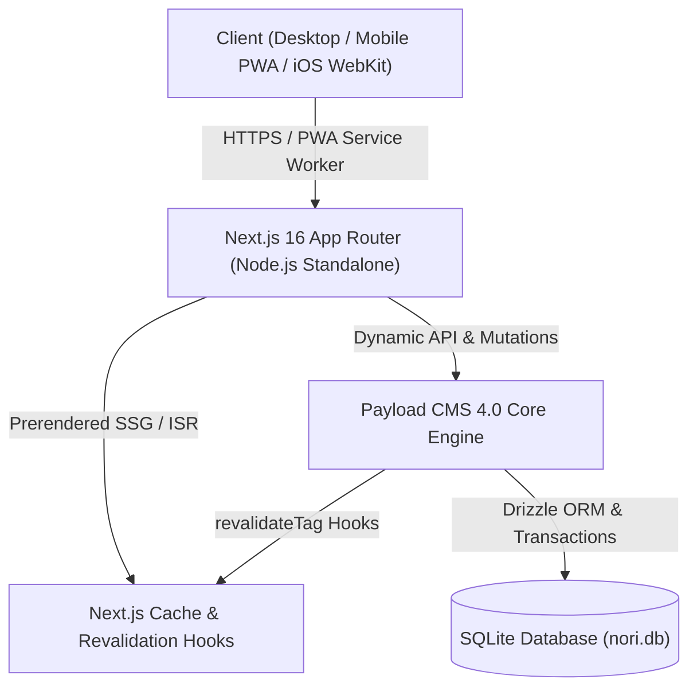

# NORI — Nền Tảng Cho Thuê Xe Linh Hoạt & Tư Vấn Mua Xe Toàn Diện

> **Dự án**: NORI Vehicle Rental (`nori-vehicle-rental`)<br />
> **Kiến trúc**: Next.js 16.4.6 (App Router), React 19.3.1, Payload CMS 4.0.0-beta.8, SQLite via `@payloadcms/db-sqlite`, Tailwind CSS v4.<br />
> **Repository chính thức**: [https://github.com/nquocthinh06/nori-vehicle-rental](https://github.com/nquocthinh06/nori-vehicle-rental)<br />
> **Nhánh chính**: `main`

---

## 1. Giới thiệu dự án

**NORI** là nền tảng số hóa dịch vụ cho thuê phương tiện tự lái (Ô tô, Xe máy, Xe bán tải) và hỗ trợ khách hàng tìm mua phương tiện tự tin tại Việt Nam.

Dự án được định hướng phát triển theo tiêu chuẩn công nghệ hiện đại:

- **Mobile-First & PWA**: Trải nghiệm mượt mà trên mọi thiết bị di động, tối ưu tương tác chạm vuốt, hỗ trợ cài đặt ứng dụng màn hình chính và hoạt động ngoại tuyến.
- **Dữ liệu Thời Gian Thực (Real-Time Integrity)**: Tách bạch rõ ràng giữa catalogue hiển thị tĩnh (SSG/ISR tối ưu SEO) và các giao dịch đặt xe, thanh toán, khóa ngày theo thời gian thực (Request-time & SQLite Transactions).
- **Phân Quyền Tập Trung (RBAC)**: Bảo vệ toàn diện 13 phân hệ quản trị dành riêng cho quản trị viên (`admins`), cách ly hoàn toàn với tài khoản khách hàng (`users`).
- **Khả Năng Tiếp Cận Cao**: Đạt chuẩn WCAG 2.2 AA (0 lỗi vi phạm khi kiểm thử tự động).

---

## 2. Các chức năng chính

### 2.1. Phía Khách Hàng (Customer Experience)

- **Catalogue & Tìm kiếm Thông minh**:
  - Quản lý danh mục 21 dòng xe thuộc 3 nhóm chính: ô tô phổ thông & hạng sang, xe máy & xe máy điện, xe bán tải địa hình.
  - Lọc đa tiêu chí: Nhóm xe, hãng sản xuất, khoảng giá thuê theo ngày, loại nhiên liệu, số chỗ ngồi.
  - Tìm kiếm tiếng Việt không dấu, chuyển đổi linh hoạt chế độ xem lưới (Grid) hoặc danh sách (List).
- **Hero Carousel Phương Tiện Quản Trị Từ CMS**:
  - 5 slide phương tiện sắc nét quản trị trực tiếp từ `/dashboard/content`, tự động chuyển mượt mà, hỗ trợ vuốt chạm di động, tạm dừng/tiếp tục và bảo toàn dữ liệu thanh tìm kiếm `<SearchBar />`.
- **Chi tiết Xe & Tính Giá Tự Động**:
  - Chuyển đổi minh bạch giữa nguồn ảnh Catalogue (`"Ảnh Catalogue – không phải hình ảnh của cá thể xe đang cho thuê."`) và ảnh cá thể xe thực tế; tự động ẩn bộ lọc `"Nội thất"` trên xe máy và ẩn thông số đốt trong trên xe thuần điện.
  - Thông số kỹ thuật chuẩn hóa, chọn phiên bản và màu sắc.
  - Lịch kiểm tra xe trống theo thời gian thực (`/nori-api/availability`).
  - Động cơ tính giá thuê tự động: Chiết khấu tuần (5%), chiết khấu tháng (12%), phụ phí cuối tuần và ngày lễ, cộng phí dịch vụ bổ sung (bảo hiểm, ghế trẻ em, thiết bị định vị).
- **Quy trình Đặt Xe, Chỉnh Sửa Đơn Chờ Duyệt & Thông Báo Sau Duyệt**:
  - Cho phép khách hàng chỉnh sửa trực tiếp đơn đang chờ duyệt (`PENDING`) tại `/my-bookings` kèm bảng đối chiếu chi phí Trước / Sau, hoán đổi ngày khóa nguyên tử và khóa Optimistic Locking (`revision`) chống ghi đè khi Admin duyệt đồng thời.
  - Tự động hiển thị Popup xác nhận đơn thuê (1 lần/sự kiện duyệt, xem lại qua Chuông thông báo trên Header) kèm ngày dự kiến nhân viên liên hệ tư vấn theo khung giờ hành chính và ngày lễ.
- **Tư vấn Mua Xe & Đặt Lịch Lái Thử**:
  - Biểu mẫu đăng ký tư vấn mua xe hoặc hẹn lịch lái thử xe trong kho.
  - Khách hàng theo dõi phản hồi trực tiếp trong trang quản lý tài khoản (`/account`).
- **Đánh Giá & Nhận Xét Đã Xác Minh**:
  - Chỉ cho phép khách hàng đã hoàn thành đơn thuê của chính dòng xe đó gửi đánh giá xếp hạng sao và nhận xét thực tế.
- **Trải Nghiệm Ứng Dụng Di Động (PWA)**:
  - Thanh điều hướng Bottom Navigation 5 mục tiện lợi trên màn hình nhỏ.
  - Bộ lọc tìm kiếm dạng Bottom Sheet có hỗ trợ thao tác vuốt chạm.
  - Lưu trữ danh sách xe yêu thích (Favorites) bền vững bằng LocalStorage.
  - Trang thông báo ngoại tuyến chuyên biệt (`/offline`) khi mất kết nối mạng.

### 2.2. Phía Quản Trị Viên (Admin Center)

- **13 Phân hệ Quản trị Chuyên sâu (`/dashboard/*`)**:
  1. **Tổng quan (Overview)**: Thống kê doanh thu, tỷ lệ lấp đầy xe, đơn mới, yêu cầu tư vấn cần xử lý.
  2. **Quản lý Đơn thuê (Bookings)**: Duyệt đơn, yêu cầu đặt cọc, chuyển giao xe, lập biên bản bàn giao, ghi nhận trả xe, hủy đơn.
  3. **Quản lý Phương tiện (Vehicles)**: Quản lý từng chiếc xe vật lý trong kho, biển số, mã nội bộ, số ODO, trạng thái vận hành (`READY`, `RENTED`, `MAINTENANCE`, `RESERVED`, `SOLD`).
  4. **Quản lý Dòng xe (Vehicle Models)**: Cấu hình thông số kỹ thuật, giá niêm yết, thư viện ảnh đa góc độ.
  5. **Quản lý Khách hàng (Customers)**: Hồ sơ người dùng, lịch sử thuê xe, quản lý khóa tài khoản.
  6. **Quản lý Đánh giá (Reviews)**: Kiểm duyệt, ẩn/hiện phản hồi công khai của khách hàng.
  7. **Lịch Bảo Dưỡng (Maintenance)**: Lên lịch bảo trì định kỳ, cập nhật chi phí và tự động khóa xe trên lịch thuê.
  8. **Giao Dịch & Thanh Toán (Payments)**: Quản lý phiếu thu cọc, tiền thuê, hoàn cọc, chống trùng lặp giao dịch (Idempotency Guard).
  9. **Chương Trình Khuyến Mãi (Promotions)**: Quản lý mã giảm giá voucher, thời hạn và số lượt sử dụng.
  10. **Quản lý Nội dung (Content & Site Settings)**: Tùy biến thông tin liên hệ, hotline, địa chỉ showroom, điều khoản dịch vụ (`NoriSite`).
  11. **Quản lý Bài viết & Tin tức (Posts)**: Xuất bản bài viết cẩm nang du lịch và kinh nghiệm lái xe an toàn.
  12. **Báo cáo & Thống kê (Reports)**: Phân tích doanh thu theo ngày/tháng, tỷ lệ hoạt động của từng dòng xe.
  13. **Xuất Dữ liệu (Export Center)**: Xuất báo cáo danh sách đơn thuê và doanh thu ra tệp CSV chuẩn Unicode UTF-8 BOM.
- **Hệ thống Ghi Nhật Ký Kiểm Toán (Audit Logs)**: Ghi vết toàn bộ hành vi quan trọng của nhân viên quản trị.

---

## 3. Kiến trúc hệ thống



- **Frontend Layer**: Next.js App Router kết hợp Server Components để dựng sẵn trang tĩnh (SSG/ISR) và Client Components cho các tương tác giỏ hàng, bộ lọc, popup.
- **Business Rule Engine (`src/lib/rental-rules.ts`)**: Độc lập hoàn toàn, xác thực tính hợp lệ của ngày thuê, công thức tính giá theo múi giờ Việt Nam (`Asia/Ho_Chi_Minh`), phụ phí cuối tuần/lễ Tết, ma trận chuyển đổi 9 trạng thái.
- **Data Persistence Layer**: SQLite cục bộ (`nori.db`) với chế độ WAL (Write-Ahead Logging), thực thi giao dịch ACID đảm bảo không xảy ra tình trạng đặt trùng xe hoặc lặp thanh toán.
- **Cache Invalidation Lifecycle**: Khi quản trị viên thay đổi thông tin dòng xe, giá hoặc ảnh, Payload hooks kích hoạt `revalidateTag` bóc tách tag cache tương ứng (`nori-model-${slug}`, `nori-catalogue-v3`) để cập nhật ngay lập tức giao diện khách hàng mà không cần build lại server.

---

## 4. Công nghệ sử dụng

| Lĩnh vực                | Công nghệ               | Phiên bản            | Vai trò                                                     |
| :---------------------- | :---------------------- | :------------------- | :---------------------------------------------------------- |
| **Framework**           | Next.js                 | 16.4.6               | App Router, Turbopack, Standalone deployment                |
| **UI Library**          | React                   | 19.3.1               | Giao diện tương tác người dùng                              |
| **Styling**             | Tailwind CSS            | 4.0.0                | Hệ thống semantic tokens, CSS biến thể mới                  |
| **Headless CMS**        | Payload CMS             | 4.0.0-beta.8         | Quản trị dữ liệu, phân quyền và API cốt lõi                 |
| **Database**            | SQLite                  | 3.x                  | Lưu trữ dữ liệu quan hệ, transaction toàn vẹn               |
| **Database Adapter**    | `@payloadcms/db-sqlite` | 4.0.0-beta.8         | Kết nối SQLite & Drizzle ORM                                |
| **Runtime & Toolchain** | Node.js / pnpm          | >=24.22.1 / pnpm 10+ | Môi trường thực thi và quản lý gói phụ thuộc                |
| **Testing Engine**      | Node Test Runner        | Node.js built-in     | Thực thi 225 Unit tests nghiệp vụ                           |
| **E2E Testing**         | Playwright              | 1.65.1               | 62 kịch bản E2E Chromium (Desktop, Mobile, Admin, Security) |
| **A11y Testing**        | Axe Core                | 4.14.0               | Kiểm tra chuẩn tiếp cận WCAG 2.2 AA                         |
| **Linter & Formatter**  | oxfmt & Custom AST      | 0.73.0               | Chuẩn hóa định dạng và quét bảo mật tĩnh                    |

---

## 5. Hướng dẫn cài đặt và khởi chạy

### 5.1. Yêu cầu môi trường

- **Node.js**: Phiên bản `>= 24.22.1` (khuyến nghị Node 24 LTS).
- **Package Manager**: `pnpm` (phiên bản 9, 10 hoặc 11).
- **Trình duyệt**: Google Chrome, Microsoft Edge hoặc Safari.

### 5.2. Các bước cài đặt

1. **Clone mã nguồn từ GitHub**:

   ```bash
   git clone https://github.com/nquocthinh06/nori-vehicle-rental.git
   cd nori-vehicle-rental
   ```

2. **Cài đặt gói phụ thuộc**:

   ```bash
   pnpm install
   ```

3. **Thiết lập biến môi trường**:
   Sao chép tệp mẫu `.env.example` thành `.env`:

   ```bash
   cp .env.example .env
   ```

   Chỉnh sửa tệp `.env` nếu cần thay đổi cổng hoặc secret:

   ```env
   DATABASE_URI=file:./nori.db
   PAYLOAD_SECRET=your-secure-random-payload-secret-at-least-32-chars-long
   NEXT_PUBLIC_SITE_URL=http://localhost:3000
   PORT=3000
   ```

4. **Khởi động môi trường phát triển (Dev Server)**:
   ```bash
   pnpm dev
   ```
   Truy cập ứng dụng tại: `http://localhost:3000`

---

## 6. Cấu hình cơ sở dữ liệu (Database)

Dự án sử dụng **SQLite** làm cơ sở dữ liệu mặc định (`./nori.db`), mang lại các ưu điểm:

- Không yêu cầu cài đặt máy chủ CSDL cồng kềnh (MySQL/PostgreSQL), không phụ thuộc vào hạ tầng đám mây bên ngoài.
- Hỗ trợ đầy đủ quan hệ bảng, chỉ mục (Unique Index) và khóa ngoại (Foreign Keys).
- Hỗ trợ thao tác đồng thời an toàn với chế độ WAL (Write-Ahead Logging).
- Toàn bộ lược đồ (schema) và quan hệ được khởi tạo và đồng bộ tự động bởi Payload CMS qua Drizzle ORM.

---

## 7. Khởi tạo dữ liệu DEMO và tài khoản Admin an toàn

Dự án đã tích hợp sẵn tập dữ liệu DEMO bao gồm:

- **20 dòng xe** phủ khắp 3 danh mục kèm **63 hình ảnh** bản quyền mở đã chuẩn hóa trong `public/seed-media/`.
- **21 xe thực tế minh họa** (`isDemo: true`, gắn nhãn `DEMO`).
- Cấu hình thông tin thương hiệu, hotline, địa chỉ showroom tại `NoriSite`.

### Tạo tài khoản Quản trị viên (Admin)

Chạy script khởi tạo quản trị viên an toàn:

```bash
pnpm seed:admin
```

- Mật khẩu được mã hóa an toàn bằng thuật toán chuẩn `PBKDF2-SHA256` với salt ngẫu nhiên 32 bytes (100,000 lượt lặp).
- Hoạt động theo cơ chế lũy kế (Idempotent): nếu tài khoản đã tồn tại, script sẽ kiểm tra toàn vẹn mà không ghi đè dữ liệu.
- Tài khoản quản trị mặc định: `admin@nori.vn` (mật khẩu được in an toàn trong console hoặc đọc từ biến môi trường `NORI_ADMIN_PASSWORD`).

Đăng nhập quản trị tại: `http://localhost:3000/login` hoặc phân hệ CMS tại `http://localhost:3000/admin`.

---

## 8. Hướng dẫn kiểm thử (Testing Suite)

Dự án thiết lập hệ thống kiểm thử tự động toàn diện với **268 Automated Tests** (100% PASS):

```bash
# 1. Kiểm tra định dạng mã nguồn
pnpm format:check

# 2. Phân tích cú pháp tĩnh & rà soát bảo mật (Linter)
pnpm lint

# 3. Kiểm tra kiểu dữ liệu TypeScript nghiêm ngặt
pnpm typecheck

# 4. Chạy toàn bộ 205 Unit Tests nghiệp vụ
pnpm test

# 5. Kiểm thử DB cô lập Admin
pnpm test:admin

# 6. Chạy toàn bộ 63 Playwright E2E Tests (Yêu cầu server đang chạy ở port 3000)
pnpm test:e2e
```

### Phân rã 268 kịch bản kiểm thử:

- **205 Unit Tests (`tests/rental-rules.test.mjs`)**: Kiểm tra toàn diện công thức tính giá theo ngày/tuần/tháng, phụ phí ngày lễ, ma trận 9×9 trạng thái chuyển đổi đơn thuê, voucher giảm giá, kiểm tra quá hạn cọc.
- **43 Playwright Core E2E Tests (`tests/e2e/nori.spec.ts`)**: Toàn trình tìm kiếm xe, giỏ hàng, gửi đơn, duyệt đơn Admin, bàn giao xe, kiểm duyệt đánh giá, xuất báo cáo CSV, quét chuẩn WCAG 2.2 AA.
- **7 Responsive & PWA Tests (`tests/e2e/mobile-pwa.spec.ts`)**: Kiểm tra 11 breakpoints, Bottom Navigation, Bottom Sheet filter, Service Worker, Offline fallback.
- **8 Data Sync & Security Tests (`tests/e2e/data-sync.spec.ts`)**: Đồng bộ giá không cần rebuild, Dynamic slug rendering, chống đặt trùng lịch 409, chống lặp thanh toán 409, phân quyền RBAC 13 route Dashboard.
- **5 Mobile WebKit Tests (`tests/e2e/mobile-webkit.spec.ts`)**: Mô phỏng iPhone 14 Safari WebKit thực tế.

---

## 9. Hướng dẫn Production Build

Để đóng gói và chạy ứng dụng ở chế độ sản xuất:

```bash
# 1. Thực hiện biên dịch và sinh trang tĩnh
pnpm build

# 2. Khởi chạy máy chủ sản xuất (Next.js Standalone mode)
node .next/standalone/server.js
```

Sau khi biên dịch thành công:

- **71/71 tuyến đường** được tối ưu hóa tĩnh (`○ Static` / `● SSG`).
- Đo lường chỉ số Core Web Vitals trên máy chủ sản xuất:
  - **CLS (Cumulative Layout Shift)**: `0.0038` (đạt xuất sắc ngưỡng chuẩn ≤ 0.1).
  - **LCP (Largest Contentful Paint)**: `516 ms` (chuẩn < 2500 ms).
  - **INP (Interaction to Next Paint)**: `40 ms` (chuẩn < 200 ms).

---

## 10. Hướng dẫn Sao lưu và Phục hồi (Backup & Restore)

Hệ thống cung cấp cơ chế sao lưu SQLite trực tuyến mà không cần dừng máy chủ:

### Sao lưu (Backup)

```bash
pnpm db:backup
```

- Lệnh sử dụng chuẩn `VACUUM INTO` của SQLite để tạo bản sao lưu nhất quán tức thì tại thư mục `backups/`.
- Tự động chạy lệnh `PRAGMA integrity_check` để xác thực độ toàn vẹn của tệp sao lưu.

### Phục hồi (Restore)

```bash
node scripts/restore-db.mjs backups/nori-backup-YYYY-MM-DD-HHmmss.db
```

- Script tự động sao lưu bản snapshot hiện tại trước khi khôi phục, kiểm tra tính toàn vẹn và nạp lại dữ liệu an toàn.

---

## 11. Các giới hạn hiện tại

1. **Dữ liệu Xe Minh Họa**: Toàn bộ 21 cá thể xe trong kho hiện được gắn nhãn `DEMO` (`isDemo: true`) để phục vụ kiểm thử và nghiệm thu giao diện. Doanh nghiệp cần cập nhật xe thực tế qua Dashboard trước khi đưa vào khai thác thương mại.
2. **Cổng Thanh Toán Trực Tuyến**: Hiện tại quy trình thanh toán đặt cọc và tiền thuê hoạt động theo cơ chế xác nhận chuyển khoản thủ công bởi Quản trị viên (Admin đối chiếu sao kê và xác nhận `CONFIRMED`). Chưa tích hợp trực tiếp webhook cổng thanh toán tự động (VNPay, MoMo, ZaloPay).
3. **Dịch Vụ SMS / Email**: Các thông báo thay đổi trạng thái đơn thuê hiện được hiển thị trực tiếp trên giao diện thông báo của tài khoản khách hàng (`/account`, `/my-bookings`), chưa kết nối nhà cung cấp dịch vụ SMS OTP / SendGrid thực tế.
4. **Figma Make CLI**: Lệnh `figma make verify-deploy` phụ thuộc vào môi trường runtime do Figma Make cung cấp trên nền tảng đám mây; trên máy tính phát triển cục bộ lệnh kiểm định chính thức là `pnpm build` và bộ kiểm thử `pnpm test:e2e`.

---

## 12. Danh mục tài liệu kỹ thuật liên quan

Hệ thống tài liệu đầy đủ của dự án được lưu trữ trong thư mục `docs/`:

- [DESIGN.md](DESIGN.md) — Quy chuẩn Design System NORI, Semantic Tokens, Typography, Bảng màu và Components.
- [SKILL.md](SKILL.md) — Kỹ năng triển khai & nguyên tắc xây dựng giao diện WCAG 2.2 AA.
- [docs/SPEC.md](docs/SPEC.md) — Đặc tả yêu cầu hệ thống chi tiết (16 nhóm yêu cầu kỹ thuật & nghiệp vụ).
- [docs/ARCHITECTURE.md](docs/ARCHITECTURE.md) — Bản vẽ kiến trúc toàn diện, sơ đồ thực thể ERD, máy trạng thái UML.
- [docs/API.md](docs/API.md) — Tài liệu đặc tả 19 API endpoints (Public, Customer và Protected Admin Dashboard).
- [docs/TEST_CASES.md](docs/TEST_CASES.md) — Ma trận 268 kịch bản kiểm thử tự động chi tiết.
- [docs/TEST_REPORT.md](docs/TEST_REPORT.md) — Báo cáo nghiệm thu kết quả kiểm thử và đo lường Web Vitals thực tế.
- [docs/PROJECT_STATUS.md](docs/PROJECT_STATUS.md) — Tình trạng dự án, tỷ lệ hoàn thiện các module và kế hoạch tiếp theo.
- [docs/CHANGELOG.md](docs/CHANGELOG.md) — Lịch sử cập nhật và nâng cấp qua các phiên bản.
- [docs/PWA.md](docs/PWA.md) — Hướng dẫn chi tiết về cấu hình, kiểm thử và cài đặt Progressive Web App.
