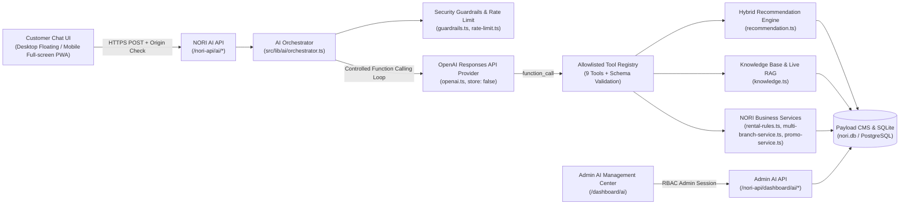
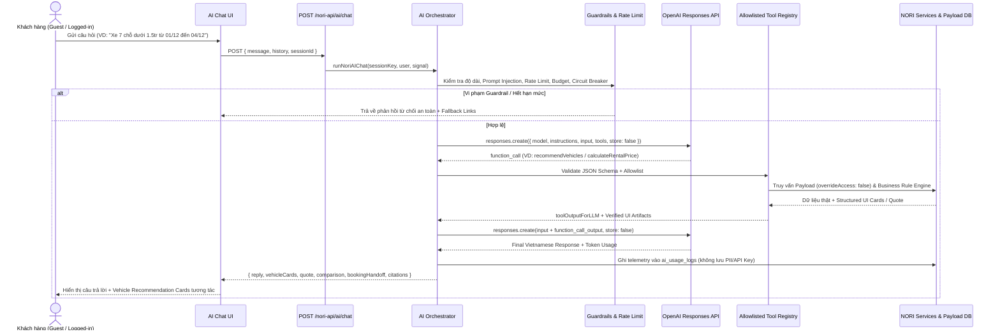
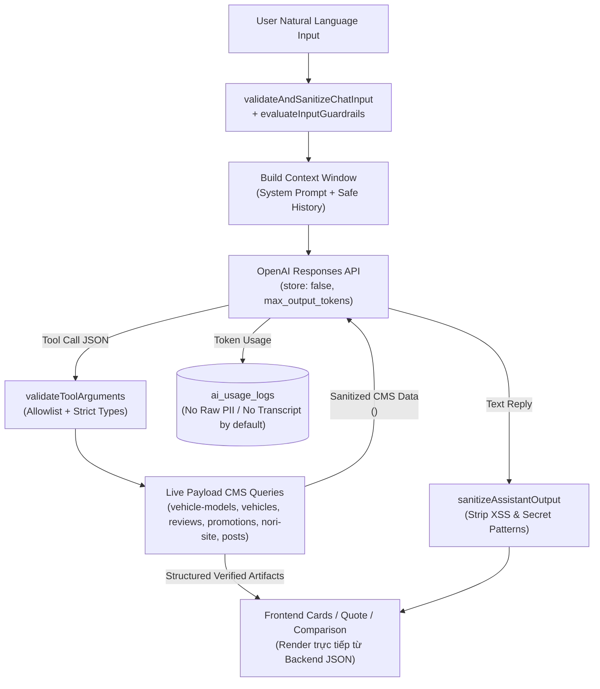
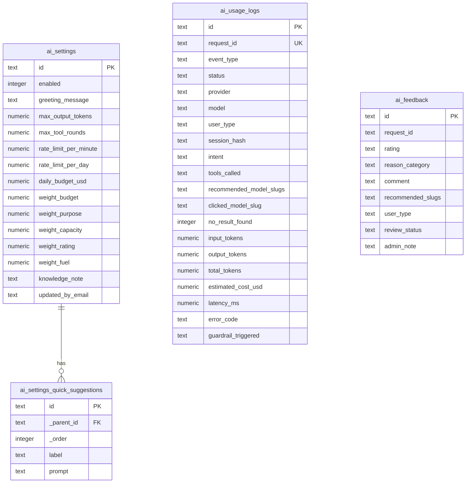

# NORI AI Assistant — Kiến Trúc Hệ Thống (AI Architecture)

> **Tên tính năng chính thức**: NORI AI Assistant – Intelligent Vehicle Recommendation & Rental Assistant  
> **Nhà cung cấp AI chính thức**: OpenAI API (Responses API qua `openai` Node/TypeScript SDK chính thức)  
> **Model mặc định**: Cấu hình qua biến môi trường `OPENAI_MODEL` (khuyến nghị `gpt-4.1-mini`)

---

## 1. Kiến trúc tổng thể (High-Level Architecture)

NORI AI Assistant được thiết kế theo kiến trúc phân tầng rõ ràng, cô lập hoàn toàn lời gọi OpenAI ở phía máy chủ và buộc mọi thông tin phương tiện, lịch trống, báo giá, khuyến mãi và chính sách phải đi qua các dịch vụ nghiệp vụ chuẩn của NORI.

---

## 2. Luồng xử lý chi tiết (Sequence Diagram)

---

## 3. Luồng dữ liệu (Data Flow Diagram)

---

## 4. Cấu trúc mã nguồn (`src/lib/ai/`)

| Module | Trách nhiệm chính |
| :--- | :--- |
| `src/lib/ai/types.ts` | Khai báo kiểu dữ liệu cho Provider, 9 Allowlisted Tools, Structured UI Cards, Quote, Comparison, Handoff, Telemetry. |
| `src/lib/ai/config.ts` | Đọc biến môi trường server, chuẩn hóa cấu hình và kẹp giới hạn Admin trong trần an toàn server. |
| `src/lib/ai/errors.ts` | Phân loại lỗi chuẩn hóa (`NoriAIError`), ánh xạ mã lỗi OpenAI (401/403/429/quota/timeout/5xx) & DB sang thông điệp tiếng Việt an toàn, ẩn secret. |
| `src/lib/ai/guardrails.ts` | Bảo vệ Input (Prompt Injection, Secret Exfiltration, Admin Escalation, Cross-User, SQL/FS), Indirect Prompt Injection sanitizer cho CMS, Redaction PII và Output XSS sanitizer. |
| `src/lib/ai/rate-limit.ts` | Rate limiting theo phút & ngày, giới hạn đồng thời, ngân sách USD/ngày và Circuit Breaker cho OpenAI provider. |
| `src/lib/ai/usage.ts` | Bảng giá tham khảo ước tính chi phí theo model và ghi nhận telemetry vào `ai-usage-logs`. |
| `src/lib/ai/system-prompt.ts` | System Prompt chuyên biệt tiếng Việt cho NORI, ranh giới bảo mật `<untrusted_cms_data>` và chuẩn phân biệt giá tham khảo / báo giá / đơn xác nhận. |
| `src/lib/ai/schemas.ts` | JSON Schema cho OpenAI Function Calling và bộ validate tham số runtime cho cả 9 hàm. |
| `src/lib/ai/recommendation.ts` | **NORI Hybrid Recommendation Engine**: NLP tiếng Việt không dấu, lọc cứng điều kiện bắt buộc, chấm điểm có trọng số minh bạch (35/25/20/10/10) và sinh lý do đề xuất. |
| `src/lib/ai/knowledge.ts` | **Lightweight RAG** truy vấn live `nori-site`, bài viết `published` (`posts`) và chi nhánh `ACTIVE`, kèm nguồn trích dẫn URL. |
| `src/lib/ai/tools.ts` | Triển khai nghiệp vụ cho 9 Business Tools tái sử dụng trực tiếp `rental-rules.ts`, `multi-branch-service.ts`, `promo-service.ts`. |
| `src/lib/ai/tool-registry.ts` | Allowlist dispatcher chặn tuyệt đối hàm ngoài danh sách. |
| `src/lib/ai/openai.ts` | Tích hợp chính thức `OpenAIResponsesProvider` (`client.responses.create`, `store: false`, exponential backoff retry, timeout & abort). |
| `src/lib/ai/provider.ts` | AI Provider Interface factory + `MockTestAIProvider` cô lập hoàn toàn chỉ bật khi `NORI_AI_TEST_MOCK=1`. |
| `src/lib/ai/orchestrator.ts` | Điều phối vòng lặp Function Calling, kiểm soát giới hạn vòng gọi và hợp nhất dữ liệu xác thực cho UI. |

---

## 5. Sơ đồ ERD phần bổ sung AI (Additive-only Schema)

Migration additive-only `20261128_010000_ai_assistant_foundation` bổ sung 7 bảng mới trên cả SQLite và PostgreSQL (`ai_settings`, `ai_settings_quick_suggestions`, `ai_usage_logs`, `ai_feedback` cùng 3 bảng quan hệ hệ thống Payload 4.0 `ai_settings_rels`, `ai_usage_logs_rels`, `ai_feedback_rels`, nâng tổng số bảng SQLite từ `109 → 116`) mà không xóa hay sửa bất kỳ bảng nghiệp vụ hiện có nào:

---

## 6. Thuật toán Hybrid Recommendation System

Thuật toán của NORI là hệ thống **Hybrid Deterministic Recommendation** (kết hợp NLP + Structured Intent Extraction + Rule-based Hard Filtering + Content-based Weighted Scoring + Explainable Rationale) — **không phải mô hình Machine Learning huấn luyện trên lịch sử cá nhân hóa**.

1. **Giai đoạn 1 — Structured Intent Extraction (`extractStructuredIntent`)**: Chuẩn hóa tiếng Việt không dấu, bóc tách ngân sách (`dưới 1.5 triệu`, `500k`), số chỗ (`7 chỗ`, `gia đình`), loại xe (`CAR`/`MOTORBIKE`/`PICKUP`), nhiên liệu, hộp số, mục đích sử dụng và khoảng ngày thuê.
2. **Giai đoạn 2 — Hard Filtering (Lọc cứng bắt buộc)**: Loại bỏ trước khi chấm điểm mọi xe không đáp ứng:
   - Không đủ số chỗ ngồi yêu cầu.
   - Sai danh mục phương tiện (`CAR` / `MOTORBIKE` / `PICKUP`).
   - Vượt ngân sách tối đa khi khách yêu cầu nghiêm ngặt (`strictBudget = true`).
   - Không khớp loại hộp số hoặc nhiên liệu bắt buộc.
   - Không khả dụng trong khoảng ngày thuê đã xác định.
   - Không ở trạng thái kinh doanh `ACTIVE` / dòng xe chưa `visible`.
3. **Giai đoạn 3 — Weighted Scoring (Trọng số mặc định chuẩn hóa 100%)**:
   - Phù hợp ngân sách: **35%**
   - Phù hợp mục đích sử dụng: **25%**
   - Phù hợp sức chứa / số chỗ: **20%**
   - Đánh giá đã xác minh: **10%** (áp dụng Bayesian smoothing với `priorMean = 4.2`, `priorWeight = 3`; dòng xe chưa có đánh giá nhận điểm trung tính `65/100`, tuyệt đối không tự bịa điểm).
   - Hiệu quả sử dụng nhiên liệu: **10%**
4. **Giai đoạn 4 — Explainable Output**: Sinh tối đa 4 lý do bằng tiếng Việt trích trực tiếp từ thuộc tính xác thực của xe và hiển thị trực quan trên Vehicle Recommendation Card.
