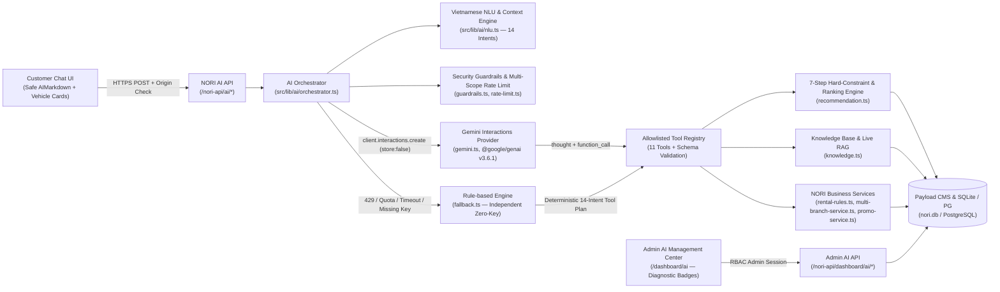

# NORI AI Assistant — Kiến Trúc Hệ Thống (AI Architecture v2.9)

> **Tên tính năng chính thức**: NORI AI Assistant – Intelligent Vehicle Recommendation & Rental Assistant (`v2.9.0`)  
> **Nhà cung cấp AI chính thức**: Google Gemini Interactions API (`@google/genai` SDK `3.6.1`, chính sách mặc định `NORI_AI_FREE_TIER_ONLY=true`, `NORI_AI_PAID_PROVIDERS_ALLOWED=false`)  
> **Model mặc định**: `GEMINI_MODEL=gemini-3.5-flash-lite` (hỗ trợ `gemini-3.5-flash-lite`, `gemini-3.1-flash-lite`, `gemini-4-hydrogen`; tự động ánh xạ các tên model cũ `gemini-2.5-*`/`2.0-*` sang model thế hệ hiện hành)  
> **Chế độ dự phòng độc lập**: `Rule-based NLU & Recommendation Engine` (`src/lib/ai/fallback.ts` + `src/lib/ai/nlu.ts`) — hoạt động độc lập 100% không cần API Key với dữ liệu thật từ Payload CMS / SQLite và Business Rule Engine khi thiếu `GEMINI_API_KEY`, hết quota (`429`), timeout hoặc mất kết nối.

---

## 1. Kiến trúc tổng thể (High-Level Architecture)

NORI AI Assistant tách biệt nghiêm ngặt 3 trách nhiệm:
1. **Hiểu ngôn ngữ, phân loại 14 ý định & quản lý ngữ cảnh đa lượt (`src/lib/ai/nlu.ts` + Gemini Interactions API `src/lib/ai/gemini.ts`)**.
2. **Xác thực nghiệp vụ, lọc cứng điều kiện bắt buộc & truy xuất dữ liệu thật (`src/lib/ai/tools.ts`, `src/lib/ai/recommendation.ts`, `src/lib/rental-rules.ts`, `src/lib/multi-branch-service.ts`, `src/lib/promo-service.ts`)**.
3. **Render giao diện an toàn không HTML thô (`src/lib/ai/markdown.ts`, `src/components/ai/ai-markdown.tsx`, `src/components/ai/ai-chat-panel.tsx`)**.

---

## 2. Phân tích Nguyên nhân Gốc rễ Lỗi Cũ & Giải pháp Triệt để (`v2.9.0`)

| Sự cố trước đây | Nguyên nhân gốc rễ trong mã nguồn cũ | Giải pháp kiến trúc đã triển khai (`v2.9.0`) |
| :--- | :--- | :--- |
| Hỏi `"innova có xe này không"` nhưng chatbot đề xuất 4 xe máy (`Evo200`, `Wave Alpha`, `Vision`, `PCX`) | 1) `nori.db` không có `Toyota Innova`. 2) `extractStructuredIntent` không nhận diện thực thể dòng xe `Innova` -> gán `category = null`. 3) `planDeterministicToolTurn` không có nhánh `VEHICLE_LOOKUP`, rơi thẳng vào `recommendVehicles` trên toàn bộ 21 xe -> xe máy giá rẻ đạt điểm ngân sách & nhiên liệu cao nhất. | 1) Xây dựng `src/lib/ai/nlu.ts` nhận diện 14 Intent (`VEHICLE_LOOKUP` ưu tiên trước `VEHICLE_RECOMMENDATION`), từ điển dòng xe/hãng xe tiếng Việt + sửa lỗi chính tả Damerau-Levenshtein (`inova`, `fotuner`, `expander`). 2) `toolGetVehicleDetails` kiểm tra trực tiếp `vehicle-models` & `vehicles`: khi không có `Toyota Innova`, trả `vehicleCards: []` (0 xe máy), thông báo trung thực chưa có `Toyota Innova` và gợi ý xe 7 chỗ cùng phân khúc (`Toyota Fortuner`, `Mitsubishi Xpander`) từ DB thật. |
| Thông báo kỹ thuật `"chưa cấu hình API Key"` trên giao diện khách hàng & Standalone Server không nạp `.env` | `scripts/start-standalone.mjs` chạy `.next/standalone/server.js` không tự nạp `.env` gốc; `fallback.ts` và `/nori-api/ai/config` chèn thông điệp kỹ thuật về `API Key` vào nội dung trả lời khách hàng. | 1) Bổ sung bộ nạp `.env` an toàn cho `scripts/start-standalone.mjs` và `scripts/validate-env.mjs`. 2) Tách bạch hoàn toàn thông điệp khách hàng (`Chế độ tư vấn cơ bản`) với chẩn đoán kỹ thuật tại `/dashboard/ai` (`Gemini Connected`, `Fallback Active`, `API Configuration Missing`, `Quota Exceeded`, `Connection Error`). |
| Hiển thị ký tự Markdown thô (`**...**`) trên khung chat | `src/components/ai/ai-chat-panel.tsx` render `{msg.content}` dưới dạng plain text (`whitespace-pre-line`). | Xây dựng bộ phân tích cú pháp AST `src/lib/ai/markdown.ts` + component `<AIMarkdown />` (`src/components/ai/ai-markdown.tsx`) chuyển đổi an toàn `**bold**`, `*italic*`, danh sách, trích dẫn, code và liên kết sang React nodes, **không dùng `dangerouslySetInnerHTML`**, chặn tuyệt đối `javascript:` / `data:`. |

---

## 3. Quy trình 7 Bước Tra cứu & Đề xuất Phương tiện (`src/lib/ai/nlu.ts` + `recommendation.ts` + `tools.ts`)

1. **Bước 1 — Nhận diện ý định (14 Intents)**: `VEHICLE_LOOKUP`, `BRAND_LOOKUP`, `VEHICLE_RECOMMENDATION`, `AVAILABILITY_CHECK`, `PRICE_QUOTE`, `VEHICLE_COMPARISON`, `PROMOTION_QUERY`, `BOOKING_GUIDANCE`, `BOOKING_STATUS`, `RENTAL_POLICY`, `PURCHASE_CONSULTATION`, `GREETING`, `CLARIFICATION`, `OUT_OF_SCOPE`.
2. **Bước 2 — Trích xuất thực thể & Giải tham chiếu ngữ cảnh đa lượt**: Chuẩn hóa tiếng Việt có dấu/không dấu, từ viết tắt (`ko`, `dc`, `bn`, `200k`, `1.5tr`, `stđ`), lỗi chính tả phổ biến, và ngữ cảnh phiên (`"Xe đó giá bao nhiêu?"`, `"Thuê 3 ngày thì sao?"`, `"Đổi sang Xpander đi"`).
3. **Bước 3 — Truy xuất dữ liệu trực tiếp từ Payload CMS & SQLite**: Đọc live `vehicle-models` (`visible = true`), `vehicles`, `reviews`, `promotions`, `bookings` (`overrideAccess: false`). Nếu DB lỗi (`SQLITE_BUSY` / mất kết nối), trả mã `AI_DB_UNAVAILABLE` (HTTP `503`), tuyệt đối không đánh đồng với "không có xe".
4. **Bước 4 — Áp dụng điều kiện bắt buộc (Hard Constraints TRƯỚC khi chấm điểm)**:
   - Khách tìm ô tô (`CAR`) -> loại bỏ 100% xe máy (`MOTORBIKE`) và ngược lại.
   - Khách yêu cầu `7 chỗ` -> loại bỏ 100% xe `4–5 chỗ`.
   - Khách nêu trần ngân sách (`dưới 1 triệu/ngày`, `xe máy dưới 200k`) -> loại bỏ 100% xe vượt ngân sách.
   - Khách yêu cầu `số tự động` -> kiểm tra ranh giới từ (`matchesTransmission`), loại bỏ 100% `Số sàn` (`Manual`).
   - Khách hỏi dòng xe cụ thể -> kiểm tra đúng dòng xe đó trước, không trượt sang đề xuất ngẫu nhiên.
   - **Không ép trả đủ 4 xe**: Có bao nhiêu kết quả hợp lệ trả bấy nhiêu (`0..4`). Nếu `0` kết quả, trả mảng rỗng và hỏi khách có muốn mở rộng tiêu chí không.
5. **Bước 5 — Chấm điểm xếp hạng có trọng số (Weighted Scoring 100%)**: Ngân sách (`35%`), Mục đích sử dụng (`25%`), Sức chứa (`20%`), Đánh giá xác minh Bayesian (`10%`), Hiệu quả nhiên liệu trung tính theo phân khúc (`10%`).
6. **Bước 6 — Xác thực trạng thái đội xe & lịch trống**: Phân biệt rõ (a) Dòng xe tồn tại trong catalogue, (b) Có cá thể xe đang mở cho thuê (`READY` + `ACTIVE`), (c) Xe đang `MAINTENANCE` hoặc đã khóa lịch `rental_days`, (d) Xe minh họa `DEMO` và xe thực tế. Không bao giờ xác nhận còn xe nếu chưa kiểm tra `startDate` + `endDate`.
7. **Bước 7 — Tổng hợp phản hồi & Xác thực đầu ra**: Orchestrator chặn mọi phản hồi LLM tự nêu số tiền/lịch trống nếu chưa gọi tool xác thực (`unverifiedClaimGuard`), làm sạch XSS/secret và trả JSON chuẩn cho `<AIMarkdown />` + `<AIVehicleCards />`.

---

## 4. Cấu trúc mã nguồn (`src/lib/ai/` & `src/components/ai/`)

| Module | Trách nhiệm chính |
| :--- | :--- |
| [types.ts](file:///f:/1.%20University/2.%20Đồ%20án/3.%20Bài%20tập/nori-vehicle-rental/nori-vehicle-rental/nori-vehicle-rental/src/lib/ai/types.ts) | Định nghĩa `NoriAIIntent` (14 intents), `AIConnectionStatus`, `AISessionContextSummary`, 11 Allowlisted Tools và kiểu dữ liệu Interactions API (`thought` signature). |
| [nlu.ts](file:///f:/1.%20University/2.%20Đồ%20án/3.%20Bài%20tập/nori-vehicle-rental/nori-vehicle-rental/nori-vehicle-rental/src/lib/ai/nlu.ts) | Bộ xử lý NLU tiếng Việt, chuẩn hóa không dấu/viết tắt, từ điển dòng xe/hãng xe, Damerau-Levenshtein fuzzy matching và quản lý ngữ cảnh hội thoại nhiều lượt cô lập theo phiên. |
| [config.ts](file:///f:/1.%20University/2.%20Đồ%20án/3.%20Bài%20tập/nori-vehicle-rental/nori-vehicle-rental/nori-vehicle-rental/src/lib/ai/config.ts) | Quản lý biến môi trường server-only (`GEMINI_API_KEY`, `GEMINI_MODEL`), allowlist model hiện hành (`gemini-3.5-flash-lite`, `gemini-3.1-flash-lite`, `gemini-4-hydrogen`) và trần an toàn. |
| [gemini.ts](file:///f:/1.%20University/2.%20Đồ%20án/3.%20Bài%20tập/nori-vehicle-rental/nori-vehicle-rental/nori-vehicle-rental/src/lib/ai/gemini.ts) | Tích hợp `@google/genai` `v3.6.1` qua `client.interactions.create({ store: false })`, bảo toàn `thought` signature qua các vòng `function_call`, hỗ trợ Structured Output (`response_format`), live `ping()` và `getGeminiRuntimeHealthSnapshot()`. |
| [recommendation.ts](file:///f:/1.%20University/2.%20Đồ%20án/3.%20Bài%20tập/nori-vehicle-rental/nori-vehicle-rental/nori-vehicle-rental/src/lib/ai/recommendation.ts) | Bộ lọc cứng bắt buộc (Hard Constraints) + chấm điểm trọng số giải thích được (Explainable Hybrid Scoring). |
| [tools.ts](file:///f:/1.%20University/2.%20Đồ%20án/3.%20Bài%20tập/nori-vehicle-rental/nori-vehicle-rental/nori-vehicle-rental/src/lib/ai/tools.ts) | 11 công cụ nghiệp vụ kết nối trực tiếp Payload CMS, `evaluateVehicleBookingAvailabilityAndPricing`, `evaluatePromotion`, `calculateRollingPrice` và kiểm tra quyền sở hữu `bookings`. |
| [fallback.ts](file:///f:/1.%20University/2.%20Đồ%20án/3.%20Bài%20tập/nori-vehicle-rental/nori-vehicle-rental/nori-vehicle-rental/src/lib/ai/fallback.ts) | Rule-based Engine độc lập hỗ trợ đầy đủ 14 nhóm ý định, ngữ cảnh nhiều lượt và tra cứu dữ liệu thật khi không có Gemini. |
| [orchestrator.ts](file:///f:/1.%20University/2.%20Đồ%20án/3.%20Bài%20tập/nori-vehicle-rental/nori-vehicle-rental/nori-vehicle-rental/src/lib/ai/orchestrator.ts) | Điều phối vòng lặp Function Calling, chèn `<conversation_context>`, chặn suy diễn chưa qua tool, chuyển đổi mượt sang Fallback và ghi nhận telemetry ẩn danh. |
| [markdown.ts](file:///f:/1.%20University/2.%20Đồ%20án/3.%20Bài%20tập/nori-vehicle-rental/nori-vehicle-rental/nori-vehicle-rental/src/lib/ai/markdown.ts) & [ai-markdown.tsx](file:///f:/1.%20University/2.%20Đồ%20án/3.%20Bài%20tập/nori-vehicle-rental/nori-vehicle-rental/nori-vehicle-rental/src/components/ai/ai-markdown.tsx) | Trình phân tích AST Markdown thuần TypeScript & bộ render React an toàn chống XSS. |
| [ai-chat-panel.tsx](file:///f:/1.%20University/2.%20Đồ%20án/3.%20Bài%20tập/nori-vehicle-rental/nori-vehicle-rental/nori-vehicle-rental/src/components/ai/ai-chat-panel.tsx) | Giao diện Chatbot khách hàng (xoay `sessionId` khi đặt lại hội thoại, đồng bộ `visualViewport` trên di động, hiển thị Vehicle/Quote/Comparison Cards). |
| [ai-panel.tsx](file:///f:/1.%20University/2.%20Đồ%20án/3.%20Bài%20tập/nori-vehicle-rental/nori-vehicle-rental/nori-vehicle-rental/src/components/admin/ai-panel.tsx) | Trung tâm quản trị & chẩn đoán AI tại `/dashboard/ai`. |
