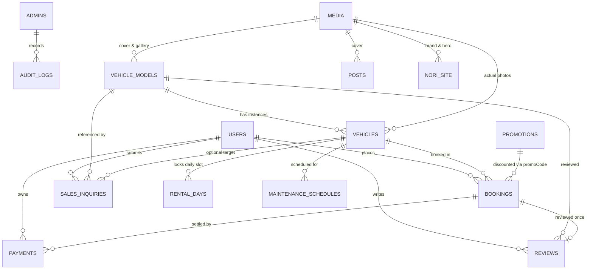
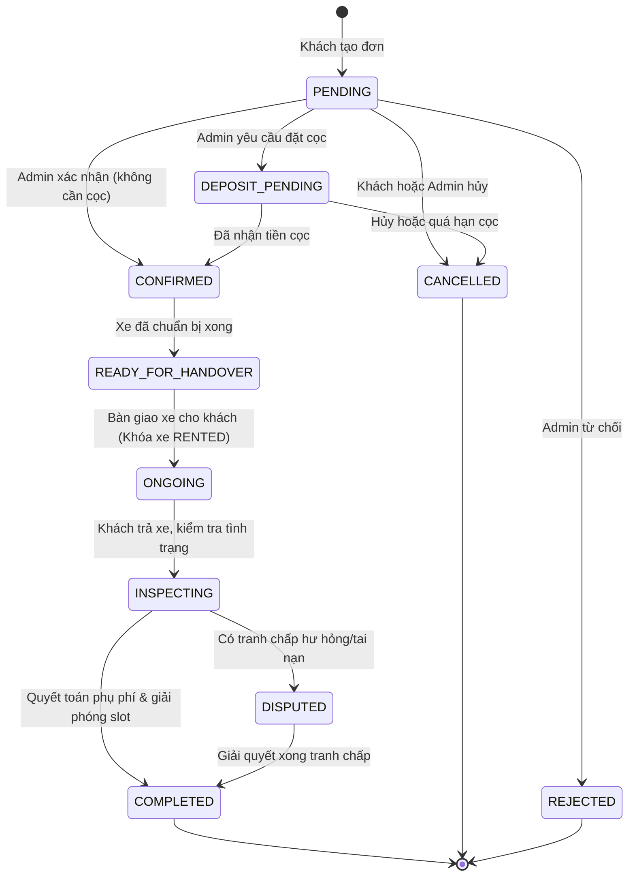
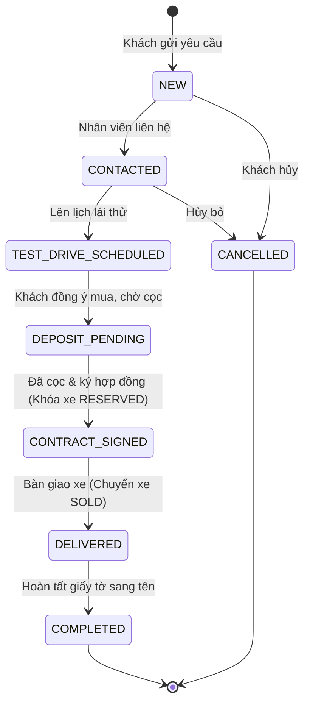
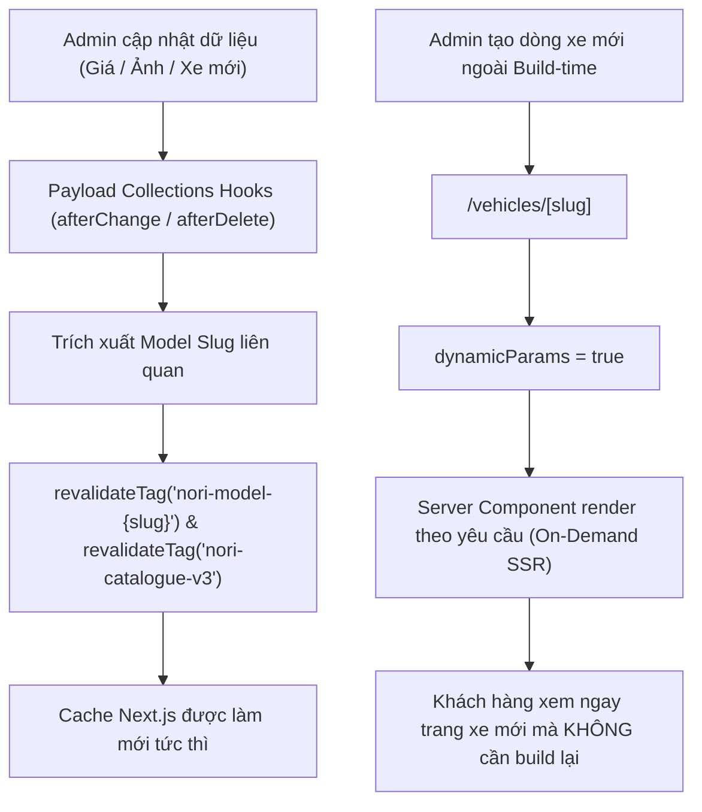

# KIẾN TRÚC TOÀN DIỆN HỆ THỐNG NORI (SYSTEM ARCHITECTURE)

- **Công nghệ nền tảng**: Next.js 16.4.6 (App Router, Standalone Output), React 19.3.1, Payload CMS 4.0.0-beta.8, SQLite via `@payloadcms/db-sqlite` & Drizzle ORM, Tailwind CSS 4.
- **Phạm vi tài liệu**: Kiến trúc tổng thể, mô hình thực thể (ERD), máy trạng thái (UML), cơ chế đồng bộ dữ liệu (Data Sync & Cache Invalidation), kiểm soát giao dịch đồng thời (Concurrency & Idempotency), bảo mật PWA và quy trình sao lưu phục hồi cơ sở dữ liệu.

---

## 1. Sơ đồ Thực thể Quan hệ (Entity-Relationship Diagram — ERD)

### Phân tách Mô hình Dòng xe và Cá thể Xe

- **`VehicleModels`**: Quản lý thông tin định danh dòng xe (tên, hãng, danh mục `CAR`/`MOTORBIKE`/`PICKUP`, phân hạng `subCategory`, thông số kỹ thuật, phiên bản, màu sắc, giá niêm yết tham khảo, ảnh catalogue).
- **`Vehicles`**: Quản lý từng chiếc xe vật lý trong kho (mã nội bộ `reference`, biển số `licensePlate`, số ODO, giá thuê theo ngày, giá bán niêm yết, tiền đặt cọc, trạng thái vận hành: `READY`, `RENTED`, `RESERVED`, `MAINTENANCE`, `SOLD`, `INACTIVE`, hình ảnh xe thực tế).

---

## 2. Máy Trạng thái Nghiệp vụ Cốt lõi (UML State Machines)

### 2.1. Vòng đời Đơn thuê xe (`Bookings` — 9 trạng thái)

### 2.2. Vòng đời Yêu cầu Mua xe (`SalesInquiries` — 8 trạng thái)

---

## 3. Kiến trúc Đồng bộ Dữ liệu & Invalidation (Data Sync Pipeline)

- **Dynamic Params**: Trang `src/app/(frontend)/vehicles/[slug]/page.tsx` thiết lập `export const dynamicParams = true`, đảm bảo mọi dòng xe mới tạo trong Payload Admin đều được render trực tiếp theo yêu cầu.
- **Revalidation Hook**: Module `src/hooks/revalidate-nori.ts` bóc tách slug phụ thuộc và xóa cache tags của Next.js (`unstable_cache`), đảm bảo việc đổi giá, đổi ảnh hoặc ẩn xe trên Admin được cập nhật tới người dùng Desktop/Mobile/PWA ngay lập tức.

---

## 4. Kiểm soát Giao dịch Đồng thời & Chống Trùng lặp (Concurrency & Idempotency)

1. **Khóa Lịch Đặt Thuê Trùng Nhau (Double-Booking Prevention)**:
   - Khi tạo đơn thuê (`POST /nori-api/bookings`), Backend mở SQLite Transaction qua Drizzle.
   - Kiểm tra bảng `rental_days` và `maintenance_schedules` của xe trong khoảng ngày yêu cầu.
   - Nếu đã có đơn hoặc lịch bảo trì, Backend trả về `HTTP 409 CONFLICT` và hủy transaction, ngăn chặn hoàn toàn việc 2 khách hàng thuê cùng 1 xe tại cùng 1 thời điểm.
2. **Chống Gọi Thanh toán Lặp (Idempotency Guard)**:
   - API `/nori-api/dashboard/payments` kiểm tra các giao dịch gần nhất của cùng `bookingId`.
   - Nếu phát hiện giao dịch trùng loại (`paymentType`) và số tiền (`amount`) trong vòng **30 giây**, Backend từ chối với `HTTP 409 DUPLICATE_PAYMENT`.

---

## 5. Kiến trúc PWA & Bảo mật Service Worker

- **Chiến lược Bộ nhớ Cache**:
  - Tĩnh công khai (Public Static Assets): Cache-first / Stale-while-revalidate cho JS, CSS, fonts, SVG icons và ảnh logo.
  - Điều hướng trang (Navigation): Network-First; tự động chuyển sang trang `/offline` khi không có kết nối Internet.
  - Tài nguyên bảo mật (Sensitive / Private): **Tuyệt đối không cache**. Chặn toàn bộ URL chứa `/nori-api/*`, `/api/*`, `/dashboard*`, `/admin*`, `/account*`, `/my-bookings*`, `/checkout*`, `/login*`, `/register*`, `/reset-password*`.
  - Header bảo mật: Bỏ qua mọi response chứa `Set-Cookie` hoặc chỉ thị `no-store` / `private`.
- **Cơ chế Dọn dẹp Cache khi Logout**:
  - Gửi thông điệp `CLEAR_CACHES` tới Service Worker khi khách hàng hoặc Admin đăng xuất.
  - Xóa sạch dữ liệu giỏ hàng nháp `nori_checkout_draft` trong `sessionStorage` của trình duyệt.

---

## 6. Kiến trúc Triển khai & Sao lưu Dữ liệu (Deployment & Backup)

- **Mô hình Máy chủ**: Next.js Standalone mode (`node .next/standalone/server.js`), đồng bộ đầy đủ các tài nguyên `.next/static/`, `public/` và thư mục tải lên `media/`.
- **Cơ chế Sao lưu Trực tuyến SQLite**:
  - Sử dụng lệnh SQLite chuẩn `VACUUM INTO '<backup-path>'` (được đóng gói trong `scripts/backup-db.mjs`).
  - Lợi ích: Thực hiện sao lưu bản snapshot nhất quán của cơ sở dữ liệu ngay khi hệ thống đang phục vụ truy vấn mà không gây nghẽn (non-blocking).
  - Tự động chạy `PRAGMA integrity_check` trên tệp sao lưu để đảm bảo tính toàn vẹn 100%.
  - Khôi phục an toàn qua `scripts/restore-db.mjs` với kiểm tra an toàn tệp nguồn và kiểm tra khóa ngoại sau khôi phục.

---

## 7. Mở rộng Kiến trúc Đa Chi Nhánh & Đa Địa Điểm (Module 3.7 — `v2.7.0`)

Xem tài liệu chuyên sâu kèm sơ đồ Use Case, ERD chi tiết, State Machine và Sequence Diagram tại:

- [docs/MULTI_BRANCH_MANAGEMENT.md](./MULTI_BRANCH_MANAGEMENT.md) — Kiến trúc tổng thể 10 collections mới (`109` bảng SQLite), Động cơ Timeline Vị trí P0 (`evaluateVehicleLocationTimeline`) và Báo cáo Đa chi nhánh không đếm trùng.
- [docs/VEHICLE_TRANSFER_WORKFLOW.md](./VEHICLE_TRANSFER_WORKFLOW.md) — Vòng đời điều chuyển xe 9 trạng thái và giao dịch nguyên tử (`createVehicleTransferAtomic` / `transitionVehicleTransferAtomic`).
- [docs/BRANCH_RBAC_MATRIX.md](./BRANCH_RBAC_MATRIX.md) — Ma trận phân quyền 8 vai trò × 20 phân hệ × phạm vi chi nhánh (`ALL` / `ASSIGNED`) & chống leo thang/IDOR.
- [docs/LOCATION_PRICING_RULES.md](./LOCATION_PRICING_RULES.md) — Phân cấp định giá 5 tầng, quy tắc thuê một chiều, phân bổ doanh thu và bất biến snapshot giá.
- [docs/DATABASE_MIGRATION.md](./DATABASE_MIGRATION.md) — Chiến lược migration additive-only (`20261120_020000_multi_branch_management`), 12 composite indexes mới và kiểm chứng zero data loss.
