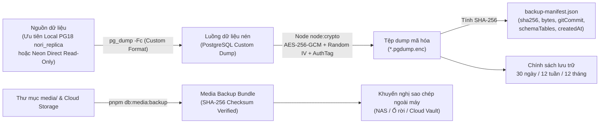

# CẨM NANG SAO LƯU & KHÔI PHỤC DỮ LIỆU (BACKUP & RESTORE) — NORI VEHICLE RENTAL

Tài liệu cung cấp hướng dẫn vận hành đồng thời cho **hai cơ chế sao lưu** của hệ thống NORI:
1. **Sao lưu PostgreSQL Tự động & Mã hóa AES-256-GCM** (dành cho hệ thống Production Neon / Local Replica `nori_replica` và đồng bộ Media).
2. **Sao lưu SQLite Nhất quán Giao dịch (`VACUUM INTO`)** (dành cho môi trường SQLite cục bộ `nori.db` và kiểm thử cô lập).

---

## PHẦN A — SAO LƯU & KHÔI PHỤC POSTGRESQL MÃ HÓA TỰ ĐỘNG

### A.1. Kiến trúc Gói Sao lưu Mã hóa (Encrypted Backup Pipeline)



#### Thông số kỹ thuật bảo mật & toàn vẹn:
- **Thuật toán mã hóa**: `AES-256-GCM` sử dụng thư viện chuẩn `node:crypto` tích hợp sẵn của Node.js (không phụ thuộc `gpg` hay `openssl` ngoài).
- **Khóa mã hóa (`NORI_BACKUP_ENCRYPTION_KEY`)**: Lưu cục bộ trong `.env` hoặc Windows DPAPI, **tuyệt đối không commit lên Git** và **không lưu chung cùng ổ/thư mục chứa tệp backup** khi mang đi lưu trữ ngoài máy.
- **Xác thực toàn vẹn**: Mỗi gói sao lưu đều sinh tệp `backup-manifest.json` chứa mã băm `SHA-256` của tệp đã mã hóa, dung lượng, git commit, danh sách bảng và trạng thái kiểm chứng `pg_restore --list`.
- **Chính sách lưu trữ phân tầng (`30d/12w/12m`)**:
  - **Daily (`daily/`)**: Giữ **30** bản sao lưu ngày gần nhất.
  - **Weekly (`weekly/`)**: Giữ **12** bản sao lưu tuần gần nhất (tự động thăng hạng bản Chủ nhật hoặc bản đầu tuần).
  - **Monthly (`monthly/`)**: Giữ **12** bản sao lưu tháng gần nhất.

---

### A.2. Lệnh CLI Vận hành PostgreSQL & Media Backup

| Lệnh CLI | Chức năng chi tiết |
| :--- | :--- |
| `pnpm db:backup` | Chạy `pg_dump` (ưu tiên từ `nori_replica` với `--source auto` để giảm tải Neon, hoặc `--source neon` / `--source replica`; tự fallback SQLite nếu chỉ định `--sqlite` hoặc chưa cấu hình Postgres), mã hóa AES-256-GCM, ghi `backup-manifest.json` và áp dụng dọn dẹp `30d/12w/12m`. |
| `pnpm db:backup:verify` | Giải mã thử gói backup mới nhất (hoặc chỉ định `--backup <dir>`), đối chiếu `SHA-256` cả bản mã hóa lẫn bản giải mã, kiểm tra auth tag AES-GCM, chạy `pg_restore --list` và hỗ trợ `--restore-test <targetUrl>` trên DB cô lập. |
| `pnpm db:restore` | Khôi phục gói backup mã hóa vào cơ sở dữ liệu đích (mặc định trỏ về `LOCAL_DEV_POSTGRES_URL` / `nori_development` hoặc `--target <url>`, yêu cầu `--confirm-production` nếu trỏ production để chống ghi đè nhầm), đồng thời **tự động reset toàn bộ 42+ sequence về `MAX(id)`**. |
| `pnpm db:media:backup` | Sao lưu tăng dần (incremental) kèm kiểm tra magic bytes & `SHA-256` toàn bộ tệp ảnh từ `media/` cục bộ (hỗ trợ `--verify`, `--restore --to <dir>`). |

> **Lưu ý an toàn**: Lệnh `pnpm db:restore` luôn yêu cầu xác định rõ database đích và thực hiện bước giải mã + xác minh `SHA-256` trước khi nạp dữ liệu. Khi chạy thử nghiệm, luôn trỏ về một database cô lập (ví dụ `nori_restore_verify`).

---

### A.3. Lịch Sao lưu Tự động Windows Task Scheduler (`23:59 Asia/Ho_Chi_Minh`)

NORI cung cấp bộ script PowerShell tại `scripts/windows/`:
- `scripts/windows/run-daily-backup.ps1`: Chạy nối tiếp `pnpm db:backup`, `pnpm db:backup:verify` và `pnpm db:media:backup`, ghi log xoay vòng (không ghi secret/URL chứa mật khẩu ra log).
- `scripts/windows/register-backup-task.ps1`: Đăng ký tác vụ tự động vào Windows Task Scheduler.

#### Cấu hình bắt buộc của Task Scheduler:
- **Thời điểm chạy**: Hàng ngày lúc **`23:59`** theo múi giờ **`Asia/Ho_Chi_Minh` (UTC+7)**.
- **Cơ chế Bù lịch khi máy ngủ/tắt (`StartWhenAvailable = $true`)**: Nếu máy tính tắt hoặc ở trạng thái Sleep vào lúc `23:59`, Windows Task Scheduler sẽ tự động kích hoạt chạy bù ngay khi máy được mở hoặc kết nối lại.
- **Tùy chọn nâng cao (nếu chạy với quyền Administrator)**: Có thể bật `WakeToRun` để đánh thức máy đang Sleep (khi cắm nguồn) hoặc chạy dưới ngữ cảnh không phụ thuộc phiên đăng nhập.

```powershell
# Đăng ký tác vụ sao lưu tự động lúc 23:59 hàng ngày
powershell -ExecutionPolicy Bypass -File scripts/windows/register-backup-task.ps1
```

---

### A.4. Khuyến nghị Sao lưu Ngoài máy (Off-Machine Copy — Quy tắc 3-2-1)

Lưu backup mã hóa trên cùng ổ cứng với `nori_replica` chỉ bảo vệ được khỏi lỗi xóa nhầm dữ liệu, **không bảo vệ được** khi hỏng ổ SSD, cháy nổ hoặc ransomware. Khuyến nghị:
1. **Bản 1**: Lưu tại thư mục backup cục bộ (`backups/pg/`).
2. **Bản 2 (Ngoài máy — Off-machine)**: Sao chép định kỳ hàng tuần các tệp `*.pgdump.enc` và `media` sang **ổ cứng gắn ngoài**, **NAS nội bộ** hoặc **Cloud Archive** (Google Drive / Backblaze B2 / S3 Bucket tách biệt).
3. **Tách biệt khóa**: Lưu bản dự phòng `NORI_BACKUP_ENCRYPTION_KEY` trong Password Manager (Bitwarden / 1Password) tách biệt hoàn toàn với nơi chứa file `.enc`.

---

## PHẦN B — SAO LƯU & KHÔI PHỤC SQLITE (`nori.db` — LOCAL & OFFLINE)

Phần này bảo toàn hoàn toàn quy trình sao lưu cho **SQLite (`nori.db`)** dùng trong phát triển offline, `migrate-db-safe.mjs` và kiểm thử cô lập.

### B.1. Cơ Chế Sao Lưu Nhất Quán Giao Dịch (`VACUUM INTO`)

Khác với việc sao chép file thông thường có thể gây hỏng cơ sở dữ liệu khi hệ thống đang ghi (do SQLite chạy ở chế độ WAL), NORI sử dụng cơ chế sao lưu an toàn:

1. **`VACUUM INTO`**: SQLite tạo ra một tệp cơ sở dữ liệu độc lập, sạch sẽ, hoàn toàn nhất quán về mặt giao dịch ngay cả khi các luồng khác đang đọc/ghi.
2. **Kiểm tra Toàn vẹn Tức thì (Integrity Check)**:
   - Tự động chạy `PRAGMA integrity_check` và `PRAGMA foreign_key_check` trên tệp sao lưu vừa tạo.
   - Tính toán mã băm SHA-256 (`dbSha256`) để chống giả mạo hoặc hư hại phần cứng.
3. **Đồng Bộ Tệp Hình Ảnh (`media/`)**:
   - Sao chép toàn bộ tệp hình ảnh tải lên vào thư mục sao lưu tương ứng.
4. **Tệp Manifest Xác Thực (`backup-manifest.json`)**:
   - Lưu trữ số lượng bản ghi các bảng, thời gian tạo, git commit SHA hiện tại và danh sách checksum của toàn bộ tệp ảnh.
5. **Tự Động Dọn Dẹp Bản Cũ (Retention Policy)**:
   - Script hỗ trợ cờ `--keep <số lượng>` (mặc định giữ lại 14 bản sao lưu gần nhất) để tránh làm đầy ổ cứng.

### B.2. Các Lệnh Sao Lưu SQLite (`pnpm backup` / `pnpm data:backup`)

```bash
# Tạo bản sao lưu SQLite đầy đủ (mặc định giữ lại 14 bản gần nhất)
pnpm backup

# Tạo bản sao lưu và tùy chỉnh số lượng lưu trữ (ví dụ giữ 30 bản)
pnpm backup --keep 30

# Lệnh tương đương qua module Data Sync
pnpm data:backup
```

#### Sao lưu qua Giao diện Quản trị:
1. Đăng nhập tài khoản `SUPER_ADMIN`.
2. Truy cập **Hệ thống** → **Đồng bộ & Sao lưu dữ liệu** (`/dashboard/system`).
3. Nhấn nút **Tạo Backup ngay**. Tiến trình sẽ tự động tạo gói sao lưu và ghi nhật ký vào `audit_logs`.

### B.3. Quy Trình Khôi Phục SQLite (`pnpm restore` / `pnpm data:restore`)

```bash
# Khôi phục SQLite từ bản sao lưu gần nhất trong thư mục backups/
pnpm restore

# Khôi phục từ một bản sao lưu chỉ định
pnpm restore --source backups/nori-backup-2026-11-27T18-31-03-358Z
```

**Các bước an toàn tự động được thực hiện**:
1. Xác minh mã băm SHA-256 và `PRAGMA integrity_check` của bản sao lưu nguồn. Nếu file sao lưu bị hỏng, lệnh dừng ngay lập tức.
2. Tự động tạo một bản sao lưu dự phòng khẩn cấp (`preRestoreBackupId`) của database hiện tại trước khi thực hiện ghi đè.
3. Đóng các kết nối đang mở và dọn dẹp các tệp tạm (`-wal`, `-shm`).
4. Ghi đè file `nori.db` và đồng bộ lại thư mục hình ảnh `media/`.
5. Kiểm tra tính toàn vẹn của database mới sau khi khôi phục (`PRAGMA integrity_check = ok`) và làm mới cache.

### B.4. Kiểm Thử Khôi Phục Định Kỳ (SQLite & PostgreSQL Drill)

Khuyến nghị thực hiện diễn tập khôi phục ít nhất **1 lần mỗi tháng** trên môi trường cô lập:
- **Với SQLite**:
  ```bash
  node scripts/data-restore.ts --source <path-to-backup> --target ./test-verify.db --media ./test-media
  ```
- **Với PostgreSQL**:
  ```powershell
  pnpm db:backup:verify --restore-test "<LOCAL_RESTORE_VERIFY_URL>"
  pnpm db:restore --backup backups/postgres/daily/<backup-dir> --target "<LOCAL_RESTORE_VERIFY_URL>"
  pnpm db:media:backup --verify
  ```
  Sau đó chạy truy vấn kiểm tra số lượng dòng trên các bảng trọng yếu (`bookings`, `vehicles`, `vehicle_models`, `payments`, `media`, `users`) và kiểm tra hiển thị ảnh.
