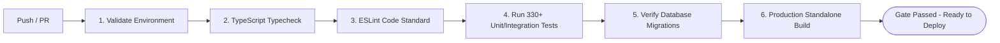

# NORI Vehicle Rental — Quy Trình CI/CD & Chiến Lược Cập Nhật Không Gián Đoạn

Tài liệu hướng dẫn quy trình Tích hợp Liên tục (CI) trên GitHub Actions và Triển khai Liên tục (CD) tự động cho Home Server hoặc VPS.

---

## 1. Chiến Lược Phân Nhánh Git (Git Branching Model)

Dự án áp dụng mô hình Git Flow rút gọn (Trunk-based with Feature Branches):

- **`main`**: Nhánh nguồn sự thật (Source of Truth) luôn ở trạng thái sẵn sàng cho Production. Mọi code trên nhánh `main` phải vượt qua toàn bộ các bài kiểm thử CI.
- **`feature/*`**: Các nhánh phát triển tính năng mới của từng thành viên.
- **`fix/*`**: Các nhánh sửa lỗi hoặc vá bảo mật.
- **`release/*`**: (Tùy chọn) Nhánh chuẩn bị đóng gói phiên bản lớn.

---

## 2. Đường Ống CI Trên GitHub Actions (`.github/workflows/ci.yml`)

Mỗi khi có commit được push lên `main` hoặc Pull Request được tạo, GitHub Actions tự động thực thi chuỗi kiểm định chất lượng:



- **Môi trường chạy**: `ubuntu-latest` với Node.js v20 và pnpm 10.
- **Bảo mật**: Không yêu cầu nạp secret thật; pipeline sử dụng `PAYLOAD_SECRET` kiểm thử độc lập.
- **Tiêu chuẩn vượt qua**: Nếu bất kỳ bước nào trong 6 bước trên thất bại, Pull Request sẽ bị chặn merge vào `main`.

---

## 3. Quy Trình Cập Nhật Lên Home Server (CD Playbook)

Khi có code mới được merge vào nhánh `main` trên GitHub, bạn không cần cài đặt các công cụ CD phức tạp hay mở cổng SSH ra Internet. Sử dụng trực tiếp script cập nhật 1-click đã tích hợp sẵn:

### Trên Windows Home Server:

Chạy script `update.ps1`:

```powershell
cd C:\NORI\app
.\deploy\windows\update.ps1
```

### Trên Linux Home Server:

Chạy script `update.sh`:

```bash
cd /opt/nori/app
sudo bash deploy/linux/update.sh
```

### Cơ Chế An Toàn 6 Bước Của Script Update:

1. **Tạo Hot Backup Tự Động**: Chạy `pnpm backup` trước khi chạm vào mã nguồn để bảo vệ 100% dữ liệu nếu có sự cố.
2. **Kéo Mã Nguồn Mới**: `git pull origin main`.
3. **Cập Nhật Dependencies**: `pnpm install --frozen-lockfile`.
4. **Áp Dụng Migrations Additive-Only**: `pnpm db:migrate:safe` tự động cập nhật các bảng mới nếu có.
5. **Build Lại Standalone**: `pnpm build` tạo các bundle tĩnh mới.
6. **Khởi Động Lại Dịch Vụ Mượt Mà**: Khởi động lại Windows Task / Systemd service với downtime chỉ vài giây.
