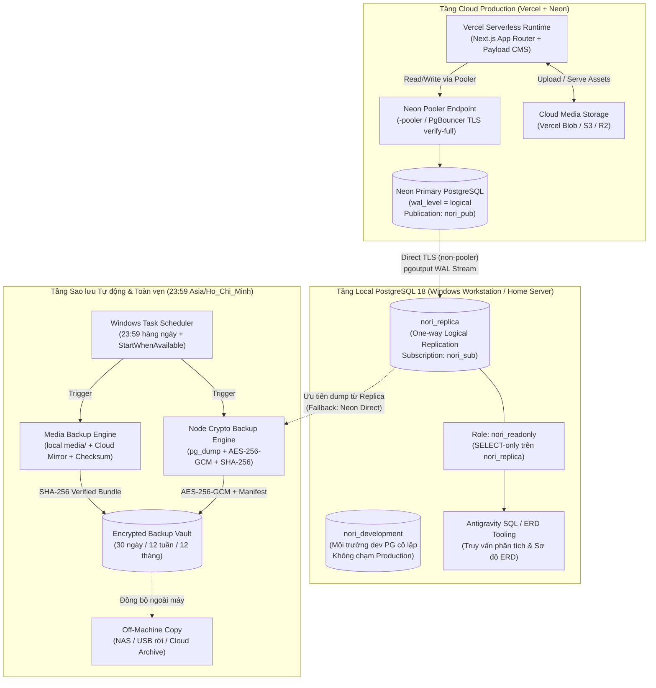
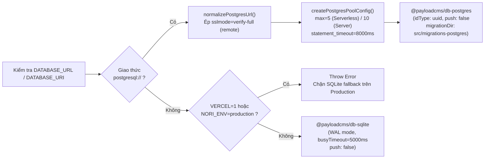

# KIẾN TRÚC CƠ SỞ DỮ LIỆU & SAO LƯU ĐA TẦNG — NORI VEHICLE RENTAL

> **Phạm vi tài liệu**: Kiến trúc cơ sở dữ liệu Before/After (Vercel Serverless → Neon PostgreSQL → Logical Replication → Local PostgreSQL 18 + Encrypted Daily Backup + Media Backup + Antigravity SQL/ERD Tooling), phạm vi `116+` bảng nghiệp vụ, kiểm kê Khóa chính (`PK`), Khóa ngoại (`FK`) và `42` Sequence tự tăng.  
> **Nguyên tắc bảo mật**: Tuyệt đối không lưu mật khẩu, chuỗi kết nối thật hay API key trong tài liệu. Toàn bộ thông số kết nối đọc qua biến môi trường (`.env` hoặc Vercel Environment Variables).

---

## 1. Bối cảnh & Chuyển đổi Kiến trúc (Before vs After)

### 1.1. Kiến trúc Trước đây (Before)

Trước khi mở rộng hệ thống sao lưu và đồng bộ Local PostgreSQL 18, NORI vận hành theo mô hình:

- **Development / Offline / Isolated Tests**: Dùng SQLite cục bộ (`nori.db`, chế độ WAL) với `sqliteAdapter` trong `src/payload.config.ts`.
- **Staging / Production**: Kết nối trực tiếp tới **Neon Serverless PostgreSQL** thông qua endpoint `-pooler` (`PgBouncer`, `DATABASE_URL`).
- **Hạn chế của mô hình cũ**:
  1. Không có bản sao dữ liệu PostgreSQL thời gian thực trên máy trạm/Home Server cục bộ để truy vấn phân tích (`read-only`) hoặc vẽ ERD mà không ảnh hưởng tới tài nguyên Compute của Neon.
  2. Chưa có cơ chế `pg_dump` tự động hàng ngày mã hóa AES-256-GCM kèm kiểm chứng `pg_restore` và chính sách lưu trữ phân tầng (`30d/12w/12m`).
  3. Phát triển cục bộ bằng PostgreSQL dễ xung đột nếu dùng chung DB hoặc làm trôi dữ liệu Neon.

### 1.2. Kiến trúc Mục tiêu (After)

---

## 2. Luồng Dữ liệu & Tách biệt Vai trò Cơ sở dữ liệu

### 2.1. Ba Cơ sở dữ liệu & Vai trò Tách biệt trên Local PostgreSQL 18

| Thành phần | Tên DB / Role | Mục đích sử dụng | Quyền ghi dữ liệu | Nguồn đồng bộ |
| :--- | :--- | :--- | :--- | :--- |
| **Neon Primary** | `neondb` (Neon Cloud) | Cơ sở dữ liệu chính thức phục vụ Vercel Production/Staging | Đọc & Ghi từ Vercel Serverless (`-pooler`) | Nguồn gốc (Single Source of Truth) |
| **Local Replica** | `nori_replica` | Bản sao chỉ đọc cập nhật liên tục qua Logical Replication | **Không ghi trực tiếp từ App/Dev** (chỉ nhận WAL stream từ `nori_sub`) | One-way Logical Replication từ Neon (`NEON_DIRECT_URL`) |
| **Local Development** | `nori_development` | Cơ sở dữ liệu PostgreSQL cô lập cho lập trình viên thử nghiệm migration & dữ liệu | Toàn quyền đọc/ghi cục bộ | Khởi tạo schema từ `src/migrations-postgres/` hoặc restore từ snapshot |
| **Read-Only Role** | `nori_readonly` | Tài khoản chuyên biệt cho Antigravity SQL Editor, BI & sinh ERD | **Chỉ `SELECT`** (`REVOKE INSERT/UPDATE/DELETE/DDL`) | Gắn quyền `USAGE` + `SELECT` trên schema `public` của `nori_replica` |
| **SQLite Fallback** | `nori.db` | Phát triển offline và kiểm thử tự động E2E cô lập (`run-e2e-isolated.mjs`) | Đọc/ghi cục bộ khi `DATABASE_URL` không trỏ tới `postgres:` | `data/snapshots/` và `src/migrations/` |

### 2.2. Luồng Vận hành Dual-Adapter (`src/payload.config.ts`)

- **Quy tắc chống `pushDevSchema`**: `push: false` được cố định cho cả `postgresAdapter` và `sqliteAdapter` trong `src/payload.config.ts` để Payload không bao giờ chèn marker `batch = -1` vào Neon trong môi trường Dev, Preview hoặc Production.
- **Bảo vệ Production**: Khi `VERCEL=1`, `VERCEL_ENV` có giá trị, `NORI_ENV=production`, `APP_ENV=production`, hoặc `NORI_REQUIRE_POSTGRES=1`, hệ thống từ chối khởi động nếu không có chuỗi kết nối PostgreSQL hợp lệ.

---

## 3. Phạm vi Schema PostgreSQL (`116+` Bảng Nghiệp vụ)

### 3.1. Lịch sử Migration Chính thức (`src/migrations-postgres/index.ts`)

Hệ thống PostgreSQL hiện quản lý schema qua các migration tăng dần (additive-only):

1. `20261121_105804_init_postgres` — Khởi tạo toàn bộ **109 bảng** nền tảng (từ Payload core, phương tiện, đa chi nhánh, thanh toán đến audit).
2. `20261121_120000_media_cloud_storage_columns` — Bổ sung cột hỗ trợ lưu trữ Cloud Storage (`cloudKey`, `cloudUrl`, `cloudProvider`...) cho `media`.
3. `20261122_010000_perf_composite_indexes` — Bổ sung các composite index tối ưu truy vấn đặt xe, lịch trống và đa chi nhánh.
4. `20261122_020000_parity_unique_constraints` — Đồng bộ các ràng buộc duy nhất (`UNIQUE`) tương đương SQLite (`rental_days(vehicle_id, date)`, v.v.).
5. `20261128_010000_ai_assistant_foundation` — Bổ sung **7 bảng** phục vụ NORI AI Assistant (`ai_usage_logs`, `ai_usage_logs_rels`, `ai_feedback`, `ai_feedback_rels`, `ai_settings`, `ai_settings_rels`, cùng bảng phiên bản/liên kết liên quan), nâng tổng số bảng lên **116 bảng**.
6. *(Mở rộng Smart Vehicle Import)* `20261128_020000_vehicle_import_jobs` — Bổ sung collection `vehicle_import_jobs` (`vehicle-import-jobs`) và các trường provenance/khóa trường (`lockedFields`, `importSourceUrl`, `sourceSha256`) trên `vehicle_models` và `media`.

### 3.2. Phân nhóm Thực thể & Kiểm kê Khóa chính / Khóa ngoại / Sequence

| Nhóm nghiệp vụ | Bảng chính tiêu biểu | Kiểu Khóa chính (`PK`) | Quan hệ Khóa ngoại (`FK`) cốt lõi | Ghi chú Replication |
| :--- | :--- | :--- | :--- | :--- |
| **Danh mục & Kho xe** | `vehicle_models`, `vehicles`, `maintenance_schedules` | `uuid` (cha), `varchar` (bảng con array) | `vehicles.model_id` → `vehicle_models.id`; `cover_id` → `media.id` | Có PK rõ ràng (`REPLICA IDENTITY DEFAULT`) |
| **Đơn thuê & Thanh toán** | `bookings`, `rental_days`, `payments`, `payment_events`, `refunds`, `promotions` | `uuid` (cha), `varchar` (lịch sử/array) | `bookings.user_id` → `users.id`; `bookings.vehicle_id` → `vehicles.id`; `rental_days.vehicle_id` → `vehicles.id`; `payments.booking_id` → `bookings.id` | `rental_days` bảo vệ chống double-booking qua `UNIQUE(vehicle_id, date)` |
| **Đa chi nhánh & Vận hành** | `branches`, `warehouses`, `service_locations`, `branch_staff`, `vehicle_transfers`, `vehicle_location_history`, `delivery_zones`, `delivery_jobs`, `location_pricing_rules`, `one_way_rental_rules` | `uuid` | Tham chiếu `branches.id`, `warehouses.id`, `vehicles.id`, `admins.id` | Đảm bảo toàn vẹn timeline điều chuyển xe |
| **Tài khoản & Bảo mật** | `admins`, `admins_sessions`, `users`, `users_sessions`, `audit_logs` | `uuid` / `varchar` (`_sessions`) | `audit_logs.actor_id` / `*_rels` | Chứa hash mật khẩu & nhật ký bất biến |
| **Nội dung, Media & AI** | `media`, `folders`, `tags`, `posts`, `nori_site`, `reviews`, `consultations`, `sales_inquiries`, `notifications`, `ai_settings`, `ai_usage_logs`, `ai_feedback` | `uuid` | Tham chiếu `media.id`, `users.id`, `vehicle_models.id` | `nori_site` & `ai_settings` là Payload Globals |
| **Import Catalogue** | `vehicle_import_jobs` | `uuid` | `target_model_id` → `vehicle_models.id` | Lưu job state machine & `rollback_snapshot` |
| **Quan hệ N-N (`*_rels`)** | `*_rels` (`39` bảng nền tảng + `3` bảng AI + mở rộng) | `serial` (`integer` tự tăng) | `parent_id`, `path`, tham chiếu bảng đích | **42+ `serial` sequences** cần reset `setval(MAX(id))` khi restore/failover |

> **Kiểm chứng sẵn sàng Logical Replication**:
> - **116/116 bảng** hiện hữu đều có `PRIMARY KEY` tường minh (`47` bảng UUID, `39` bảng `*_rels` dùng `serial`, `23` bảng con dùng `varchar` PK, `7` bảng `ai_*`), đủ điều kiện sử dụng `REPLICA IDENTITY DEFAULT` mà không cần `REPLICA IDENTITY FULL`.
> - **42+ Sequence tự tăng**: Logical Replication (`pgoutput`) không đồng bộ trạng thái bộ đếm sequence (`nextval`/`setval`). Mọi quy trình khôi phục (`db:restore`) hoặc chuyển đổi dự phòng đều phải thực thi bước đồng bộ lại sequence về `MAX(id)`.

---

## 4. Tài liệu liên quan

- [docs/DATABASE_REPLICATION.md](./DATABASE_REPLICATION.md) — Hướng dẫn cấu hình & vận hành Logical Replication Neon → Local PostgreSQL 18.
- [docs/BACKUP_RESTORE.md](./BACKUP_RESTORE.md) — Quy trình sao lưu mã hóa AES-256-GCM tự động và khôi phục dữ liệu SQLite / PostgreSQL.
- [docs/DISASTER_RECOVERY.md](./DISASTER_RECOVERY.md) — Kịch bản ứng phó sự cố (4 kịch bản DR), phân tích RPO/RTO và đề xuất Failover.
- [docs/MEDIA_STORAGE.md](./MEDIA_STORAGE.md) — Phân tách metadata cơ sở dữ liệu và lưu trữ tệp hình ảnh vật lý.
