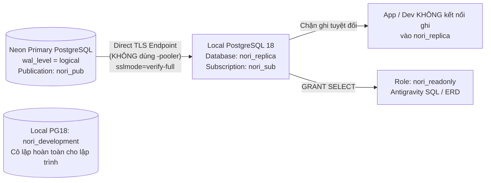

# HƯỚNG DẪN ĐỒNG BỘ LOGICAL REPLICATION (NEON → LOCAL POSTGRESQL 18) — NORI

> **Mục tiêu**: Thiết lập luồng sao chép logic một chiều (**One-way Logical Replication**) từ **Neon PostgreSQL (Publisher)** về **Local PostgreSQL 18 `nori_replica` (Subscriber)**, phục vụ sao lưu cục bộ, kiểm tra dữ liệu và truy vấn chỉ đọc (`nori_readonly`) qua Antigravity mà **không ghi ngược lên Neon**.

---

## 1. Kiến trúc Kết nối & Nguyên tắc An toàn



### Quy tắc bất biến:
1. **Một chiều tuyệt đối (One-way)**: Dữ liệu chỉ chảy từ **Neon → `nori_replica`**. Không thiết lập publication hai chiều, không chạy `INSERT/UPDATE/DELETE` từ ứng dụng vào `nori_replica`.
2. **Bắt buộc dùng Direct Endpoint (Non-Pooler)**: Chuỗi kết nối `DATABASE_URL` của ứng dụng thường trỏ tới Neon `-pooler` (PgBouncer). PgBouncer **không hỗ trợ** giao thức streaming replication của `CREATE SUBSCRIPTION`. Phải sử dụng `NEON_DIRECT_URL` (endpoint không có hậu tố `-pooler`) kèm `sslmode=verify-full`.
3. **Tách biệt môi trường Development**: Lập trình viên phát triển tính năng và thử nghiệm migration trên `nori_development` (hoặc `nori.db`), không dùng chung với `nori_replica`.

---

## 2. Yêu cầu Tiên quyết (Prerequisites)

1. **Local PostgreSQL 18** (ví dụ PostgreSQL 18.6 cài tại `C:\Program Files\PostgreSQL\18\bin`, dịch vụ `postgresql-x64-18` đang `Running` trên cổng `5432`).
2. **Biến môi trường cục bộ (chỉ lưu trong `.env` cục bộ, không commit lên Git)**:
   - `NEON_DIRECT_URL`: Chuỗi kết nối direct (non-pooler) tới Neon, có `sslmode=verify-full`.
   - `LOCAL_REPLICA_URL`: Chuỗi kết nối tới database `nori_replica` cục bộ.
   - `LOCAL_DEV_POSTGRES_URL`: Chuỗi kết nối tới database `nori_development` cục bộ.
   - `PG_BIN_DIR`: Đường dẫn tới thư mục chứa `psql.exe`, `pg_dump.exe`, `pg_restore.exe` (nếu chưa thêm vào `PATH`).
3. **Phiên bản Migration khớp nhau**: Toàn bộ các migration trong `src/migrations-postgres/` phải được áp dụng đồng bộ trên cả Neon và `nori_replica` trước khi kích hoạt subscription.

---

## 3. Quy trình Cấu hình từng bước

### Bước 1: Kích hoạt `wal_level = logical` và tạo `PUBLICATION` trên Neon

1. Trong **Neon Console → Project Settings → Compute / Parameters**, bật `wal_level = logical` (thao tác này sẽ khởi động lại compute của Neon trong vài giây).
2. Kết nối tới Neon bằng tài khoản quản trị qua **Direct Endpoint** và kiểm tra:
   ```sql
   SHOW wal_level;
   -- Kết quả bắt buộc: logical
   ```
3. Tạo Publication cho toàn bộ bảng nghiệp vụ:
   ```sql
   CREATE PUBLICATION nori_pub FOR ALL TABLES;
   ```
   *(Khuyến nghị kiểm tra lại bằng `SELECT * FROM pg_publication_tables WHERE pubname = 'nori_pub';`).*

### Bước 2: Khởi tạo Local Databases & Role Chỉ đọc trên PostgreSQL 18

Chạy script thiết lập cục bộ (hoặc thực thi tương đương qua `psql` với quyền `postgres`):

```powershell
# Khởi tạo nori_replica, nori_development và role nori_readonly
node scripts/pg-local-setup.mjs
```

Script hoặc thao tác SQL thủ công sẽ thực hiện:
1. Tạo database `nori_replica` và `nori_development`.
2. Tạo role `nori_readonly` (với mật khẩu mạnh lưu cục bộ, không commit):
   ```sql
   CREATE ROLE nori_readonly WITH LOGIN PASSWORD '<mat-khau-manh-cuc-bo>';
   GRANT CONNECT ON DATABASE nori_replica TO nori_readonly;
   \c nori_replica
   GRANT USAGE ON SCHEMA public TO nori_readonly;
   GRANT SELECT ON ALL TABLES IN SCHEMA public TO nori_readonly;
   ALTER DEFAULT PRIVILEGES IN SCHEMA public GRANT SELECT ON TABLES TO nori_readonly;
   REVOKE CREATE ON SCHEMA public FROM PUBLIC;
   ```
3. Áp dụng schema `src/migrations-postgres/` lên `nori_replica` và `nori_development` để đảm bảo **100% đồng nhất DDL**.

### Bước 3: Tạo `SUBSCRIPTION` trên `nori_replica`

Kết nối vào database `nori_replica` trên Local PG 18:

```sql
CREATE SUBSCRIPTION nori_sub
CONNECTION 'postgresql://<repl_user>:<repl_password>@<neon-direct-host>/neondb?sslmode=verify-full'
PUBLICATION nori_pub
WITH (
  copy_data = true,
  create_slot = true,
  enabled = true,
  streaming = on
);
```

- `copy_data = true`: Sao chép dữ liệu ban đầu của toàn bộ 116+ bảng từ Neon về máy cục bộ.
- `create_slot = true`: Tự động tạo replication slot `nori_sub` trên Neon để theo dõi vị trí WAL (LSN).

---

## 4. Ràng buộc Kỹ thuật: Replica Identity, DDL & Sequences

### 4.1. Replica Identity
- Toàn bộ **116+ bảng** trong schema PostgreSQL của NORI đều có `PRIMARY KEY` tường minh (`uuid`, `serial`, hoặc `varchar`).
- Nhờ vậy, cơ chế mặc định `REPLICA IDENTITY DEFAULT` hoạt động đầy đủ cho các lệnh `INSERT`, `UPDATE`, `DELETE` mà không gây phình WAL như `REPLICA IDENTITY FULL`.

### 4.2. Quy tắc Đồng bộ DDL (Schema Migrations)
PostgreSQL Logical Replication **không tự động sao chép lệnh DDL** (`CREATE TABLE`, `ALTER TABLE`, `DROP COLUMN`). Khi có migration mới trong `src/migrations-postgres/`:
1. **Áp dụng migration lên `nori_replica` trước** (hoặc tạm dừng subscription bằng `ALTER SUBSCRIPTION nori_sub DISABLE;`).
2. **Áp dụng migration tương ứng lên Neon**.
3. Nếu có bảng mới được thêm vào, cập nhật lại subscription để nhận diện bảng mới:
   ```sql
   ALTER SUBSCRIPTION nori_sub ENABLE;
   ALTER SUBSCRIPTION nori_sub REFRESH PUBLICATION;
   ```

### 4.3. Đồng bộ Sequence (`42+` Serial Sequences)
Logical replication (`pgoutput`) chỉ sao chép dữ liệu hàng, **không đồng bộ giá trị bộ đếm `nextval`/`setval`** của các bảng dùng `serial` (`*_rels`, `ai_*_rels`).
- Trên `nori_replica` (chỉ đọc), điều này không gây lỗi vận hành.
- **Bắt buộc**: Khi thực hiện restore hoặc chuẩn bị nâng cấp bản sao thành database ghi độc lập, phải chạy hàm reset toàn bộ sequence về `MAX(id)` của từng bảng.

---

## 5. Giám sát Replication, Auto-Reconnect & Xử lý Sự cố

### 5.1. Lệnh Kiểm tra Nhanh (CLI)

```powershell
# Xem trạng thái subscription, replication slot, lag (bytes/seconds) và trạng thái kết nối
pnpm db:sync:status

# Chỉ kiểm tra cục bộ (không gọi Neon) hoặc xem định dạng JSON
pnpm db:sync:status --local-only --json

# Kiểm tra đối chiếu toàn diện: schema parity, số dòng các bảng trọng yếu, quyền nori_readonly
pnpm db:sync:check

# In runbook khôi phục slot an toàn hoặc cập nhật publication / sequence cục bộ
pnpm db:sync:check --reinit-plan
pnpm db:sync:check --refresh --sync-sequences
```

### 5.2. Truy vấn Giám sát Chuyên sâu

Trên **Local `nori_replica`** (Subscriber):
```sql
SELECT subname, pid, received_lsn, latest_end_lsn, latest_end_time
FROM pg_stat_subscription;

SELECT srsubid, srrelid::regclass AS table_name, srsubstate, srsublsn
FROM pg_subscription_rel
WHERE srsubstate <> 'r'; -- 'r' = ready (đồng bộ hoàn tất)
```

Trên **Neon** (Publisher):
```sql
SELECT slot_name, plugin, slot_type, active, restart_lsn, confirmed_flush_lsn,
       pg_wal_lsn_diff(pg_current_wal_lsn(), confirmed_flush_lsn) AS lag_bytes
FROM pg_replication_slots
WHERE slot_name = 'nori_sub';
```

### 5.3. Cơ chế Auto-Reconnect khi Mất mạng hoặc Tắt máy
- PostgreSQL 18 tự động thử kết nối lại `nori_sub` theo chu kỳ `wal_retrieve_retry_interval` (mặc định `5s`) khi Internet hoặc Neon tạm gián đoạn.
- **Lưu ý dung lượng WAL trên Neon**: Khi máy cục bộ tắt nguồn hoặc mất mạng trong thời gian dài, replication slot `nori_sub` giữ lại WAL chưa gửi trên Neon. Cần theo dõi dung lượng WAL định kỳ qua `pnpm db:sync:status`. Nếu máy cục bộ nghỉ quá dài ngày và Neon cảnh báo đầy WAL, có thể tạm `DROP SUBSCRIPTION` / xóa slot trên Neon và khởi tạo lại khi cần.

### 5.4. Runbook Khôi phục khi Slot bị Vô hiệu hóa (Slot Invalidation / Re-Init)

Nếu gặp lỗi `replication slot "nori_sub" does not exist` hoặc slot bị invalidated do vượt ngưỡng giữ WAL:

1. **Kiểm tra nguyên nhân** trên Neon (`pg_replication_slots` xem `wal_status`).
2. **Xóa subscription cũ trên `nori_replica`**:
   ```sql
   ALTER SUBSCRIPTION nori_sub DISABLE;
   ALTER SUBSCRIPTION nori_sub SET (slot_name = NONE);
   DROP SUBSCRIPTION nori_sub;
   ```
3. **Dọn slot cũ trên Neon (nếu còn tồn tại)**:
   ```sql
   SELECT pg_drop_replication_slot('nori_sub');
   ```
4. **Đảm bảo Schema trùng khớp**: Chạy `pnpm db:sync:check` hoặc đối chiếu bảng `payload_migrations` giữa Neon và `nori_replica`.
5. **Làm sạch dữ liệu cũ trên `nori_replica` và khởi tạo lại Subscription**:
   - Truncate các bảng hoặc tái tạo database `nori_replica` sạch từ `src/migrations-postgres/`.
   - Tạo lại `CREATE SUBSCRIPTION nori_sub ... WITH (copy_data = true, create_slot = true, enabled = true);`.
6. **Xác nhận lại**: Chạy `pnpm db:sync:status` và `pnpm db:sync:check` tới khi mọi bảng ở trạng thái `ready` (`r`) và lag tiệm cận `0`.

---

## 6. Hướng dẫn Kết nối Antigravity SQL / ERD Tooling (`nori_readonly`)

Để xem dữ liệu thực tế hoặc dựng sơ đồ ERD trong IDE/Antigravity mà không bao giờ rủi ro sửa nhầm dữ liệu:

- **Host**: `127.0.0.1` (hoặc `localhost`)
- **Port**: `5432`
- **Database**: `nori_replica`
- **Username**: `nori_readonly`
- **Password**: Mật khẩu cục bộ của `nori_readonly` (lấy từ `.env` cá nhân hoặc `%APPDATA%\postgresql\pgpass.conf`, tuyệt đối không lưu vào repo).
- **SSL Mode**: `disable` hoặc `prefer` (chỉ áp dụng cho kết nối nội bộ `127.0.0.1`).
- **Kiểm tra an toàn**: Thử chạy `DELETE FROM bookings WHERE 1=0;` hoặc `INSERT INTO ...` phải nhận lỗi `ERROR: permission denied for table ...`.
