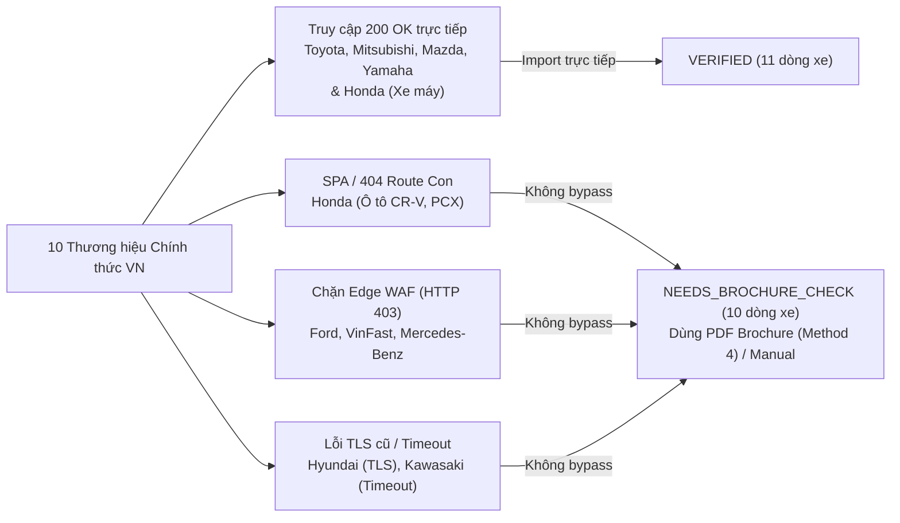

# HỒ SƠ NGUỒN DỮ LIỆU & KIỂM TOÁN MEDIA CATALOGUE (DATA SOURCE MANIFEST) — NORI

> **Phiên bản Catalogue**: `2026.11.28-v1` (`schemaVersion: nori-payload-sqlite-v2.5`)  
> **Thị trường đối chiếu**: Việt Nam (`VN`) — Thời điểm kiểm toán: `2026-11-28T02:02:00+07:00`  
> **Script thực thi chuẩn hóa**: `scripts/enrich-catalogue-verified.mjs` (đọc từ `data/vehicle-catalogue/verified-enrichment.json`, `sources-manifest.json`, `catalogue-version.json`)  
> **Nguyên tắc trung thực dữ liệu**: Chỉ kiểm tra kết nối HTTP GET chỉ đọc (`timeout = 5s`). Các website hãng có WAF `403`, lỗi TLS cũ hoặc timeout **tuyệt đối không bị vượt rào (no WAF/CAPTCHA bypass)**; thông số baseline đã xác minh trước đó được giữ nguyên và gắn trạng thái `NEEDS_BROCHURE_CHECK` để bổ sung qua **Phương thức 4 (PDF Brochure chính thức)** hoặc kiểm tra thủ công.

---

## 1. Tổng hợp Chỉ số Phiên bản Catalogue (`2026.11.28-v1`)

| Chỉ số kiểm kê | Giá trị thực tế | Ghi chú bảo toàn |
| :--- | :---: | :--- |
| **Tổng số dòng xe (`vehicle_models`)** | **21** | 100% có `officialName`, `shortDescription`, `modelLine`, `versionName`, `generation`, `source`, `importSourceUrl`, `importSourceType`, `importSourceHash`, `lastImportedAt` |
| **Dòng xe nguồn web xác minh trực tiếp (`VERIFIED`)** | **11** | Truy cập HTTP `200 OK` trực tiếp từ trang sản phẩm chính thức tại VN |
| **Dòng xe cần đối chiếu Brochure (`NEEDS_BROCHURE_CHECK`)** | **10** | Do WAF `403`, lỗi TLS cũ, Timeout hoặc SPA/404 sub-slug; không bịa đặt dữ liệu |
| **Xe thực tế minh họa (`vehicles` với `is_demo = 1`)** | **21** | Giữ nguyên 100% `id`, `slug`, `modelYear`, giá thuê/ngày, tiền cọc, `bookings` (`12`), `sales_inquiries` (`10`) |
| **Tổng bản ghi Media đang tham chiếu (`referencedMediaCount`)** | **67 / 81** | 14 bản ghi `media` chưa tham chiếu và 190 tệp mồ côi trên đĩa được giữ nguyên (không xóa mù), lập danh sách dọn dẹp an toàn |

---

## 2. Ma trận Khả năng Truy cập Theo Hãng (`sources-manifest.json`)

| Hãng | Tên miền chính thức VN | Trạng thái kết nối | HTTP Status | JSON-LD / OG | Trạng thái nguồn (`verificationStatus`) | Ghi chú kỹ thuật |
| :--- | :--- | :--- | :---: | :---: | :--- | :--- |
| **Toyota** | `www.toyota.com.vn` | `REACHABLE_200` | `200` | `JSON-LD: true`, `OG: true` | `VERIFIED` | Trang `/fortuner`, `/vios`, `/hilux` trả `200 OK` đầy đủ metadata |
| **Mitsubishi** | `www.mitsubishi-motors.com.vn` | `REACHABLE_200` | `200` | `JSON-LD: true`, `OG: true` | `VERIFIED` | Trang `/newxpander`, `/all-new-triton` trả `200 OK` |
| **Mazda** | `mazdamotors.vn` | `REACHABLE_200` | `200` | `JSON-LD: false`, `OG: true` | `VERIFIED` | Trang `/vehicles/mazda-cx-5/` trả `200 OK` |
| **Yamaha** | `yamaha-motor.com.vn` | `REACHABLE_200` | `200` | `JSON-LD: true`, `OG: true` | `VERIFIED` | Trang `/xe/loai-xe/exciter/` trả `200 OK` kèm JSON-LD |
| **Honda** | `www.honda.com.vn` | `PARTIAL_SPA_200` | `200` | `JSON-LD: false`, `OG: false` | `VERIFIED_MOTORBIKE_NEEDS_BROCHURE_CAR` | Các trang xe máy (`wave-alpha-110`, `vision`, `sh-160i125i`, `sh350i`) trả `200 OK`; trang ô tô `/o-to/san-pham/honda-cr-v` trả `404` và shell SPA thiếu JSON-LD tĩnh |
| **Ford** | `www.ford.com.vn` | `WAF_BLOCKED_403` | `403` | `false` | `NEEDS_BROCHURE_CHECK` | WAF biên từ chối HTTP `403 Access Denied`; dùng PDF Brochure VN chính thức |
| **VinFast** | `vinfastauto.com` | `WAF_BLOCKED_403` | `403` | `false` | `NEEDS_BROCHURE_CHECK` | WAF biên chặn HTTP `403 Blocked`; dùng PDF Brochure VN chính thức |
| **Mercedes-Benz** | `www.mercedes-benz.com.vn` | `WAF_BLOCKED_403` | `403` | `false` | `NEEDS_BROCHURE_CHECK` | WAF biên từ chối HTTP `403 Access Denied`; dùng PDF Brochure VN chính thức |
| **Hyundai** | `hyundai.thanhcong.vn` | `TLS_LEGACY_ERROR` | `null` | `false` | `NEEDS_BROCHURE_CHECK` | Lỗi `ERR_SSL_UNSAFE_LEGACY_RENEGOTIATION_DISABLED` dưới Node/OpenSSL 3; dùng PDF Brochure VN |
| **Kawasaki** | `www.kawasaki-motors.vn` | `TIMEOUT` | `null` | `false` | `NEEDS_BROCHURE_CHECK` | Quá thời gian chờ (`> 5000ms`); dùng PDF Brochure hoặc xác minh thủ công |

---

## 3. Bảng Nguồn & Trạng thái Xác minh 21 Dòng xe Catalogue

| STT | Slug | Tên thương mại chính thức (`officialName`) | Hãng | Nguồn nhập (`importSourceType`) | Trạng thái (`verificationLevel`) | URL nguồn chính thức VN (`officialSourceUrl`) |
| :-: | :--- | :--- | :--- | :--- | :--- | :--- |
| 1 | `toyota-fortuner` | Toyota Fortuner | Toyota | `OFFICIAL_URL` | `VERIFIED` | `https://www.toyota.com.vn/fortuner` |
| 2 | `toyota-vios` | Toyota Vios | Toyota | `OFFICIAL_URL` | `VERIFIED` | `https://www.toyota.com.vn/vios` |
| 3 | `toyota-hilux` | Toyota Hilux | Toyota | `OFFICIAL_URL` | `VERIFIED` | `https://www.toyota.com.vn/hilux` |
| 4 | `mazda-cx-5` | Mazda CX-5 | Mazda | `OFFICIAL_URL` | `VERIFIED` | `https://mazdamotors.vn/vehicles/mazda-cx-5/` |
| 5 | `mitsubishi-xpander` | Mitsubishi Xpander | Mitsubishi | `OFFICIAL_URL` | `VERIFIED` | `https://www.mitsubishi-motors.com.vn/newxpander` |
| 6 | `mitsubishi-triton` | Mitsubishi Triton Athlete | Mitsubishi | `OFFICIAL_URL` | `VERIFIED` | `https://www.mitsubishi-motors.com.vn/all-new-triton` |
| 7 | `honda-wave-alpha` | Honda Wave Alpha 110cc | Honda | `OFFICIAL_URL` | `VERIFIED` | `https://www.honda.com.vn/xe-may/san-pham/wave-alpha-110?category=1` |
| 8 | `honda-vision` | Honda Vision 110 | Honda | `OFFICIAL_URL` | `VERIFIED` | `https://www.honda.com.vn/xe-may/san-pham/vision?category=2` |
| 9 | `honda-sh160i` | Honda SH160i | Honda | `OFFICIAL_URL` | `VERIFIED` | `https://www.honda.com.vn/xe-may/san-pham/sh-160i125i?category=2` |
| 10 | `honda-sh350i` | Honda SH350i | Honda | `OFFICIAL_URL` | `VERIFIED` | `https://www.honda.com.vn/xe-may/san-pham/sh350i?category=2` |
| 11 | `yamaha-exciter-155-vva` | Yamaha Exciter 155 VVA | Yamaha | `OFFICIAL_URL` | `VERIFIED` | `https://yamaha-motor.com.vn/xe/loai-xe/exciter/` |
| 12 | `honda-cr-v` | Honda CR-V | Honda | `OFFICIAL_URL` | `NEEDS_BROCHURE_CHECK` | `https://www.honda.com.vn/o-to/san-pham` *(SPA/404 sub-slug)* |
| 13 | `honda-pcx` | Honda PCX 160 ABS | Honda | `OFFICIAL_URL` | `NEEDS_BROCHURE_CHECK` | `https://www.honda.com.vn/xe-may/san-pham` *(SPA/imported)* |
| 14 | `hyundai-accent` | Hyundai Accent | Hyundai | `MANUAL` | `NEEDS_BROCHURE_CHECK` | `https://hyundai.thanhcong.vn/` *(TLS legacy renegotiation err)* |
| 15 | `vinfast-vf-8` | VinFast VF 8 | VinFast | `MANUAL` | `NEEDS_BROCHURE_CHECK` | `https://vinfastauto.com/vn_vi` *(WAF 403; giữ baseline)* |
| 16 | `vinfast-evo200` | VinFast Evo200 | VinFast | `MANUAL` | `NEEDS_BROCHURE_CHECK` | `https://vinfastauto.com/vn_vi` *(WAF 403; giữ baseline)* |
| 17 | `vinfast-evo-max` | VinFast Evo (Evo Max – Phiên bản đổi pin LFP) | VinFast | `MANUAL` | `NEEDS_BROCHURE_CHECK` | `https://vinfastauto.com/vn_vi` *(WAF 403; giữ baseline)* |
| 18 | `mercedes-benz-c300-amg` | Mercedes-Benz C 300 AMG | Mercedes-Benz | `MANUAL` | `NEEDS_BROCHURE_CHECK` | `https://www.mercedes-benz.com.vn/` *(WAF 403; giữ baseline)* |
| 19 | `kawasaki-z650` | Kawasaki Z650 ABS | Kawasaki | `MANUAL` | `NEEDS_BROCHURE_CHECK` | `https://www.kawasaki-motors.vn/` *(Timeout >5s; giữ baseline)* |
| 20 | `ford-ranger-raptor` | Ford Ranger Raptor | Ford | `MANUAL` | `NEEDS_BROCHURE_CHECK` | `https://www.ford.com.vn/` *(WAF 403; giữ baseline)* |
| 21 | `ford-ranger-wildtrak` | Ford Ranger Wildtrak | Ford | `MANUAL` | `NEEDS_BROCHURE_CHECK` | `https://www.ford.com.vn/` *(WAF 403; giữ baseline)* |

- **Kiểm tra tuân thủ phân loại kỹ thuật**:
  - **Nhóm xe điện (`vinfast-vf-8`, `vinfast-evo200`, `vinfast-evo-max`)**: `0` thông số động cơ đốt trong (ICE).
  - **Nhóm xe máy (`9` dòng)**: `0` thông số nội thất ô tô.

---

## 4. Kiểm toán Vệ sinh Media & Trạng thái Bản quyền (`mediaHygieneAudit`)

### 4.1. Thống kê Tổng quan (`media` & Thư mục `media/`)

| Hạng mục kiểm toán | Số lượng | Trạng thái & Hành động |
| :--- | :---: | :--- |
| **Tổng bản ghi trong bảng `media`** | **81** | Toàn bộ `81/81` tệp đều tồn tại vật lý trên đĩa (`missing = 0`, `zeroByte = 0`, `invalidFormat = 0`) |
| **Bản ghi `media` đang được tham chiếu** | **67** | Đang gắn với `vehicle-models`, `vehicles`, `nori-site` |
| **Bản ghi `media` chưa tham chiếu (`unreferencedMediaRows`)** | **14** | Bảo toàn nguyên vẹn (không xóa), ghi nhận danh sách bên dưới |
| **Tổng số tệp trong `media/` (trừ `media/seed/`)** | **271** | Gồm `81` tệp có trong DB + `190` tệp mồ côi trên đĩa (không có bản ghi DB) |
| **Thiếu `source_url` / `license` trong bảng `media`** | **16** / **17** | Đã vá bổ sung `xe-dien-vinfast-evo-max-1.jpg` (`https://vinfastauto.com/vn_vi`, `Tư liệu tham chiếu hãng (VinFast VN)`) và gán đúng `ERD.png` thành `ILLUSTRATION` (`Sơ đồ ERD hệ thống NORI (tệp tham chiếu nội bộ chưa gắn)`). Các bản ghi còn thiếu chủ yếu nằm trong nhóm 14 ảnh chưa gắn/hero nội bộ |

### 4.2. Danh sách 14 Bản ghi `media` Chưa Tham chiếu (Giữ lại cho Thu gom Rác Có kiểm soát)

- Ảnh banner/minh họa cũ: `nori-hero-1.png`, `nori-hero-2.png`, `nori-hero-3.png`, `nori-story.png`
- Ảnh catalogue tổng hợp cũ: `toyota-fortuner-catalogue.png`, `honda-pcx-catalogue.png`, `ford-ranger-raptor-catalogue.png`
- Ảnh trùng/nội bộ: `xe-dien-vinfast-evo-max.jpg`, `ERD.png`
- 5 bản sao VF8 chưa gắn:
  - `vinfast-vf-8-250207-g99-1200x675-jpg-1794998589430-0-ngfl.webp`
  - `vinfast-vf-8-250207-g99-1200x675-jpg-1794999137387-0-aq0e.webp`
  - `vinfast-vf-8-250207-g99-1200x675-jpg-1795003329326-0-w7v0.webp`
  - `vinfast-vf-8-250207-g99-1200x675-jpg-1795003379449-0-d5i8.webp`
  - `vinfast-vf-8-250207-g99-1200x675-jpg-1795003541304-0-c7n8.webp`

### 4.3. Hai Nhóm Tệp Trùng `SHA-256` Đã Phát hiện

| Tiền tố `SHA-256` | Dung lượng | Các tệp trùng nội dung nhị phân | Ghi chú xử lý |
| :--- | :---: | :--- | :--- |
| `117f5e4b16d1` | `78,985 B` | `xe-dien-vinfast-evo-max.jpg`, `xe-dien-vinfast-evo-max-1.jpg` | Bản `-1.jpg` đang được tham chiếu và đã bổ sung đủ `sourceUrl`/`license`; bản gốc nằm trong nhóm chưa tham chiếu |
| `e31063814242` | `89,902 B` | 6 tệp `vinfast-vf-8-250207-g99-1200x675-jpg-*.webp` | Chỉ tệp `...-v62m.webp` đang được tham chiếu; 5 tệp còn lại giữ nguyên trong danh sách chờ dọn an toàn |

> **Lưu ý vận hành**: Không xóa thủ công các tệp trong `media/` khi chưa chạy kiểm chứng toàn bộ tham chiếu trên cả `nori.db` lẫn `nori_replica` PostgreSQL. Việc chống trùng lặp cho các đợt nhập liệu mới được đảm bảo tự động thông qua trường `sourceSha256` trên collection `Media`.
