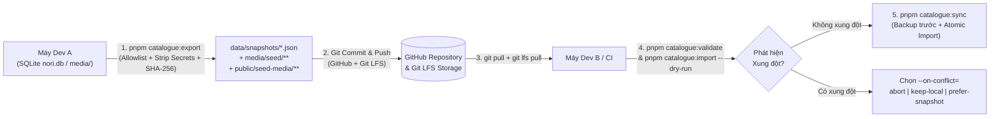

# ĐỒNG BỘ DỮ LIỆU ĐA LẬP TRÌNH VIÊN & LƯU TRỮ BỀN VỮNG (DATA SYNCHRONIZATION) — NORI

> **Phạm vi**: Kiến trúc đồng bộ Catalogue dùng chung giữa nhiều máy lập trình viên qua **GitHub + Git LFS**, bộ lệnh `pnpm catalogue:*` kế thừa từ `src/lib/data-sync.ts`, cơ chế ánh xạ định danh ổn định (`slug` / `recordHash`), xem trước xung đột (`dry-run`) & hoàn tác, hướng dẫn lưu trữ bền vững cho VPS/Production và danh sách loại trừ bảo mật GitHub.

---

## 1. Kiến trúc Đồng bộ Đa Lập trình viên (GitHub + Git LFS)

### Quy tắc theo dõi tệp trên GitHub (`.gitattributes` & `.gitignore`):
- **Theo dõi trực tiếp bằng Git Binary** (`*.png`, `*.jpg`, `*.jpeg`, `*.webp`, `*.ico` trong `public/seed-media/` và `media/seed/`): Đảm bảo **Vercel Build** và môi trường CI luôn nhận được đầy đủ tệp ảnh nhị phân thật mà không bị biến thành file con trỏ (pointer text) khi thiếu Git LFS hook.
- **Theo dõi qua Git LFS** (`.gitattributes`): Các tệp dung lượng lớn như `*.pdf` (brochure catalogue), `*.mp4`, `*.zip`, `*.db`, `*.sqlite*`, font chữ (`*.woff2`, `*.ttf`) và tài nguyên thiết kế (`*.psd`, `*.ai`).
- **Tệp dữ liệu Dev SQLite chuẩn hóa**: `dev-data/database/nori-dev.db` được phép theo dõi riêng làm ảnh chụp dev thống nhất, trong khi `./nori.db` runtime luôn bị bỏ qua trong `.gitignore`.

---

## 2. Bộ lệnh Catalogue CLI (`pnpm catalogue:*`) & Data Sync (`src/lib/data-sync.ts`)

Bộ lệnh `pnpm catalogue:*` được xây dựng như lớp bọc mỏng (thin wrapper) tái sử dụng trực tiếp lõi kiểm chứng, xuất/nhập và sao lưu nguyên tử của `src/lib/data-sync.ts`:

| Lệnh CLI | Chức năng | Ghi chú an toàn |
| :--- | :--- | :--- |
| `pnpm catalogue:status` | Báo cáo trạng thái đồng bộ giữa DB cục bộ và `data/snapshots/`, kèm thống kê độ phủ ảnh, thông số và trạng thái `verificationStatus` từng dòng xe | Chỉ đọc, an toàn tuyệt đối |
| `pnpm catalogue:validate` | Kiểm tra hợp lệ cấu trúc JSON, `schemaVersion`, toàn vẹn khóa ngoại giữa các snapshot và **quét chặn dữ liệu nhạy cảm (`FORBIDDEN_FIELD_NAMES`)** | Chặn build/sync nếu phát hiện mật khẩu, token, CCCD/GPLX |
| `pnpm catalogue:export` | Xuất dữ liệu công khai được phép chia sẻ (bao gồm `vehicle-models`, `vehicles` với `isDemo=true`, `site-settings`, `media-manifest`...) ra `data/snapshots/` | Tự động loại trừ `EXCLUDED_SENSITIVE_COLLECTIONS` |
| `pnpm catalogue:import -- --dry-run` | Chạy mô phỏng nhập snapshot để xem số lượng `toCreate`, `toUpdate`, `unchanged` và `conflicts` trước khi chạm DB | Không làm thay đổi dữ liệu thật |
| `pnpm catalogue:import` | Nhập snapshot vào DB trong giao dịch nguyên tử; hỗ trợ `--on-conflict=abort \| keep-local \| prefer-snapshot` | Luôn tự động tạo bản backup dự phòng trước khi ghi |
| `pnpm catalogue:sync` | Quy trình chuẩn 3 bước: `validate` → `import --dry-run` → `import` | Dùng ngay sau khi `git pull` |
| `pnpm catalogue:backup` | Tạo bản sao lưu đầy đủ trước khi thao tác catalogue lớn | Gọi tới `createFullBackup` |

*(Các lệnh `pnpm data:status`, `pnpm data:export`, `pnpm data:validate`, `pnpm data:import`, `pnpm data:sync`, `pnpm data:backup`, `pnpm data:restore` và `pnpm dev:sync:*` tiếp tục hoạt động song song với cùng lõi `data-sync.ts`).*

---

## 3. Định danh Ổn định, Hash Mapping & Giải quyết Xung đột

1. **Định danh ổn định (Stable Keys)**:
   - Không phụ thuộc ID tự tăng cục bộ hoặc UUID ngẫu nhiên khác nhau giữa các máy khi đối chiếu:
     - `vehicle-models` & `posts`: ghép theo `slug`.
     - `vehicles`: ghép theo `reference`.
     - `promotions`: ghép theo `code`.
     - `media`: ghép theo `stableKey` / `filename` + `SHA-256` (`checksum`).
2. **Băm nội dung (`recordHash`) & Baseline**:
   - Mỗi bản ghi snapshot có chữ ký `recordHash`. Trạng thái lần đồng bộ gần nhất được lưu ở `payload_kv` (`key = 'nori_data_sync_state'`) và `data/runtime/sync-state.json`.
3. **Phát hiện xung đột & Chiến lược xử lý**:
   - Nếu cả DB cục bộ lẫn Snapshot trên Git đều thay đổi cùng một bản ghi kể từ lần đồng bộ cơ sở, hệ thống báo `CONFLICT` (kèm danh sách trường xung đột và `mediaConflict`).
   - Mặc định `--on-conflict=abort` để bảo vệ thay đổi cục bộ; người dùng chủ động chọn `--on-conflict=keep-local` hoặc `--on-conflict=prefer-snapshot`.
   - **Rollback ngay lập tức**: Mọi lần `catalogue:import` đều tự động sinh bản backup trước khi chạy (`preImportBackupId`), có thể hoàn tác qua `pnpm restore --source <backup-id>`.

---

## 4. Lưu trữ Bền vững cho VPS / Self-Hosted & Vercel Production

- **Trên Vercel + Neon Production**:
  - Database sử dụng **Neon PostgreSQL** (`DATABASE_URL` có `sslmode=verify-full`), hoàn toàn tách biệt với vòng đời container/serverless stateless của Vercel.
  - Media sử dụng **Vercel Blob** (`BLOB_READ_WRITE_TOKEN`) hoặc **S3/R2** (`S3_BUCKET`, `S3_ACCESS_KEY_ID`, `S3_SECRET_ACCESS_KEY`) — bắt buộc khi `VERCEL=1` (`assertVercelBlobStorageReady()`).
- **Trên VPS / Home Server (Linux Ubuntu / Windows)**:
  - Thiết lập biến `DATA_DIR`, `MEDIA_DIR`, `BACKUP_DIR` trỏ ra thư mục bền vững **nằm ngoài thư mục mã nguồn Git** (ví dụ `/var/lib/nori/data` trên Linux hoặc `C:\NORI\data` trên Windows) để khi chạy `git pull`, rebuild `.next/standalone` hoặc khởi động lại PM2/Docker, dữ liệu vận hành và ảnh upload không bao giờ bị xóa mất.

---

## 5. Danh sách Loại trừ Bảo mật GitHub (Strict Exclusions)

Dữ liệu nhạy cảm **tuyệt đối không bao giờ được commit** lên GitHub hoặc lọt vào `data/snapshots/`:

| Nhóm bị chặn tuyệt đối | Ví dụ cụ thể | Cơ chế bảo vệ tại NORI |
| :--- | :--- | :--- |
| **Biến môi trường & Bí mật** | `.env`, `.env.local`, `PAYLOAD_SECRET`, `OPENAI_API_KEY`, `BLOB_READ_WRITE_TOKEN`, `NORI_BACKUP_ENCRYPTION_KEY`, `DATABASE_URL`, `NEON_DIRECT_URL` | `.gitignore` chặn `.env*` (trừ `.env.example`); `SENSITIVE_VALUE_PATTERNS` quét chặn khi export/validate |
| **Chứng chỉ & Khóa mạng** | `tunnel-credentials.json`, `*.pem`, `cert.pem`, `.cloudflared/` | `.gitignore` chặn tuyệt đối |
| **Tài khoản & Dữ liệu cá nhân (PII)** | `admins`, `users`, `password`/`hash`/`salt`, `sessions`, `driverLicenseNumber`, `idCardNumber`, `customerPhone`, `deliveryAddress`, `pickupAddress` | `EXCLUDED_SENSITIVE_COLLECTIONS` & `FORBIDDEN_FIELD_NAMES` trong `src/lib/data-sync.ts` |
| **Giao dịch & Vận hành thực tế** | `bookings`, `rental-days`, `payments`, `payment-events`, `refunds`, `audit-logs`, `branch-staff`, `vehicle-transfers`, `delivery-jobs`, `ai-usage-logs`, `ai-feedback` | Bị chặn hoàn toàn khỏi cơ chế Snapshot |
| **Bản sao lưu & Runtime** | `backups/`, `/data/backups/`, `/data/runtime/`, `/media/*` (trừ `/media/seed/`) | Bị chặn trong `.gitignore` |
