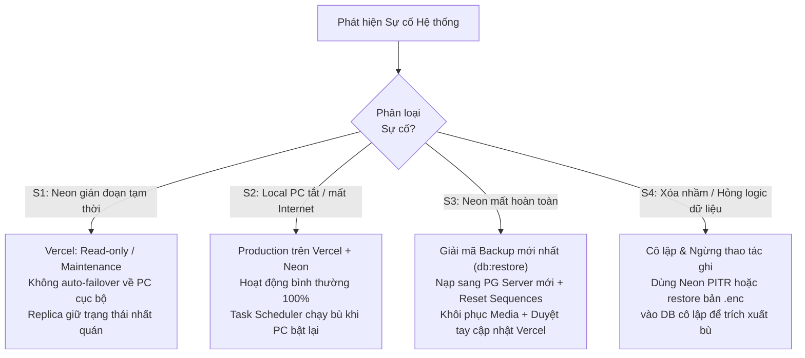

# KẾ HOẠCH PHỤC HỒI SAU THẢM HỌA (DISASTER RECOVERY & FAILOVER) — NORI

> **Mục tiêu**: Thiết lập quy trình ứng phó rõ ràng cho **4 kịch bản sự cố thực tế**, định nghĩa chỉ tiêu **RPO / RTO**, và nguyên tắc **Failover có kiểm soát** bảo vệ tuyệt đối dữ liệu sản xuất (Production) trên Vercel + Neon PostgreSQL.

---

## 1. Chỉ tiêu Phục hồi (RPO & RTO)

| Chỉ số | Định nghĩa | Giá trị mục tiêu theo tầng | Cơ sở đạt được |
| :--- | :--- | :--- | :--- |
| **RPO** *(Recovery Point Objective — Lượng dữ liệu mất tối đa chấp nhận được)* | Khoảng thời gian tối đa từ giao dịch cuối cùng đến điểm khôi phục | - **Neon PITR (Cloud)**: ~vài giây – vài phút (tùy gói Neon Branch Restore)<br>- **Local Replica (`nori_replica`)**: **< 1 phút** khi máy bật & có mạng<br>- **Encrypted Daily Backup (`23:59`)**: **≤ 24 giờ** (trường hợp mất cả Neon lẫn Replica) | Logical Replication streaming liên tục + `pg_dump` mã hóa AES-256-GCM lúc `23:59 Asia/Ho_Chi_Minh` |
| **RTO** *(Recovery Time Objective — Thời gian khôi phục dịch vụ)* | Thời gian từ lúc phát hiện sự cố đến khi hệ thống phục vụ lại | - **Neon gián đoạn tạm thời**: Tự phục hồi ngay khi Neon online<br>- **Local PC mất mạng/tắt máy**: **0 phút** cho Production (chỉ cần sync lại sau)<br>- **Neon mất hoàn toàn & dựng DB mới**: **30 – 90 phút** (tùy dung lượng Media & duyệt tay Vercel) | Script tự động `db:restore` (kèm reset sequence) + `db:media:backup` + chuyển `DATABASE_URL` có kiểm soát |

---

## 2. Sơ đồ Phân tách Kịch bản Ứng phó



---

## 3. Chi tiết 4 Kịch bản Phục hồi (DR Runbooks)

### Kịch bản 1 (S1): Neon Tạm thời Gián đoạn (Temporary Outage)

- **Triệu chứng**: Vercel log lỗi kết nối tới Neon (`ECONNRESET`, `ETIMEDOUT`, hoặc sự cố vùng AWS `ap-southeast-1`). `pnpm db:sync:status` báo `nori_sub` mất kết nối tới publisher.
- **Tác động**: Ứng dụng web không thể ghi đơn đặt xe/thanh toán mới. Dữ liệu đã đồng bộ về `nori_replica` vẫn còn nguyên vẹn để tra cứu nội bộ (`nori_readonly`).
- **Quy trình xử lý**:
  1. **Không** trỏ Vercel Production về máy tính cá nhân cục bộ (xem Mục 4 về nguyên tắc chống Split-Brain).
  2. Kiểm tra trạng thái trên [Neon Status](https://neonstatus.com/) và bảng điều khiển Neon Console.
  3. Nếu cần tra cứu lịch trình giao nhận xe cho khách hàng đang thuê, kết nối bằng `nori_readonly` vào `nori_replica` trên máy cục bộ.
  4. Khi Neon hoạt động trở lại, PostgreSQL 18 tự động nối lại `nori_sub`. Chạy `pnpm db:sync:status` và `pnpm db:sync:check` để xác nhận lag về `0`.

---

### Kịch bản 2 (S2): Máy tính Cục bộ Tắt nguồn hoặc Mất Internet

- **Triệu chứng**: Máy Windows cá nhân/Home Server bị tắt điện, ngủ (Sleep) qua `23:59`, hoặc rớt mạng gia đình.
- **Tác động**:
  - **Vercel Production + Neon**: Hoạt động **100% bình thường**, khách hàng không bị gián đoạn.
  - **Rủi ro tiềm ẩn**: Replication slot `nori_sub` trên Neon tạm giữ các tệp WAL chưa gửi. Nếu máy cục bộ offline nhiều ngày liên tiếp, dung lượng WAL trên Neon có thể tăng lên.
- **Quy trình xử lý**:
  1. Khi máy tính bật lại và có Internet, Windows Task Scheduler với cờ **`StartWhenAvailable`** sẽ tự động kích hoạt chạy bù backup nếu bỏ lỡ lịch `23:59`.
  2. PostgreSQL 18 tự động kéo phần WAL còn thiếu về `nori_replica`.
  3. Kiểm tra xác nhận:
     ```powershell
     pnpm db:sync:status
     pnpm db:backup:verify
     ```
  4. **Trường hợp mất mạng quá dài ngày (ví dụ > 3-7 ngày)** và Neon cảnh báo dung lượng WAL:
     - Chạy `pnpm db:backup --source neon` để đảm bảo có bản dump mới nhất trực tiếp từ Neon.
     - Thực hiện quy trình Re-init slot tại [docs/DATABASE_REPLICATION.md](./DATABASE_REPLICATION.md#54-runbook-kh%C3%B4i-ph%E1%BB%A5c-khi-slot-b%E1%BB%8B-v%C3%B4-hi%E1%BB%87u-h%C3%B3a-slot-invalidation--re-init).

---

### Kịch bản 3 (S3): Mất hoàn toàn Neon / Lỗi Hỏng Cụm Cloud (Total Loss)

- **Triệu chứng**: Project hoặc branch Neon bị xóa nhầm, hỏng dữ liệu nghiêm trọng không thể dùng PITR trên Neon.
- **Quy trình khôi phục từng bước (Full Recovery)**:
  1. **Xác minh bản sao lưu tốt nhất**:
     - Chọn bản backup mã hóa mới nhất (hoặc kiểm tra cả bản trên Off-machine Copy).
     - Chạy `pnpm db:backup:verify --backup <path-to-backup-dir>` để chắc chắn file giải mã thành công, khớp `SHA-256` và `pg_restore --list` hợp lệ.
  2. **Chuẩn bị PostgreSQL Server mới** (một Project Neon mới hoặc máy chủ Managed Postgres có chứng chỉ TLS hợp lệ và endpoint pooler).
  3. **Khôi phục cơ sở dữ liệu & Reset Sequences**:
     ```powershell
     pnpm db:restore --backup <path-to-backup-dir> --target "<NEW_PG_DIRECT_URL>" --confirm-production
     ```
     - Lệnh tự động khôi phục cấu trúc + dữ liệu toàn bộ `116+` bảng và **reset toàn bộ 42+ sequence (`*_rels_id_seq`, `ai_*_rels_id_seq`, ...)** về `MAX(id)`.
     - Nếu thiếu bất kỳ dữ liệu phút chót nào mới phát sinh trên `nori_replica` mà chưa kịp chạy lịch `23:59`, thực hiện dump trực tiếp từ `nori_replica` thay cho file `.enc` ngày hôm trước.
  4. **Khôi phục Media**:
     - Đối chiếu và đồng bộ lại tệp ảnh từ gói `pnpm db:media:backup` lên Vercel Blob / S3 bucket mới (hoặc chạy `pnpm media:migrate:cloud`).
  5. **Phê duyệt & Chuyển đổi Thủ công trên Vercel (Manual Cutover Approval)**:
     - Chỉ sau khi kỹ sư trưởng/Admin xác nhận kiểm tra thành công số dòng và ảnh hiển thị trên môi trường Staging/Preview, cập nhật `DATABASE_URL` (và `BLOB_READ_WRITE_TOKEN` nếu đổi store) trên **Vercel Project Settings**, rồi **Redeploy** Production.
  6. **Thiết lập lại Replication**: Tạo lại `PUBLICATION nori_pub` trên server mới và trỏ lại `nori_sub` trên `nori_replica`.

---

### Kịch bản 4 (S4): Xóa nhầm Dữ liệu hoặc Lỗi Logic Nghiệp vụ (Accidental Deletion / Bad Write)

- **Triệu chứng**: Quản trị viên xóa nhầm dòng xe, cập nhật sai hàng loạt giá/trạng thái, hoặc một bug code làm sai lệch dữ liệu đơn thuê/thanh toán.
- **Quy trình xử lý (PITR & Isolated Restore)**:
  1. **Cô lập tức thì**:
     - Nếu lỗi do một đợt Smart Vehicle Import vừa thực hiện: sử dụng ngay nút **Rollback (`POST /nori-api/dashboard/catalogue-import/jobs/[id]/rollback`)** từ `rollbackSnapshot` (nhanh nhất, < 5 giây, không downtime).
     - Nếu lỗi diện rộng trên nhiều bảng nghiệp vụ (`bookings`, `payments`, `vehicles`): tạm khóa thao tác ghi hoặc bật chế độ bảo trì.
  2. **Khôi phục Điểm thời gian (PITR)**:
     - **Phương án 1 (Nhanh nhất trên Neon)**: Dùng **Neon Time Travel / Point-in-Time Restore (Branch Restore)** để tạo một branch phụ tại đúng thời điểm `T - 1 phút` trước khi sự cố xảy ra.
     - **Phương án 2 (Từ Backup mã hóa cục bộ)**: Giải mã và khôi phục bản backup gần nhất vào database cô lập trên Local PG18 (`nori_restore_verify`):
       ```powershell
       pnpm db:restore --backup <path-to-backup-dir> --target "<LOCAL_RESTORE_VERIFY_URL>"
       ```
  3. **Đối chiếu & Vá bù có chọn lọc**:
     - So sánh dữ liệu giữa DB cô lập (`nori_restore_verify` hoặc Neon PITR branch) với DB hiện tại.
     - Xuất chính xác các bản ghi bị mất/sai và khôi phục có chọn lọc, tránh ghi đè ngược làm mất các đơn thuê hợp lệ phát sinh sau thời điểm sự cố.
  4. **Kiểm chứng & Ghi Audit**: Xác minh toàn vẹn khóa ngoại, số dư thanh toán, làm mới Next.js cache và ghi nhận biên bản sự cố.

---

## 4. Đề xuất Kiến trúc Failover (Tách biệt & Chống Split-Brain)

### Tại sao KHÔNG BAO GIỜ tự động chuyển lưu lượng Vercel Production về máy PC cá nhân?

1. **Rủi ro Split-Brain (Phân tách dữ liệu)**: `nori_replica` là bản sao một chiều. Nếu Vercel tự động ghi đơn thuê mới vào máy PC cục bộ trong khi Neon phục hồi lại sau vài phút, dữ liệu hai bên sẽ lệch nhau không thể gộp tự động mà không mất/trùng đơn hoặc trùng lịch `rental_days`.
2. **Độ trễ & Đường truyền dân dụng**: IP động, cúp điện, khởi động lại Windows Update và băng thông upload gia đình không đáp ứng SLA cho Vercel Serverless Edge/Functions.
3. **Sequence & Replication Conflict**: `nori_replica` có các bộ đếm sequence chưa reset và subscription đang gắn vào publisher cũ.

### Kiến trúc Failover Đề xuất cho Production Thực tế:
- **Failover có kiểm soát (Manual Approval Gate)**:
  - **Cấp độ 1 (Tức thời)**: Bật **Multi-AZ / Read-Replica hoặc Neon PITR Branch** trên cùng nền tảng Cloud Managed PostgreSQL; chuyển hướng sau khi kiểm tra kết nối TLS.
  - **Cấp độ 2 (Chuyển nhà cung cấp Cloud)**: Chuẩn bị sẵn kịch bản khởi tạo **Managed PostgreSQL dự phòng** (ví dụ Supabase / Neon Region khác / AWS RDS) và khôi phục từ Encrypted Backup + Media Backup theo Kịch bản 3, chỉ đổi `DATABASE_URL` trên Vercel sau khi có xác nhận thủ công từ người vận hành.
  - **Vai trò của Local `nori_replica`**: Là **Kho dữ liệu Dự phòng Nóng (Warm Standby Data Vault)** và nguồn cấp bản dump sạch hàng ngày để giảm tải cho Production, không đóng vai trò máy chủ chịu tải trực tiếp cho Internet công cộng.
