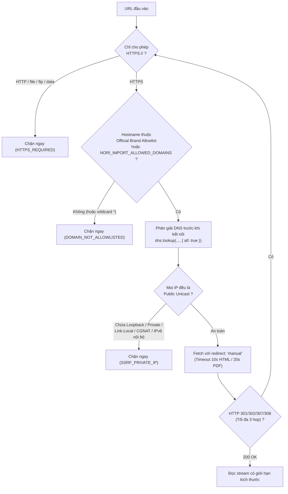

# BẢO MẬT SMART VEHICLE IMPORT & KIỂM SOÁT CHI PHÍ (IMPORT SECURITY) — NORI

> **Phạm vi**: Cơ chế phòng thủ theo chiều sâu (**Defense-in-Depth**) cho pipeline Smart Vehicle Import (`src/lib/vehicle-import/security.ts`, `fetcher.ts`, `media-processor.ts`, `ai-search.ts` và `/nori-api/dashboard/catalogue-import/*`), bao gồm chống **SSRF**, giới hạn tệp/MIME/magic-byte/kích thước ảnh, chống **HTML/XSS** & **Prompt Injection**, **RBAC + CSRF Origin**, **Audit Logging** và kiểm soát chi phí API bên ngoài.

---

## 1. Phòng chống SSRF (Server-Side Request Forgery) Theo Chiều sâu

Mọi URL do người dùng hoặc AI đề xuất trước khi `fetcher.ts` kết nối đều phải đi qua kiểm định nghiêm ngặt trong `security.ts`:

### Danh sách dải địa chỉ & tên miền bị chặn tuyệt đối:
- **Giao thức**: Chỉ chấp nhận `https:`. Từ chối `http:`, `file:`, `ftp:`, `gopher:`, `javascript:`, `data:`.
- **Tên miền nội bộ**: Chặn `localhost`, `*.localhost`, `*.local`, `*.internal`, `*.localdomain`.
- **IPv4 bị chặn**:
  - Loopback: `127.0.0.0/8`
  - Private (RFC 1918): `10.0.0.0/8`, `172.16.0.0/12`, `192.168.0.0/16`
  - Link-local & Cloud Metadata (AWS/GCP/Azure): `169.254.0.0/16`
  - CGNAT: `100.64.0.0/10`
  - Unspecified / Multicast / Broadcast: `0.0.0.0/8`, `224.0.0.0/4`, `240.0.0.0/4`
- **IPv6 bị chặn**: Loopback (`::1`), Unspecified (`::`), ULA (`fc00::/7`), Link-local (`fe80::/10`), và địa chỉ ánh xạ IPv4 (`::ffff:<ipv4>` thuộc dải nội bộ).
- **Chống DNS Rebinding & Redirect Bypass**:
  - Không dùng `redirect: 'follow'` mặc định của `fetch`. Bắt buộc đặt `redirect: 'manual'`, giới hạn tối đa **3 lần chuyển hướng**, và **tái kiểm tra toàn bộ quy tắc HTTPS + Allowlist + DNS/IP** cho mỗi URL `Location` mới.
- **Allowlist tên miền hãng**: Mặc định chỉ mở cho tên miền chính thức của 10 hãng xe VN (`toyota.com.vn`, `honda.com.vn`, `ford.com.vn`, `mitsubishi-motors.com.vn`, `mazdamotors.vn`, `hyundai.thanhcong.vn`, `mercedes-benz.com.vn`, `vinfastauto.com`, `yamaha-motor.com.vn`, `kawasakivietnam.vn`) cùng các tên miền được khai báo tường minh trong `NORI_IMPORT_ALLOWED_DOMAINS` (tuyệt đối cấm ký tự đại diện `*`).

---

## 2. Giới hạn Tệp, Kiểm tra Magic Bytes & Giới hạn Điểm ảnh

Kế thừa chuẩn bảo mật từ `src/app/(frontend)/nori-api/dashboard/media/route.ts`:

| Loại tài nguyên | Giới hạn dung lượng tối đa | Kiểm tra chữ ký nhị phân (Magic Bytes) | Kiểm tra bổ sung |
| :--- | :---: | :--- | :--- |
| **Trang HTML hãng** | **5 MB** | `Content-Type` HTML/XHTML | Loại bỏ toàn bộ `<script>`, `<style>`, trình xử lý sự kiện |
| **Tài liệu PDF Brochure** | **25 MB** | Header bắt buộc `%PDF-` (`25 50 44 46 2D`) | Chỉ trích xuất luồng văn bản an toàn, không thực thi JS nhúng trong PDF |
| **Hình ảnh tải về** | **8 MB** / ảnh | Chỉ chấp nhận: - JPEG (`FF D8 FF`) - PNG (`89 50 4E 47 0D 0A 1A 0A`) - WebP (`RIFF....WEBP`) - AVIF (`....ftypavif` / `avis` / `mif1`) | - **Chặn SVG** (ngăn Stored XSS) - Quét mẫu độc hại `<?php`, `<script`, `<!doctype html`, `<svg` ở đầu & cuối buffer - Kiểm tra kích thước tối đa **`12,000 × 12,000 px`** qua `sharp` (chống Image Bomb / Decompression Bomb) - Chuẩn hóa tên tệp ASCII an toàn |

---

## 3. Phòng chống HTML/XSS & Indirect Prompt Injection

1. **Làm sạch HTML & Đầu ra (Anti-XSS)**:
   - Mọi văn bản bóc tách từ HTML, OpenGraph, JSON-LD, PDF hoặc CSV đều được giải mã thực thể HTML an toàn và **tước bỏ toàn bộ thẻ HTML (`stripTags`)** trước khi đưa vào `normalizedDraft` và UI Preview.
   - Tuyệt đối không dùng `dangerouslySetInnerHTML` (được kiểm soát tĩnh bởi `scripts/static-lint.mjs`).
2. **Chống Indirect Prompt Injection (khi dùng AI Smart Search / Trích xuất hỗ trợ bởi LLM)**:
   - Toàn bộ dữ liệu thu thập từ trang web ngoài hoặc PDF được bọc trong ranh giới phân tách dữ liệu không tin cậy (tương đồng chuẩn `<untrusted_cms_data>` của `src/lib/ai/guardrails.ts`).
   - System prompt quy định cứng LLM chỉ đóng vai trò **bộ trích xuất cấu trúc JSON theo schema**, bỏ qua mọi chỉ thị dạng *"Ignore previous instructions..."* nằm trong HTML/PDF nguồn, và không bao giờ tiết lộ biến môi trường hay cấu hình hệ thống.
   - Bắt buộc kiểm chứng schema đầu ra bằng runtime validator trước khi tạo `diffPreview`.

---

## 4. Phân quyền RBAC, Chống CSRF (`assertOrigin`) & Audit Logging

- **Kiểm tra Origin trên mọi API ghi (`assertOrigin`)**: Toàn bộ endpoint `POST` và `PATCH` dưới `/nori-api/dashboard/catalogue-import/*` bắt buộc gọi `assertOrigin(request)` ngay đầu handler (trả `403 FORBIDDEN` nếu thiếu hoặc sai `Origin`, được xác minh tự động bởi `scripts/static-lint.mjs`).
- **Phân quyền RBAC chặt chẽ (`requireAdmin`)**:
  - Nhân sự quản trị có quyền tương ứng trên phân hệ `models` (`requireAdmin({ permission: ['models', 'read' | 'create' | 'update'] })`) mới được đọc danh sách job, tạo preview hoặc phê duyệt/hoàn tác/khóa trường.
  - Mọi truy vấn Payload Local API đều truyền `user` và **`overrideAccess: false`**.
- **Nhật ký kiểm toán bất biến (`audit_logs`)**:
  - Mọi thao tác phê duyệt (`vehicle-model.import_create` / `vehicle-model.import_update`), hoàn tác (`vehicle-model.import_rollback`), và thay đổi khóa trường (`vehicle-model.lock_fields`) đều ghi vào `audit_logs` thông qua `recordAudit()`, kèm `actorId`, thời gian, `jobCode`, và tóm tắt diff (không ghi bí mật hay dữ liệu nhạy cảm).

---

## 5. Kiểm soát Chi phí API Ngoài & Tài nguyên Hệ thống

- **Giới hạn đồng thời (Concurrency Cap)**: Tối đa **3 import job chạy song song** (`MAX_CONCURRENT_IMPORT_JOBS = 3`, vượt ngưỡng trả `429 CONCURRENCY_LIMIT_REACHED`) để tránh quá tải bộ nhớ `sharp` / CPU hoặc băng thông khi nhập hàng loạt.
- **Rate Limiting theo Admin (`assertRateLimit`)**: Giới hạn số lượng yêu cầu Preview / AI Search theo phút và theo ngày trên từng tài khoản quản trị.
- **Giới hạn Timeout & Retry có chặn trên**:
  - Timeout `10 giây` cho tải HTML/ảnh, `20 giây` cho PDF lớn.
  - Số lần retry tối đa bị giới hạn (`attemptCount`), không tự động lặp vô tận khi gặp `403` WAF hoặc `429 Too Many Requests`.
- **Cô lập chi phí AI (`AI_SEARCH` — Gemini Free Tier)**:
  - Sử dụng cùng ngân sách $0 và giới hạn token server-side (`NORI_AI_FREE_TIER_ONLY=true`, `NORI_AI_PAID_PROVIDERS_ALLOWED=false`, `GEMINI_API_KEY` chỉ đọc ở server, `NORI_AI_MAX_OUTPUT_TOKENS=1024`, không bật Google Search/Maps Grounding).
  - Trong bộ kiểm thử tự động (`tests/`), tuyệt đối dùng fixture cục bộ hoặc mock provider (`NORI_AI_TEST_MOCK=1`), không phát sinh chi phí gọi mạng/AI thật.
