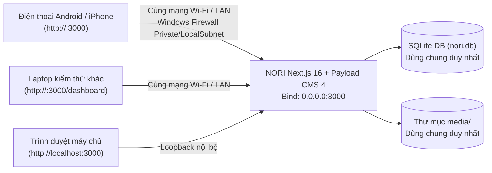

# HƯỚNG DẪN CẤU HÌNH & VẬN HÀNH LOCAL NETWORK SERVER (LAN) — NORI VEHICLE RENTAL

Tài liệu này hướng dẫn đội ngũ phát triển và kiểm thử NORI khởi chạy **Local Network Server (LAN Development)** để truy cập, kiểm thử đa thiết bị (Android, iPhone, iPad/Tablet, Laptop khác) trên cùng mạng Wi-Fi/LAN nội bộ mà **không công khai server ra Internet** và **không làm yếu cơ chế bảo mật Production**.

---

## 1. Kiến trúc LAN Server



### Nguyên tắc vận hành cốt lõi

- **Bind địa chỉ `0.0.0.0` (chế độ `pnpm dev:lan`)**: Tiếp nhận đồng thời kết nối từ `http://localhost:3000` và `http://<LAN_IPv4>:3000`.
- **Một Backend & Một SQLite DB duy nhất**: Mọi thiết bị (điện thoại, tablet, laptop) cùng đọc/ghi vào một cơ sở dữ liệu (`nori.db`) trên máy chủ phát triển.
- **Không hardcode IP máy cá nhân vào source code dùng chung**: Tệp [scripts/lan-network.mjs](../scripts/lan-network.mjs) tự động quét các card mạng vật lý (`os.networkInterfaces()`), ưu tiên Wi-Fi/Ethernet đang dùng RFC1918 (`192.168.x.x`, `10.x.x.x`, `172.16–31.x.x`) và loại bỏ loopback, APIPA (`169.254.x.x`) và adapter ảo (WSL, Hyper-V, VMware, VirtualBox, Docker, VPN).
- **Bảo vệ HMR & Server Actions chỉ trong chế độ Dev**: Trong [next.config.ts](../next.config.ts), `allowedDevOrigins` và danh sách dev của `experimental.serverActions.allowedOrigins` chỉ mở cho các IPv4 LAN vật lý cục bộ khi `NODE_ENV !== 'production'`. Bản build production và cấu hình `FIGMA_PUBLIC_URL` hoàn toàn không bị thay đổi.
- **Tương đối hóa toàn bộ Browser API & Media URL**: Client gọi API tương đối (`/nori-api/...`) thông qua [src/lib/client-api.ts](../src/lib/client-api.ts), hình ảnh đi qua đường dẫn tương đối + [figma-image-loader.ts](../figma-image-loader.ts), không ép `localhost` trong response trả về trình duyệt.

---

## 2. Cách xác định địa chỉ IPv4 & Khởi chạy NORI qua LAN

### 2.1. Khởi chạy tự động (Khuyên dùng)

```bash
pnpm dev:lan
```

Launcher [scripts/start-lan.mjs](../scripts/start-lan.mjs) sẽ:

1. Kiểm tra an toàn xem cổng `3000` đã có tiến trình giữ chưa (không tự ý kill tiến trình đang chạy).
2. Tự động nhận diện IPv4 Wi-Fi/Ethernet đang hoạt động (trên các thành viên khác nhau sẽ tự ra IP riêng của máy đó).
3. Hiển thị đầy đủ URL truy cập thực tế trên terminal:
   - `http://localhost:3000`
   - `http://<LAN_IP>:3000`
   - `http://<LAN_IP>:3000/login`
   - `http://<LAN_IP>:3000/dashboard`
   - `http://<LAN_IP>:3000/admin`

### 2.2. Chỉ định IP thủ công hoặc đổi Port (khi cần)

```bash
# Khi máy có nhiều card mạng (vừa cắm LAN vừa bật Wi-Fi) và cần ép đúng IP:
pnpm dev:lan -- --ip 192.168.1.7

# Hoặc chạy trên port khác nếu port 3000 đang có server khác sử dụng:
pnpm dev:lan -- --port 3001

# Hoặc qua biến môi trường (trong .env cá nhân, không commit):
# NORI_LAN_IP=192.168.1.7
```

### 2.3. Kiểm tra IPv4 thủ công trên Windows / macOS / Linux

- **Windows PowerShell**:
  ```powershell
  Get-NetIPAddress -AddressFamily IPv4 | Where-Object { $_.AddressState -eq 'Preferred' } | Format-Table InterfaceAlias,IPAddress,PrefixLength
  ```
- **Windows CMD**: `ipconfig` (tìm mục `Wireless LAN adapter Wi-Fi` → `IPv4 Address`).
- **macOS / Linux**: `ipconfig getifaddr en0` hoặc `hostname -I`.

---

## 3. Cấu hình Windows Firewall an toàn (Bắt buộc chạy bằng Administrator)

### 3.1. Phân định cơ chế bảo mật giữa `pnpm dev` và `pnpm dev:lan`

Để bảo đảm an toàn tuyệt đối cho nhà phát triển ngay cả khi Windows Defender Firewall đang bị tắt trên máy cá nhân:

- **`pnpm dev` (`scripts/start-dev.mjs`)**: Mặc định **chỉ lắng nghe loopback `127.0.0.1:3000`** trên máy cục bộ (chỉ bind `0.0.0.0` khi chạy trong môi trường Figma Make sboxd với `FIGMA=1`). Mọi thiết bị khác trong LAN hoặc qua Internet/IPv6 hoàn toàn bị từ chối kết nối (`Connection Refused`).
- **`pnpm dev:lan` (`scripts/start-lan.mjs`)**: Lắng nghe `0.0.0.0:3000` để phục vụ kiểm thử đa thiết bị qua Wi-Fi/LAN. Cần được bảo vệ bằng Windows Firewall Rule hạn chế theo Profile `Private` và Subnet nội bộ (`LocalSubnet`).

> [!WARNING]
> Khi khởi chạy `pnpm dev:lan` với server lắng nghe `0.0.0.0:3000` (hoặc wildcard IPv6 `:::3000`), nếu Windows Defender Firewall đang ở trạng thái `Enabled = False` trên máy tính, cổng 3000 có nguy cơ bị quét hoặc kết nối từ các máy tính khác trong cùng mạng hoặc qua IPv6. Do đó, khuyến nghị bật lại Firewall đầy đủ trước khi kích hoạt `pnpm dev:lan`.

### 3.2. Kiểm tra trạng thái mạng & Windows Defender Firewall hiện tại

Mở PowerShell (quyền người dùng thông thường hoặc Administrator):

```powershell
# 1. Xem Network Profile của Wi-Fi hiện tại (Private hay Public)
Get-NetConnectionProfile | Select-Object Name, InterfaceAlias, NetworkCategory

# 2. Xem trạng thái 3 profile của Windows Defender Firewall (Domain, Private, Public)
Get-NetFirewallProfile | Select-Object Name, Enabled, DefaultInboundAction

# 3. Kiểm tra đã có rule cho NORI port 3000 chưa
Get-NetFirewallRule -DisplayName "NORI LAN Port 3000" -ErrorAction SilentlyContinue
```

### 3.3. Hướng dẫn bật lại Firewall an toàn (Khi Firewall đang bị tắt)

Nếu kết quả ở bước trên hiển thị `Enabled = False` trên các profile, chạy **PowerShell với quyền Administrator** để kích hoạt lại tường lửa:

```powershell
# Bật lại Windows Defender Firewall trên cả 3 profile an toàn
Set-NetFirewallProfile -Profile Domain,Private,Public -Enabled True

# Xác nhận lại trạng thái Enabled = True
Get-NetFirewallProfile | Select-Object Name, Enabled, DefaultInboundAction
```

### 3.4. Chuyển Wi-Fi sang Private & Mở Inbound Rule hạn chế (`LocalSubnet`)

> [!IMPORTANT]
> Chỉ thực hiện chuyển mạng sang `Private` nếu bạn đang kết nối vào mạng Wi-Fi **gia đình / công ty đáng tin cậy** của mình. Tuyệt đối không chuyển sang `Private` khi đang dùng Wi-Fi công cộng (quán cà phê, sân bay, khách sạn).

Mở **PowerShell với quyền Administrator**:

```powershell
# 1. Chuyển card Wi-Fi tin cậy sang Private (thay "Wi-Fi" bằng InterfaceAlias thực tế nếu khác):
Set-NetConnectionProfile -InterfaceAlias "Wi-Fi" -NetworkCategory Private

# 2. Tạo Inbound Rule NORI LAN Port 3000 (chỉ áp dụng cho Profile Private và dải IP LocalSubnet):
if (-not (Get-NetFirewallRule -DisplayName "NORI LAN Port 3000" -ErrorAction SilentlyContinue)) {
  New-NetFirewallRule `
    -DisplayName "NORI LAN Port 3000" `
    -Direction Inbound `
    -Action Allow `
    -Protocol TCP `
    -LocalPort 3000 `
    -Profile Private `
    -RemoteAddress LocalSubnet `
    -Description "Cho phep thiet bi cung mang LAN/Wi-Fi Private truy cap NORI Dev Server cong 3000"
  Write-Host "Da tao thanh cong Inbound Rule 'NORI LAN Port 3000'." -ForegroundColor Green
} else {
  Write-Host "Rule 'NORI LAN Port 3000' da ton tai tren he thong." -ForegroundColor Yellow
}
```

### 3.5. Thu hồi Firewall Rule khi hoàn tất kiểm thử

Khi không còn nhu cầu kiểm thử đa thiết bị qua mạng nội bộ, mở **PowerShell Administrator** để thu hồi rule:

```powershell
Remove-NetFirewallRule -DisplayName "NORI LAN Port 3000" -ErrorAction SilentlyContinue
Write-Host "Da thu hoi thanh cong Rule 'NORI LAN Port 3000'." -ForegroundColor Green
```

---

## 4. Truy cập từ Điện thoại Android, iPhone & Laptop khác

1. Đảm bảo điện thoại/tablet/laptop và máy tính chạy server kết nối **cùng một mạng Wi-Fi** (không dùng 4G/5G và không dùng Wi-Fi Khách/Guest).
2. Mở trình duyệt trên điện thoại (Chrome trên Android, Safari trên iPhone) và nhập đúng địa chỉ `Network:` hiển thị ở terminal (ví dụ `http://192.168.1.7:3000`).
3. Các đường dẫn kiểm thử chính:
   - Trang chủ & Tìm kiếm: `http://<LAN_IP>:3000`
   - Danh mục xe: `http://<LAN_IP>:3000/vehicles`
   - Đăng nhập / Đăng ký khách hàng: `http://<LAN_IP>:3000/login` · `/register`
   - NORI Admin Dashboard: `http://<LAN_IP>:3000/dashboard`
   - Payload CMS: `http://<LAN_IP>:3000/admin`

---

## 5. Xử lý khi IP thay đổi & Cách dừng Server an toàn

### 5.1. Khi DHCP cấp lại IP hoặc đổi sang mạng Wi-Fi khác

- IPv4 cục bộ không cố định vĩnh viễn nếu router cấp qua DHCP.
- Khi IP thay đổi, chỉ cần nhấn `Ctrl+C` để dừng `pnpm dev:lan` và chạy lại `pnpm dev:lan`.
- Script tự động nhận diện IP mới và tự cập nhật `allowedDevOrigins` / `serverActions.allowedOrigins` theo tiến trình mới. Không cần đổi code hay mở lại Firewall Rule (vì Rule lọc theo `-LocalPort 3000` và `-RemoteAddress LocalSubnet`).

### 5.2. Dừng Server & Giải phóng cổng 3000

- Tại cửa sổ terminal đang chạy `pnpm dev:lan`: nhấn `Ctrl+C` (xác nhận `Y` nếu Windows CMD hỏi).
- Nếu lỡ đóng cửa sổ khiến tiến trình Node còn giữ cổng 3000, xem PID qua `pnpm dev:lan` (cảnh báo xung đột cổng sẽ in sẵn PID) hoặc PowerShell:
  ```powershell
  Get-NetTCPConnection -LocalPort 3000 -State Listen | Select-Object LocalAddress, LocalPort, OwningProcess
  # Chỉ dừng khi đã xác nhận đúng là tiến trình node.exe của NORI:
  Stop-Process -Id <PID>
  ```

---

## 6. Bảo vệ Database, Backup & Kiểm thử Cô lập LAN

- **Luôn backup trước khi test ghi dữ liệu nhiều thiết bị**:
  ```bash
  pnpm db:backup
  ```
- **Chạy E2E tự động qua LAN IP trên bản sao DB & Media cô lập (không chạm `nori.db` gốc)**:
  ```bash
  pnpm build
  pnpm test:e2e:lan
  ```
- Lưu ý: Sau khi kiểm thử thủ công trên `pnpm dev:lan` (sử dụng `nori.db`), nên kiểm tra và xóa các tài khoản/đơn test nếu không muốn giữ lại, hoặc khôi phục từ bản backup bằng `pnpm db:restore`. Tuyệt đối không commit `nori.db`, `.env`, hoặc thư mục `backups/` lên Git.

---

## 7. Xử lý Sự cố Phổ biến (Troubleshooting)

### 7.1. Lỗi Đăng nhập / Mất phiên khi bấm Checkout (`"Vui lòng đăng nhập để đặt xe"`)

- **Cookie tách biệt theo hostname**: Phiên đăng nhập tại `http://localhost:3000` **không** tự động dùng chung với `http://192.168.1.7:3000` (đặc tính bảo mật Same-Origin/Host của trình duyệt — KHÔNG ép `Domain` lỏng lẻo). Trên điện thoại phải đăng nhập trực tiếp tại `http://192.168.1.7:3000/login`.
- **Cookie trên HTTP LAN**: Hàm `resolveRequestCookieConfig()` trong [src/lib/session-cookie.ts](../src/lib/session-cookie.ts) tự động suy luận theo giao thức thực tế của từng request: trên `http://<LAN_IP>:3000` đặt `HttpOnly; SameSite=Lax; Path=/` (không bật `Secure` vì đang là HTTP thường). Trình duyệt vẫn giữ cookie bình thường miễn không truy cập bằng chế độ ẩn danh đóng tab ngay hoặc chặn cookie toàn phần.
- **Lỗi CSRF (`403 Nguồn yêu cầu không hợp lệ`)**: Kiểm tra `Host` và `Origin` của tab điện thoại phải khớp chính xác `http://<LAN_IP>:3000`. Nếu vừa đổi IP Wi-Fi mà chưa restart `pnpm dev:lan`, hãy khởi động lại server.

### 7.2. Lỗi Không tải được Hình ảnh hoặc Fast Refresh (`/_next/*`) bị `403`

- Đảm bảo khởi chạy bằng **`pnpm dev:lan`** (hoặc truyền `--ip <IP>` nếu bạn có nhiều card mạng/VPN). Nếu chạy `pnpm dev` mặc định (không bind `0.0.0.0` khi cần và thiếu `NORI_LAN_IP` nếu dùng IP tùy biến), điện thoại sẽ không kết nối được hoặc HMR bị chặn `403`.
- Mọi ảnh CMS dùng đường dẫn tương đối `/api/media/file/...`. Nếu bất kỳ ảnh nào bị hỏng trên đĩa, chạy `pnpm media:audit` để kiểm tra.

### 7.3. AP Isolation, Guest Wi-Fi & VPN chặn kết nối nội bộ

- **AP Isolation / Client Isolation**: Nhiều Wi-Fi ký túc xá, quán cà phê, trường học hoặc Wi-Fi Khách (**Guest Wi-Fi**) bật cô lập giữa các thiết bị (`ping <LAN_IP>` từ điện thoại báo `Request timed out`). Khắc phục: chuyển sang Wi-Fi chính (mạng gia đình/văn phòng) hoặc phát Mobile Hotspot từ điện thoại cho laptop bắt rồi kiểm tra lại IP qua `pnpm dev:lan`.
- **VPN (Cloudflare WARP / 1.1.1.1, Tailscale, WireGuard, NordVPN)**: Bật VPN trên máy chủ hoặc điện thoại có thể bẻ luồng local subnet ra tunnel. Hãy tắt VPN trên cả hai thiết bị trong lúc test LAN, hoặc dùng `pnpm dev:lan -- --ip <IP_Wi-Fi>` nếu chỉ cần lọc đúng interface Wi-Fi.

### 7.4. Giới hạn của HTTP LAN đối với PWA & Giải pháp Local HTTPS Tùy chọn

- Theo chuẩn W3C/Browser Security, `http://<LAN_IP>:3000` (khác `http://localhost`) bị trình duyệt đánh dấu là **`isSecureContext === false`** (Non-Secure Context).
- Hệ quả khi test bằng **HTTP LAN**:
  - Website Responsive, Mobile-First, Auth/Cookie, Đặt xe, Admin Dashboard, Payload CMS, Ảnh và API hoạt động bình thường.
  - **Không** thể nghiệm thu đầy đủ: Service Worker (`/sw.js`), Offline Mode (`/offline` qua cache SW), Push Notification, Web Share API, Geolocation API, và nút Cài đặt PWA tự động (`beforeinstallprompt`).
- **Nếu cần kiểm thử đầy đủ PWA qua LAN trên điện thoại thật** (giải pháp Local HTTPS riêng biệt — KHÔNG tắt cờ bảo mật trình duyệt):
  1. Cài `mkcert` trên máy chủ phát triển (`mkcert -install`) và tạo cặp chứng chỉ riêng cho IP LAN (`mkcert 192.168.1.7 localhost`).
  2. Chạy reverse proxy TLS nội bộ (ví dụ Caddy hoặc Nginx cục bộ) trỏ `https://192.168.1.7:3443` → `http://127.0.0.1:3000` (giữ nguyên header `X-Forwarded-Proto: https` và `Host`, khi đó `assertOrigin` và `resolveRequestCookieConfig` tự động bật `Secure` cookie đúng chuẩn).
  3. Cài đặt chứng chỉ Root CA cục bộ (`mkcert -CAROOT`) một cách chủ động vào Settings trên thiết bị kiểm thử nội bộ (và gỡ bỏ khi hoàn tất kiểm thử). Không được đặt tùy chọn bỏ qua lỗi SSL hoặc disable web security trong trình duyệt.

---

## 8. Checklist Kiểm thử Thực tế Trên Thiết bị Vật lý

Vì các thiết bị vật lý nằm ngoài môi trường tự động trên máy phát triển, người dùng tự thực hiện các bước xác nhận sau khi khởi chạy `pnpm dev:lan`:

- [ ] **Android (Chrome)**: Mở `http://<LAN_IP>:3000` → cuộn trang chủ, kiểm tra Hero Carousel & ảnh xe → đăng ký/đăng nhập tại `/login` → chọn ngày tại `/vehicles/toyota-fortuner` → qua `/checkout`, reload trang (xác nhận không mất phiên) → đặt đơn thành công.
- [ ] **iPhone (Safari iOS)**: Mở `http://<LAN_IP>:3000` → kiểm tra không tự phóng to màn hình khi chạm ô input (font `>= 16px`), kiểm tra Bottom Nav tránh vạch Home (`safe-area-inset-bottom`), kiểm tra lịch chọn ngày và checkout đồng bộ sang máy chủ.
- [ ] **Đồng bộ đa thiết bị (Điện thoại + Laptop Admin)**: Đặt đơn trên điện thoại → mở `http://localhost:3000/dashboard` (hoặc `http://<LAN_IP>:3000/dashboard` trên laptop thứ 2) → xác nhận đơn `CONFIRMED` → refresh điện thoại thấy trạng thái đã duyệt + popup thông báo.
- [ ] **Hot Reload**: Sửa một đoạn text nhỏ trong chế độ `pnpm dev:lan` → kiểm tra giao diện trên điện thoại cập nhật mà không cần chạy `pnpm build`.
