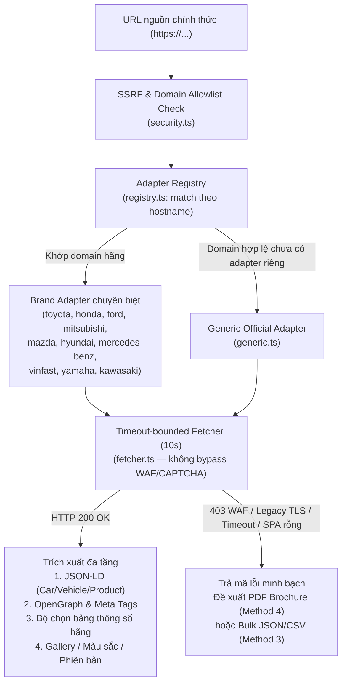

# KIẾN TRÚC ADAPTER HÃNG XE (MANUFACTURER ADAPTERS) — NORI

> **Phạm vi**: Kiến trúc module `src/lib/vehicle-import/adapters/` hỗ trợ **10 thương hiệu ô tô/xe máy chính thức tại Việt Nam** cùng **Generic Adapter**, kết quả khảo sát khả năng truy cập thực tế (Reachability Matrix), cơ chế fallback minh bạch khi gặp WAF/TLS/Timeout, và hướng dẫn mở rộng khi thêm hãng mới hoặc khi website hãng thay đổi giao diện.

---

## 1. Kiến trúc Adapter Pattern (`src/lib/vehicle-import/adapters/`)

### Nguyên tắc thiết kế:
- **Không tự động vượt rào bảo mật**: Khi gặp HTTP `403` (WAF/Bot Protection), CAPTCHA, lỗi bắt tay TLS cũ (`ERR_SSL_UNSAFE_LEGACY_RENEGOTIATION_DISABLED`) hoặc Timeout, adapter **tuyệt đối không** sử dụng kỹ thuật giả mạo trình duyệt lách chống bot hay giải CAPTCHA tự động. Hệ thống báo lỗi rõ nguyên nhân và hướng dẫn Admin tải **PDF Brochure chính thức** của hãng để dùng Phương thức 4 (`PDF_BROCHURE`).
- **Trích xuất phân tầng ưu tiên dữ liệu có cấu trúc**: Ưu tiên `JSON-LD` (`schema.org/Car`, `Product`, `Vehicle`), sau đó đến `OpenGraph`, rồi mới đến các bộ selector CSS/HTML bảng thông số đặc thù của từng hãng.

---

## 2. Danh sách 10 Brand Adapters + Generic & Ma trận Khả năng Truy cập Thực tế

Kết quả kiểm tra thực tế bằng HTTP GET chỉ đọc (timeout `5s`, từ môi trường Node.js chuẩn, không vượt WAF):

| STT | Hãng / Adapter | Domain chính thức tại VN | Loại xe chính | Trạng thái kết nối thực tế (Wave 1 Probe) | Chiến lược trích xuất & Fallback khuyến nghị |
| :-: | :--- | :--- | :--- | :--- | :--- |
| **1** | **Toyota** (`toyota.ts`) | `www.toyota.com.vn` | Ô tô, Bán tải | **200 OK** *(~953ms, 209 KB HTML, có JSON-LD & OpenGraph)* | Trích xuất trực tiếp từ HTML + JSON-LD + bảng thông số kỹ thuật Toyota VN |
| **2** | **Mitsubishi** (`mitsubishi.ts`) | `www.mitsubishi-motors.com.vn` | Ô tô, Bán tải | **200 OK** *(~435ms, 300 KB HTML, có JSON-LD & OpenGraph)* | Trích xuất trực tiếp HTML + JSON-LD + cấu hình phiên bản/màu |
| **3** | **Yamaha** (`yamaha.ts`) | `yamaha-motor.com.vn` | Xe máy | **200 OK** *(root ~309ms, có JSON-LD & OpenGraph; lưu ý URL sản phẩm cần đúng slug hiện hành)* | Trích xuất trực tiếp khi dùng đúng URL sản phẩm hợp lệ; nếu 404 gợi ý kiểm tra URL hoặc dùng PDF |
| **4** | **Mazda** (`mazda.ts`) | `mazdamotors.vn` | Ô tô | **200 OK** *(root ~249ms, có OpenGraph; một số đường dẫn cũ trả 404)* | Trích xuất OpenGraph + DOM bảng thông số; hỗ trợ fallback PDF Brochure |
| **5** | **Honda** (`honda.ts`) | `www.honda.com.vn` | Ô tô, Xe máy | **200 OK** *(root ~394ms, 71 KB; trang con là SPA/JS-hydrated, thiếu JSON-LD/OG tĩnh)* | Nếu HTML tĩnh không chứa thông số (SPA render client), tự động cảnh báo thiếu spec và gợi ý **PDF Brochure** hoặc **AI Search / Manual** |
| **6** | **Ford** (`ford.ts`) | `www.ford.com.vn` | Ô tô, Bán tải | **403 Access Denied** *(~111ms — WAF chặn request tự động)* | Báo lỗi `WAF_BLOCKED_403`, hướng dẫn Admin tải **Brochure PDF chính thức** (Method 4) hoặc JSON (Method 3) |
| **7** | **VinFast** (`vinfast.ts`) | `vinfastauto.com` | Ô tô điện, Xe máy điện | **403 Blocked** *(~175ms — WAF chặn request tự động)* | Báo lỗi `WAF_BLOCKED_403`, ưu tiên nhập qua **PDF Brochure** (Method 4) với bộ chuẩn hóa thông số `EV` |
| **8** | **Mercedes-Benz** (`mercedes-benz.ts`) | `www.mercedes-benz.com.vn` | Ô tô hạng sang | **403 Access Denied** *(~73ms — WAF chặn request tự động)* | Báo lỗi `WAF_BLOCKED_403`, ưu tiên nhập qua **PDF Brochure** (Method 4) |
| **9** | **Hyundai** (`hyundai.ts`) | `hyundai.thanhcong.vn` | Ô tô | **Lỗi TLS** *(`ERR_SSL_UNSAFE_LEGACY_RENEGOTIATION_DISABLED` — ~72–116ms do OpenSSL mặc định của Node từ chối TLS cũ)* | Báo lỗi `TLS_LEGACY_UNSUPPORTED` (không hạ chuẩn bảo mật TLS toàn cục), đề xuất dùng **PDF Brochure** hoặc JSON |
| **10** | **Kawasaki** (`kawasaki.ts`) | `www.kawasakivietnam.vn` | Mô tô PKL | **Timeout** *(> 5000ms khi kết nối từ server)* | Báo lỗi `FETCH_TIMEOUT`, tăng hoặc giới hạn timeout hợp lý (10s) và fallback sang **PDF Brochure** / Manual |
| **11** | **Generic** (`generic.ts`) | Các domain hợp lệ trong `NORI_IMPORT_ALLOWED_DOMAINS` | Đa dạng | Phụ thuộc trang nguồn | Dùng chung bộ bóc tách `JSON-LD` + `OpenGraph` + bảng HTML `<table>` / `<dl>` chuẩn |

---

## 3. Hướng dẫn Thêm Adapter Hãng Mới

Để mở rộng thêm một thương hiệu mới (ví dụ: Kia, Suzuki, BMW, Piaggio) trong `src/lib/vehicle-import/adapters/`:

1. **Tạo file adapter mới**, ví dụ `src/lib/vehicle-import/adapters/kia.ts`, triển khai interface chuẩn từ `adapters/types.ts`:
   - `id`: Mã định danh duy nhất (ví dụ `'kia'`).
   - `brand`: Tên thương hiệu chuẩn hiển thị (`'Kia'`).
   - `domains`: Danh sách hostname chính thức (ví dụ `['kiamotorsvietnam.com.vn', 'www.kiamotorsvietnam.com.vn']`).
   - `matchUrl(url: URL)`: Kiểm tra tên miền chính xác (không dùng regex lỏng lẻo tránh bypass allowlist).
   - `extract(html: string, url: string)`: Bóc tách tên dòng xe, năm, phiên bản, giá niêm yết, bảng thông số, ảnh gallery và màu sắc.
2. **Đăng ký vào `registry.ts`** (và thêm domain chính thức vào danh sách allowlist mặc định trong `security.ts` hoặc biến `NORI_IMPORT_ALLOWED_DOMAINS`).
3. **Viết unit test fixture HTML tĩnh** trong `tests/vehicle-import.test.mjs` (tuyệt đối dùng HTML fixture cục bộ, không gọi mạng thật trong bộ test CI).

---

## 4. Xử lý khi Website Hãng Thay đổi Cấu trúc Giao diện (Layout Changes)

Website các hãng xe thường xuyên cập nhật giao diện theo từng chiến dịch ra mắt xe mới:
- **Triệu chứng**: Adapter trả về `200 OK` nhưng số lượng thông số (`specifications`) hoặc ảnh gallery trích xuất được giảm về `0`, job chuyển sang `PREVIEW_READY` kèm cảnh báo `LOW_EXTRACTION_CONFIDENCE` hoặc `FAILED`.
- **Quy trình khắc phục**:
  1. Lưu một bản HTML mẫu (đã loại bỏ script nhạy cảm) làm fixture kiểm thử mới.
  2. Kiểm tra lại cấu trúc `JSON-LD` hoặc các selector CSS/heading bảng thông số trong file adapter tương ứng.
  3. Cập nhật bộ selector dự phòng (giữ lại selector cũ làm nhánh fallback thứ 2 để tương thích ngược các trang dòng xe chưa đổi giao diện).
  4. Trong thời gian chờ cập nhật code adapter, Admin vẫn có thể nhập ngay dữ liệu dòng xe mới bằng **Phương thức 4 (`PDF_BROCHURE`)** mà không bị gián đoạn nghiệp vụ.
