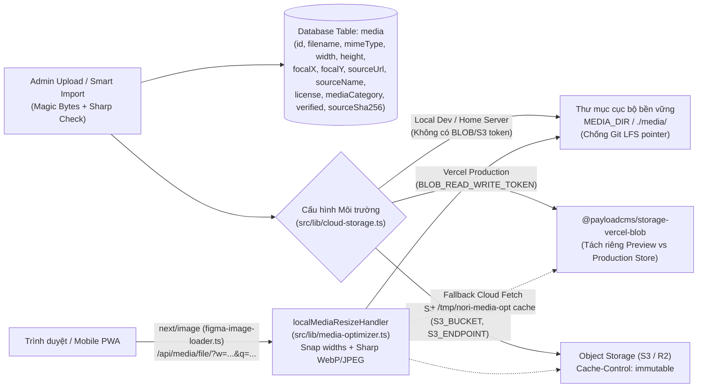

# KIẾN TRÚC LƯU TRỮ & TỐI ƯU HÓA MEDIA (MEDIA STORAGE ARCHITECTURE) — NORI

> **Phạm vi**: Phân tách rạch ròi **Metadata Media trong Database (`media`)** và **Tệp nhị phân vật lý** (`local media/` vs `Vercel Blob` / `S3 / R2`), cơ chế khử trùng lặp `SHA-256`, tối ưu hóa ảnh đáp ứng qua `next/image` (`figma-image-loader.ts` & `media-optimizer.ts`), tâm điểm ảnh (`focalX`/`focalY`), quản trị nguồn & bản quyền, tính bền vững qua restart/rebuild/deploy và sao lưu/khôi phục Media.

---

## 1. Phân tách Database Metadata & Physical Binary Storage

### Nguyên tắc tách biệt cốt lõi:
1. **Database (`media`) chỉ lưu Metadata và Con trỏ tương đối**: Không lưu nhị phân (`BLOB` SQL) vào bảng database và **không lưu đường dẫn tuyệt đối của máy cá nhân** (`C:\...` hoặc `/Users/...`). URL phục vụ luôn đi qua Payload upload URL chuẩn (`/api/media/file/<filename>`).
2. **Fail-fast trên Vercel (`assertVercelBlobStorageReady()`)**: Khi `VERCEL=1` hoặc có `VERCEL_ENV`, `src/payload.config.ts` kiểm tra chặt `BLOB_READ_WRITE_TOKEN` (định dạng `vercel_blob_rw_<store_id>_<secret>`) hoặc cấu hình `S3_*`. Hệ thống **nghiêm cấm âm thầm fallback về đĩa cục bộ tạm thời** của Vercel Serverless (vì `/var/task` là read-only và `/tmp` bị xóa sau mỗi cold start).

---

## 2. Cơ chế Khử Trùng lặp `SHA-256` (`sourceSha256`)

Trong quá trình Smart Vehicle Import hoặc tải lên hàng loạt nhiều phiên bản/màu sắc:
1. Trước khi tạo bản ghi mới trong collection `media`, `media-processor.ts` tính mã băm **SHA-256** trên buffer ảnh gốc sau khi kiểm tra magic bytes.
2. Hệ thống truy vấn trường `sourceSha256` (được đánh index trong `Media.ts`) hoặc đối chiếu manifest hiện hữu:
   - **Nếu đã tồn tại**: Tái sử dụng `media.id` hiện có thay vì ghi trùng tệp nhị phân lên ổ đĩa / Vercel Blob.
   - **Nếu chưa tồn tại**: Tối ưu kích thước/định dạng qua `sharp`, ghi file với tên đã làm sạch (`sanitizeImageFilename`) và lưu `sourceSha256`.
3. Cơ chế này ngăn chặn tình trạng phình kho lưu trữ khi nhiều phiên bản hoặc nhiều lần đồng bộ lại từ website hãng dùng chung cùng một bức ảnh.

---

## 3. Tối ưu hóa Ảnh Đáp ứng (`next/image`) & Tâm điểm Ảnh (Focal Point)

- **Custom Loader (`figma-image-loader.ts` & `next.config.ts`)**:
  - Giữ nguyên `images: { loader: 'custom', loaderFile: './figma-image-loader.ts', qualities: [75, 80, 84] }`.
  - Truyền trực tiếp `media.url` từ Payload vào `<Image />` của `next/image`; tuyệt đối **không** tạo route proxy `/media/[id]` tự chế (dễ gây lỗi 404 sau khi Publish).
- **Bộ xử lý kích thước máy chủ (`src/lib/media-optimizer.ts`)**:
  - Chuẩn hóa chiều rộng về các mốc cho phép (`ALLOWED_WIDTHS = [256, 384, 640, 750, 828, 1080, 1200, 1920]`) để tránh tấn công tạo vô số biến thể kích thước làm đầy ổ đĩa cache.
  - Tự động đọc header file để **bỏ qua tệp con trỏ Git LFS** (`version https://git-lfs.github.com/spec/v1`) và tiếp tục tìm tệp nhị phân thật trong danh sách thư mục ứng viên (`NORI_MEDIA_DIR`, `MEDIA_DIR`, `public/media`, `dev-data/media`, `media`, `public/seed-media`) hoặc Cloud Storage.
  - Trả header `Cache-Control: public, max-age=31536000, s-maxage=31536000, stale-while-revalidate=86400`.
- **Tâm điểm ảnh (`focalX`, `focalY`)**:
  - Hỗ trợ `focalX`, `focalY` (và cấu hình riêng Desktop/Mobile cho `HeroSlides` trên `nori_site`) giúp cắt ảnh (`object-position`) chính xác vào trọng tâm chiếc xe trên cả màn hình rộng và di động.

---

## 4. Quản trị Nguồn gốc, Bản quyền & Bảo vệ Khóa ngoại (`beforeDelete`)

- **Metadata bắt buộc cho ảnh catalogue**:
  - `mediaCategory`: Phân biệt 4 loại rõ ràng — `CATALOGUE_OFFICIAL` (ảnh từ trang/brochure chính thức của hãng), `CATALOGUE_REFERENCE` (ảnh tham khảo đã kiểm duyệt), `ACTUAL_VEHICLE` (ảnh chụp xe thật tại bãi NORI), `ILLUSTRATION` (ảnh minh họa/banner).
  - `sourceUrl`, `sourceName`, `license`, `modelYear`, `variantName`, `colorName`, `verified`.
- **Chống xóa nhầm ảnh đang sử dụng (`Media.ts → hooks.beforeDelete`)**:
  - Trước khi xóa bất kỳ tệp `media` nào, Payload tự động quét tham chiếu trên `vehicle-models` (`cover`, `gallery`, `variants[].colors[].image`), `vehicles` (`photos`), `posts` (`cover`) và `nori-site` (`logo`, `favicon`, `ogImage`, `storyImage`, `heroImages`, `heroSlides`).
  - Nếu còn liên kết, hệ thống trả về `HTTP 409` và chặn xóa, bảo vệ giao diện người dùng khỏi ảnh gãy (`naturalWidth === 0`).

---

## 5. Tính Bền vững & Sao lưu / Khôi phục Media

| Môi trường | Cách đảm bảo bền vững qua Restart / Rebuild / Deploy | Lệnh Sao lưu & Kiểm chứng |
| :--- | :--- | :--- |
| **Local Dev / Home Server** | Đặt `MEDIA_DIR` / `NORI_MEDIA_DIR` tới thư mục dữ liệu bền vững ngoài `.next/` (như `./media` hoặc `C:\NORI\data\media`). Không commit file ảnh runtime vào Git (chỉ commit `media/seed/` và `public/seed-media/`). | `pnpm media:audit` (kiểm tra 100% file tồn tại & kích thước > 0) `pnpm db:media:backup` |
| **Vercel Serverless + Blob/S3** | Sử dụng Store Vercel Blob hoặc Bucket S3/R2 độc lập cho Staging/Preview và Production. Ảnh sau khi upload tồn tại độc lập với các lần deploy mới. | `pnpm media:migrate:cloud` (đồng bộ ảnh local lên Cloud) `pnpm db:media:backup` (tải và đối chiếu SHA-256 về kho backup cục bộ) |
