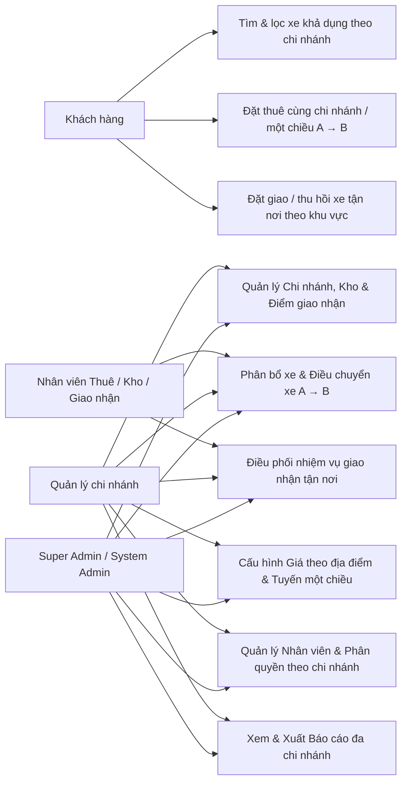
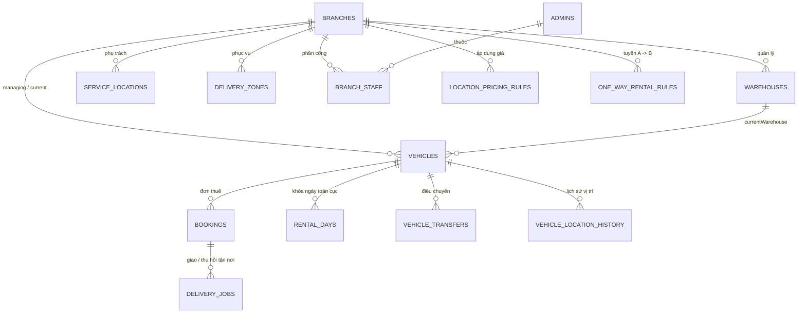
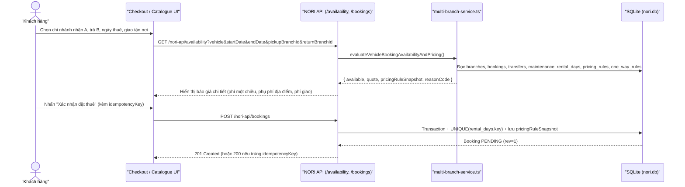

# NORI Vehicle Rental — Module 3.7: Multi-Branch & Multi-Location Management

## 1. Tổng quan kiến trúc

Module 3.7 (`v2.7.0`) nâng cấp NORI Vehicle Rental từ mô hình một địa điểm sang hệ thống quản trị đa chi nhánh, đa kho phương tiện, đa điểm nhận/trả xe, điều chuyển nội bộ, giao nhận tận nơi và định giá theo địa điểm — chạy tập trung trên cùng nền tảng **Next.js 16 App Router + React 19 + Payload CMS 4.0 + SQLite (`nori.db`)**.

### Nguyên tắc thiết kế cốt lõi

1. **Một phương tiện = Một định danh duy nhất (`vehicles.id`)**: Tuyệt đối không nhân bản bản ghi phương tiện theo chi nhánh. Hệ thống tách biệt rõ `managingBranch` (chi nhánh quản lý tài sản), `currentBranch` / `currentWarehouse` (vị trí vật lý hiện tại) và `nextExpectedBranch` (vị trí dự kiến tiếp theo).
2. **Động cơ khả dụng theo dòng thời gian (P0 Vehicle Location Timeline Engine)**: Một xe chỉ khả dụng cho đơn `[startDate, endDate)` tại chi nhánh nhận `A` và trả tại `B` khi:
   - Không trùng `bookings` đang giữ lịch, `maintenance-schedules`, `vehicle-transfers` hoặc khóa toàn cục `rental-days`.
   - Chi nhánh nhận `A` và chi nhánh trả `B` đều ở trạng thái `ACTIVE`.
   - Tuyến một chiều `A → B` (nếu `A ≠ B`) được cho phép trong `one-way-rental-rules` và đáp ứng `minRentalDays`.
   - Vị trí vật lý dự kiến của xe vào `startDate` khớp `A`, và vị trí trả `B` vào `endDate` không làm đứt gãy điểm nhận của đơn thuê kế tiếp (nếu chưa có phiếu điều chuyển trung gian).
3. **Không cộng trùng doanh thu & Tách biệt tài sản ký quỹ**: Doanh thu đơn thuê một chiều được phân bổ chính xác theo tỷ lệ `revenueSplitPickupPercent` (mặc định `100%` chi nhánh nhận, hoặc `50/50`, `0/100`, tỷ lệ tùy chỉnh), bảo đảm $\sum \text{Doanh thu chi nhánh} = \text{Tổng toàn hệ thống}$. Tiền cọc tài sản (`SECURITY_DEPOSIT`) và chi phí điều chuyển nội bộ (`transferCost`) tách biệt hoàn toàn.
4. **Không giả mạo dữ liệu thật**: Các phương tiện minh họa hiện có giữ `allocationStatus = 'UNALLOCATED'` cho đến khi quản trị viên chủ động gán vào chi nhánh/kho thực tế bằng công cụ phân bổ hàng loạt.

---

## 2. Use Case Diagram

---

## 3. Entity-Relationship Diagram (ERD)

---

## 4. Booking Multi-Location & One-Way Sequence Diagram

---

## 5. Các route & API mới

| Admin Dashboard Route         | API Endpoint                           | Collection chính                                                        |
| ----------------------------- | -------------------------------------- | ----------------------------------------------------------------------- |
| `/dashboard/branches`         | `/nori-api/dashboard/branches`         | `branches`                                                              |
| `/dashboard/warehouses`       | `/nori-api/dashboard/warehouses`       | `warehouses`, `vehicles`                                                |
| `/dashboard/locations`        | `/nori-api/dashboard/locations`        | `service-locations`                                                     |
| `/dashboard/staff`            | `/nori-api/dashboard/staff`            | `admins`, `branch-staff`                                                |
| `/dashboard/transfers`        | `/nori-api/dashboard/transfers`        | `vehicle-transfers`, `rental-days`, `vehicle-location-history`          |
| `/dashboard/deliveries`       | `/nori-api/dashboard/deliveries`       | `delivery-zones`, `delivery-jobs`                                       |
| `/dashboard/location-pricing` | `/nori-api/dashboard/location-pricing` | `location-pricing-rules`, `one-way-rental-rules`                        |
| `/dashboard/branch-reports`   | `/nori-api/dashboard/branch-reports`   | Báo cáo tổng hợp + CSV `/nori-api/dashboard/export?type=branch-reports` |
| _(Public)_                    | `/nori-api/locations`                  | Chi nhánh, điểm xác minh, khu vực giao, tuyến 1 chiều đang `ACTIVE`     |
