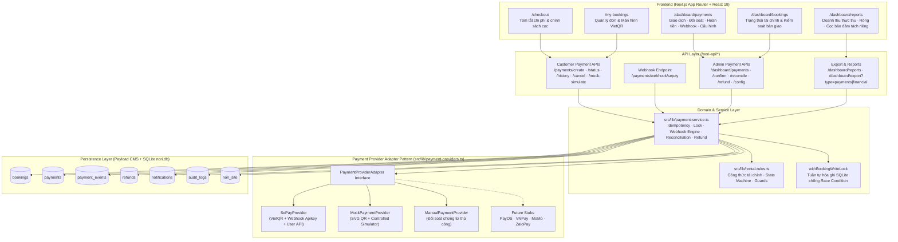

# Kiến trúc Hệ thống Thanh toán — NORI Vehicle Rental

## 1. Sơ đồ kiến trúc tổng thể

## 2. Payment Adapter Pattern

Mọi cổng thanh toán đều triển khai chuẩn `PaymentProviderAdapter` trong [`src/lib/payment-providers.ts`](../src/lib/payment-providers.ts):

- `isConfigured(env, bankConfig)`: Kiểm tra khóa môi trường & tài khoản ngân hàng hợp lệ.
- `createPayment(input)`: Khởi tạo yêu cầu thanh toán, mã tham chiếu `NORIPAY...`, URL VietQR và dữ liệu SVG QR dự phòng.
- `verifyWebhook(params)`: Xác thực chữ ký / `Apikey` bằng so sánh hằng số thời gian (`crypto.timingSafeEqual`).
- `normalizeWebhookEvent(payload, env)`: Chuẩn hóa payload nhà cung cấp về `NormalizedWebhookEvent` thống nhất.
- `queryTransaction(params)`: Tra cứu trạng thái giao dịch tại cổng (hỗ trợ SePay User API).
- `cancelPayment(params)`: Hủy mã thanh toán đang chờ.
- `createRefund(params)`: Hỗ trợ quy trình hoàn tiền (trả trạng thái đối soát thủ công với SePay/Manual hoặc hoàn tức thì với Mock).

## 3. Phân tách dữ liệu tài chính chuẩn hóa

Toàn bộ công thức tài chính được tập trung duy nhất tại [`src/lib/rental-rules.ts`](../src/lib/rental-rules.ts) (`calculateBookingFinancialSummary`):

1. **Doanh thu thuê xe thực thu (`rentalRevenueCollected`)**: Chỉ tính tổng tiền đã xác thực (`CONFIRMED`, `PARTIALLY_REFUNDED`, `REFUNDED` trước khi trừ hoàn) từ các loại `DEPOSIT`, `RENTAL_FEE`, `FULL_PAYMENT`, `EXTRA_FEE`.
2. **Tiền cọc bảo đảm tài sản (`securityDepositHeld`)**: Được hạch toán hoàn toàn độc lập từ loại `SECURITY_DEPOSIT`, **không bao giờ cộng gộp vào doanh thu thuê xe**.
3. **Doanh thu ròng sau hoàn tiền (`netCollectedAmount`)**: `max(0, totalVerifiedReceived - totalRefundedAmount)`.
4. **Còn phải thu (`totalRemainingRentalObligation`)**: `remainingRentalBeforeExtra + remainingExtraFeeDue`.
