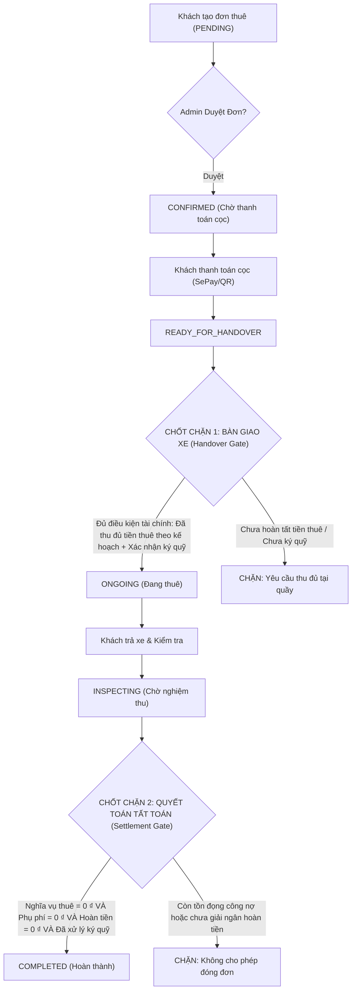

# QUY CHUẨN NGHIỆP VỤ THANH TOÁN, ĐẶT CỌC & QUYẾT TOÁN TÀI CHÍNH (PAYMENT BUSINESS RULES)

# NORI VEHICLE RENTAL SYSTEM — PHIÊN BẢN 2.7.1

---

## I. MỤC TIÊU VÀ NGUYÊN TẮC CỐT LÕI

Tài liệu này xác lập quy chuẩn nghiệp vụ tài chính bất biến của hệ thống **NORI Vehicle Rental**, đảm bảo:

1. **Phân định rõ ràng bản chất kinh tế** giữa **Doanh thu dịch vụ thuê xe** và **Tài sản bảo đảm thực hiện nghĩa vụ (Ký quỹ thế chấp)**.
2. **Tính nhất quán dữ liệu 100% (Single Source of Truth)** giữa giao diện Khách hàng (Frontend Client) và Phân hệ Quản trị (Admin Portal).
3. **Cung cấp cho khách hàng quyền tự do lựa chọn phương thức thanh toán linh hoạt**: Đặt cọc giữ xe 30% hoặc Thanh toán toàn bộ 100% tiền thuê.
4. **Thiết lập các chốt chặn an toàn tài chính (Financial Clearance Gates)** tại các thời điểm nhạy cảm: Phê duyệt đơn, Bàn giao phương tiện (Handover), và Nghiệm thu quyết toán sau trả xe (Settlement).
5. **Đảm bảo tính toàn vẹn số liệu (Financial Integrity)**: Tiền tệ là số nguyên VND (Integer VND), không phát sinh sai số làm tròn thập phân.

---

## II. PHÂN ĐỊNH BẢN CHẤT HAI KHOẢN TIỀN (TWO DISTINCT FINANCIAL REALITIES)

Một trong những nguyên nhân phổ biến gây nhầm lẫn trong các hệ thống cho thuê xe là việc gộp chung hoặc dùng từ ngữ không chuẩn xác cho khái niệm "Tiền cọc". Tại NORI, hệ thống tách bạch tuyệt đối hai khái niệm sau:

```
┌────────────────────────────────────────────────────────────────────────────────────────┐
│                        TỔNG NGHĨA VỤ TÀI CHÍNH CỦA KHÁCH HÀNG                          │
└──────────────────────────────────────────┬─────────────────────────────────────────────┘
                                           │
             ┌─────────────────────────────┴─────────────────────────────┐
             ▼                                                           ▼
┌─────────────────────────────────────────┐ ┌───────────────────────────────────────────┐
│     1. TIỀN DỊCH VỤ THUÊ XE TRỌN GÓI    │ │    2. TIỀN KÝ QUỸ BẢO ĐẢM TÀI SẢN XE      │
│          (RENTAL SERVICE FEE)           │ │       (ASSET SECURITY COLLATERAL)         │
├─────────────────────────────────────────┤ ├───────────────────────────────────────────┤
│ • Bản chất: DOANH THU KINH DOANH        │ │ • Bản chất: TÀI SẢN KÝ QUỸ THẾ CHẤP       │
│ • Gồm: Giá thuê theo ngày + Phí dịch vụ │ │ • Doanh nghiệp giữ hộ trong thời gian thuê│
│   giao nhận/ngoài giờ/phụ trội + Bảo    │ │ • Không ghi nhận vào doanh thu công ty    │
│   hiểm chuyến đi - Giảm giá/Khuyến mãi. │ │ • Mức thế chấp:                           │
│ • Thu theo tiến trình:                  │ │   - Xe máy: 15.000.000 ₫ - 20.000.000 ₫   │
│   A. Cọc giữ xe 30% (khi duyệt đơn)     │ │   - Ô tô 4-7 chỗ: 20.000.000 - 30.000.000₫│
│   B. Thanh toán 100% (khi duyệt đơn)    │ │ • Phương thức: Tiền mặt, chuyển khoản tạm │
│   Phần còn lại thu khi bàn giao xe.     │ │   giữ hoặc xe máy kèm cà vẹt chính chủ.   │
│ • Không hoàn lại nếu hủy cận ngày theo  │ │ • Hoàn trả 100% cho khách sau khi hoàn tất│
│   chính sách hủy đơn (Cancellation Fee).│ │   kiểm tra xe đạt chuẩn khi trả xe.       │
└─────────────────────────────────────────┘ └───────────────────────────────────────────┘
```

### 1. Tiền Thuê Xe & Tiền Cọc Giữ Chỗ (Rental Fee & Reservation Deposit)

- **Tiền cọc giữ chỗ (Reservation Deposit)**: Khoản tiền bảo đảm khách hàng chắc chắn thuê xe sau khi đơn thuê được Quản trị viên phê duyệt. Mặc định là **30% tổng tiền thuê** (hoặc 100% nếu khách chọn phương án thanh toán toàn bộ).
- **Hạch toán**: Ghi nhận vào doanh thu của đơn hàng khi khách nhận xe và hoàn thành chuyến đi.
- **Biểu diễn trong CSDL**:
  - `bookings.total_price`: Tổng chi phí thuê xe.
  - `bookings.payment_option`: Phương thức thanh toán khách chọn (`'DEPOSIT'` hoặc `'FULL'`).
  - `bookings.reservation_deposit_snapshot`: Số tiền cọc giữ chỗ 30% được chốt lúc tạo đơn.
  - `bookings.initial_payment_due`: Số tiền cần thanh toán đợt đầu khi đơn được duyệt (`reservationDepositRequired` hoặc `total_price`).
  - `bookings.remaining_amount`: Tiền thuê còn lại cần đóng khi nhận xe (`total_price - initial_payment_due`).

### 2. Tiền Ký Quỹ Bảo Đảm Tài Sản (Asset Security Collateral)

- **Bản chất**: Khoản bảo đảm giá trị phương tiện chống mất cắp, hư hỏng do lỗi người dùng, hoặc vi phạm luật giao thông nghiêm trọng.
- **Hạch toán**: Khoản nợ phải trả (Tài khoản ký quỹ giữ hộ), **tuyệt đối không cộng vào doanh thu thuê xe** và **không tính vào số dư còn lại của tiền thuê**.
- **Biểu diễn trong CSDL**:
  - `vehicles.deposit`: Mức ký quỹ bảo đảm tài sản niêm yết của từng dòng xe.
  - `bookings.deposit_snapshot`: Mức ký quỹ tài sản được chốt cố định tại thời điểm khách đặt xe.
- **Thời điểm thực hiện**: Chỉ thu và bàn giao biên nhận khi khách hàng đến nhận xe thực tế tại chi nhánh hoặc khi nhân viên giao xe tận nơi.

---

## III. GIẢI TRÌNH VỤ VIỆC BẤT THƯỜNG TRÊN ADMIN UI (13.010.000 ₫ vs 15.000.000 ₫)

### 1. Hiện tượng ghi nhận

Trên giao diện Quản trị Đơn thuê (Admin Bookings Panel), xuất hiện trường hợp đơn thuê có các thông số:

- **Tổng tiền thuê (Total Rental)**: 13.010.000 ₫
- **Tiền cọc hiển thị (Deposit)**: 15.000.000 ₫
- **Đã thu (Collected)**: 13.010.000 ₫
- **Còn lại (Remaining)**: 0 ₫
- **Trạng thái đơn**: `READY_FOR_HANDOVER` (Sẵn sàng giao xe)

### 2. Phân tích nguyên nhân gốc (Root Cause Analysis)

1. **Dữ liệu thực tế trong CSDL**:
   - Đơn thuê mang ID `61b04fa0-4bdd-48e4-b99a-a3935cca944d` thuê dòng xe VinFast VF 3 trong 7 ngày, tổng tiền thuê là **13.010.000 ₫**.
   - Mức ký quỹ bảo đảm phương tiện đối với xe này quy định trong danh mục là **15.000.000 ₫**.
   - Khách hàng đã thực hiện 2 giao dịch thanh toán thành công qua chuyển khoản trực tuyến:
     - Giao dịch 1: Đặt cọc giữ xe 30% = **3.903.000 ₫** (`CONFIRMED`).
     - Giao dịch 2: Thanh toán nốt 70% tiền thuê còn lại = **9.107.000 ₫** (`CONFIRMED`).
     - Tổng tiền thuê đã thu = 3.903.000 + 9.107.000 = **13.010.000 ₫** (100% tiền thuê xe).
     - Số tiền thuê còn thiếu = **0 ₫**.
2. **Khuyết tật về UI/UX và nhãn hiển thị**:
   - Trước đây, cột và nhãn trên giao diện hiển thị trường `deposit_snapshot` bằng nhãn chung chung là **"Tiền cọc"**.
   - Người quản trị nhìn vào thấy: Tổng tiền 13.010.000 ₫, "Tiền cọc" 15.000.000 ₫, dẫn đến ngộ nhận nghiêm trọng:
     - "Tại sao tiền cọc lại lớn hơn cả tổng tiền thuê?"
     - "Tại sao đã thu 13.010.000 ₫ mà tiền cọc vẫn là 15.000.000 ₫?"
     - "Hệ thống có bị lỗi tính trùng hoặc sai lệch số dư không?"
3. **Kết luận**:
   - Về mặt toán học và logic thanh toán dịch vụ: **Hệ thống tính đúng 100%**. Khách đã thanh toán đủ 13.010.000 ₫ tiền thuê.
   - Về mặt kế toán và trải nghiệm hiển thị: **Giao diện thiếu phân định bản chất dòng tiền**, gây nhầm lẫn giữa _Cọc giữ xe (30%)_ và _Ký quỹ thế chấp tài sản (15.000.000 ₫)_.

### 3. Giải pháp khắc phục đã triển khai

1. **Chuẩn hóa cấu trúc dữ liệu (`src/collections/Bookings.ts`)**:
   - Bổ sung trường `reservationDepositSnapshot`: Ghi nhận chuẩn xác số tiền cọc giữ chỗ 30% (ví dụ: 3.903.000 ₫).
   - Đổi nhãn `depositSnapshot` thành **"Tiền ký quỹ bảo đảm tài sản (thế chấp nhận xe, tách riêng)"**.
2. **Nâng cấp giao diện Admin (`src/components/admin/bookings-panel.tsx`)**:
   - Bổ sung khối **"Phân định hạch toán tài chính chuẩn"** hiển thị tách bạch 2 cột:
     - Cột A: **Doanh thu tiền thuê**: Tổng tiền (13.010.000 ₫) | Đã thu (13.010.000 ₫) | Còn nợ (0 ₫) -> **Đã hoàn tất thanh toán tiền thuê**.
     - Cột B: **Ký quỹ bảo đảm tài sản**: 15.000.000 ₫ (Thu trực tiếp khi bàn giao xe, hoàn trả 100% khi trả xe).
   - Bổ sung chỉ báo trực quan giúp quản trị viên nắm bắt tức thì tình trạng hạch toán mà không cần tính toán thủ công.

---

## IV. THIẾT KẾ KẾ HOẠCH THANH TOÁN CHO KHÁCH HÀNG (PAYMENT PLAN SELECTION)

Tại bước Xác nhận đặt xe (Checkout), khách hàng được chủ động lựa chọn 1 trong 2 kế hoạch thanh toán:

### Phương án A: Đặt cọc giữ xe 30% (`paymentOption = 'DEPOSIT'`)

- **Tỷ lệ thanh toán**: 30% tổng tiền thuê xe (`Math.round(totalPrice * 0.3)`).
- **Thời điểm đóng**: Sau khi Quản trị viên duyệt đơn và gửi thông báo xác nhận.
- **Tiền còn lại**: 70% tổng tiền thuê được thanh toán vào ngày nhận xe thực tế.
- **Ký quỹ bảo đảm tài sản**: Thực hiện tại quầy khi nhận xe (bằng chuyển khoản hoặc tiền mặt hoặc xe máy).

### Phương án B: Thanh toán toàn bộ 100% (`paymentOption = 'FULL'`)

- **Tỷ lệ thanh toán**: 100% tổng tiền thuê xe (`totalPrice`).
- **Thời điểm đóng**: Thanh toán trọn gói ngay sau khi đơn được duyệt.
- **Ưu điểm**: Khách hàng không cần bận tâm về chi phí thuê trong ngày nhận xe, thủ tục nhận xe nhanh chóng hơn (Fast-track Pickup).
- **Tiền thuê còn lại tại ngày nhận xe**: **0 ₫**.
- **Ký quỹ bảo đảm tài sản**: Vẫn thực hiện độc lập tại quầy khi nhận xe.

---

## V. CÁC CHỐT CHẶN KIỂM SOÁT TÀI CHÍNH (FINANCIAL CLEARANCE GATES)

Hệ thống NORI cài đặt các bộ lọc an toàn tại 3 thời điểm then chốt:



### 1. Chốt chặn Bàn giao xe (Pre-Handover Clearance Gate)

Trước khi chuyển trạng thái sang `ONGOING`:

- Đối với đơn chọn thanh toán 100%: Phải xác nhận đã thu đủ 100% tiền thuê.
- Đối với đơn chọn đặt cọc 30%: Phải xác nhận đã thu đủ 30% tiền cọc và thu tiếp 70% còn lại tại quầy (trừ khi có xác nhận công nợ đặc biệt được bảo lãnh).
- Phải ghi nhận hình thức ký quỹ tài sản (Tiền mặt / Chuyển khoản / Hiện vật) vào biên bản bàn giao xe.

### 2. Chốt chặn Nghiệm thu & Tất toán (Post-Return Settlement Gate)

Hàm kiểm soát `checkSettlementCompletionEligibility` trong `src/lib/rental-rules.ts`:

- **Điều kiện 1**: `totalRemainingRentalObligation === 0` (Không còn nợ tiền thuê gốc).
- **Điều kiện 2**: `remainingExtraFeeDue === 0` (Không còn nợ phụ phí xăng/pin, quá giờ, vệ sinh, hư hỏng).
- **Điều kiện 3**: `pendingRefundAmount === 0` (Toàn bộ khoản hoàn tiền thừa đã được giải ngân thành công).
- **Điều kiện 4**: Khoản ký quỹ bảo đảm tài sản đã được hoàn trả lại cho khách hàng hoặc đã cấn trừ minh bạch vào chi phí khắc phục hư hại với sự đồng thuận của khách hàng.

---

## VI. BẢNG TỔNG HỢP CÔNG THỨC TOÁN HỌC TÀI CHÍNH

| Đại lượng                         | Mã biến                          | Công thức tính toán                                                       |
| :-------------------------------- | :------------------------------- | :------------------------------------------------------------------------ |
| **Tiền thuê gốc**                 | `baseRentalPrice`                | `dailyRate × rentalDays` (áp dụng bảng giá bậc thang/tuần/tháng)          |
| **Phụ phí địa điểm / giao nhận**  | `deliveryFee`                    | Tra cứu theo khoảng cách và vùng giao nhận (`delivery_zones`)             |
| **Giảm giá / Khuyến mãi**         | `discountAmount`                 | Tính theo voucher/promo code và trần giảm tối đa                          |
| **Tổng tiền thuê**                | `totalPrice`                     | `Math.max(0, baseRentalPrice + deliveryFee + addonFees - discountAmount)` |
| **Cọc giữ chỗ 30%**               | `reservationDepositRequired`     | `paymentOption === 'FULL' ? totalPrice : Math.round(totalPrice * 0.3)`    |
| **Tiền thuê đợt 1**               | `initialPaymentDue`              | `paymentOption === 'FULL' ? totalPrice : reservationDepositRequired`      |
| **Tiền thuê còn lại khi nhận xe** | `totalRemainingRentalObligation` | `Math.max(0, totalPrice - totalRentalPaid)`                               |
| **Ký quỹ bảo đảm tài sản**        | `depositSnapshot`                | `vehicle.deposit` (Cố định, hạch toán riêng)                              |

---

_Tài liệu ban hành bởi Ban Kỹ thuật & Nghiệp vụ NORI Vehicle Rental — 2026-11-20._
