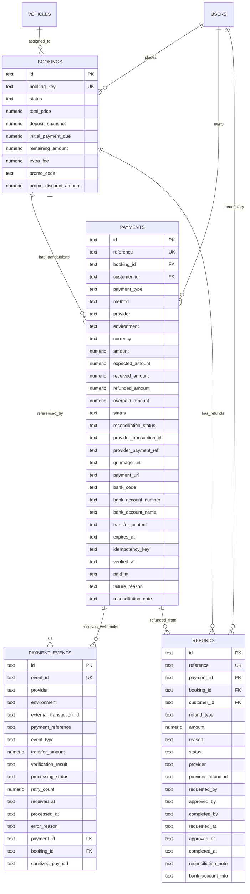

# Thiết kế Cơ sở dữ liệu & ERD Thanh toán — NORI Vehicle Rental

## 1. Sơ đồ quan hệ thực thể (Mermaid ERD)

## 2. Migration mở rộng an toàn (Additive-Only)

File migration: [`src/migrations/20261120_010000_online_payment_integration.ts`](../src/migrations/20261120_010000_online_payment_integration.ts) (tích hợp đồng thời vào `applyAdditivePaymentSchema` trong [`src/lib/data-sync.ts`](../src/lib/data-sync.ts)):

- **Không xóa cột**, **không sửa đổi kiểu dữ liệu cũ**, **không ghi đè dữ liệu hiện có** trong `nori.db`.
- Thêm 4 bảng mới: `payment_events`, `payment_events_rels`, `refunds`, `refunds_rels` (nâng tổng số bảng trong `nori.db` từ 84 lên 88 bảng).
- Bổ sung 21 cột mới trên `payments` và 17 cột cấu hình thanh toán trên `nori_site` với giá trị mặc định tương thích ngược hoàn toàn.
- Bổ sung các Unique Index & Index quan trọng:
  - `payment_events_event_id_idx` (UNIQUE) — chống xử lý trùng lặp sự kiện Webhook ở tầng Database.
  - `payments_provider_payment_ref_idx`, `payments_provider_transaction_id_idx`, `payments_idempotency_key_idx`, `payments_reconciliation_status_idx`.
  - `refunds_reference_idx` (UNIQUE), `refunds_booking_idx`, `refunds_payment_idx`, `refunds_status_idx`.
