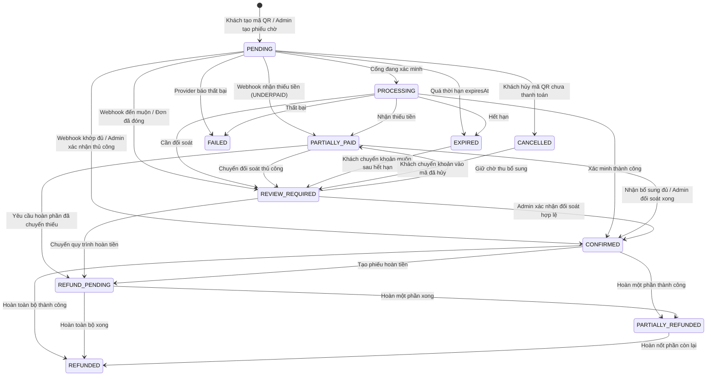
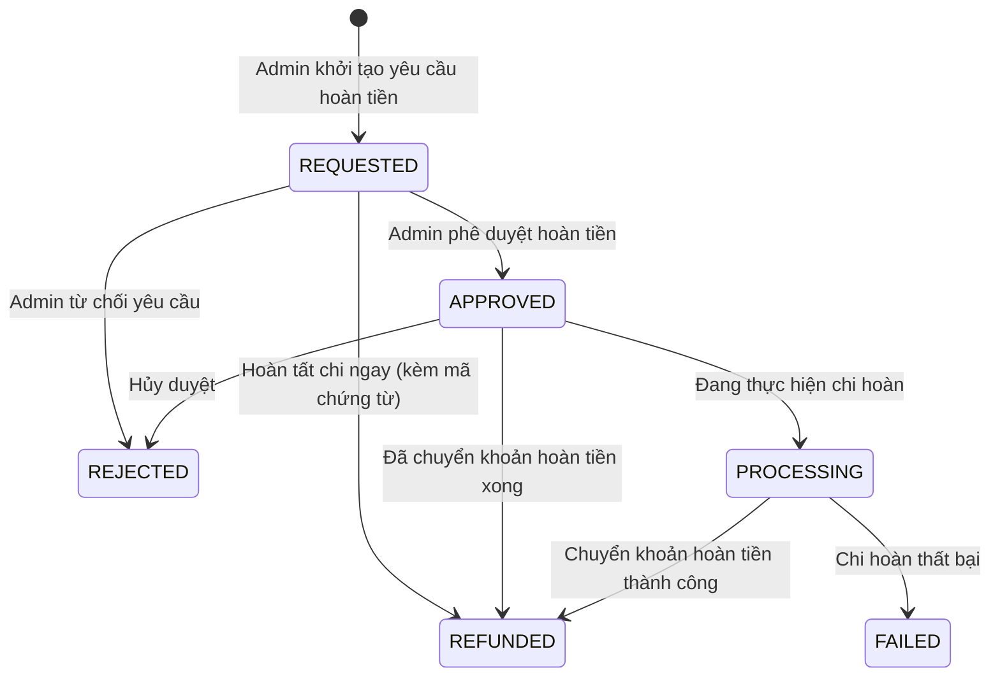

# Ma trận Trạng thái Thanh toán & Hoàn tiền — NORI Vehicle Rental

## 1. Sơ đồ trạng thái Giao dịch Thanh toán (`Payment.status`)

## 2. Sơ đồ trạng thái Hoàn tiền (`Refund.status`)

## 3. Quy tắc chống sự kiện đến sai thứ tự (Out-of-Order / Stale Event Guard)

Được kiểm soát trong `isPaymentEventStale(currentStatus, incomingStatus)` tại [`src/lib/rental-rules.ts`](../src/lib/rental-rules.ts):

- Khi `Payment` đã đạt `CONFIRMED`, mọi sự kiện muộn báo `PENDING`, `PROCESSING`, `FAILED`, `EXPIRED`, `CANCELLED` đều bị bỏ qua an toàn (`ignoredStaleEvent: true`) và ghi nhận trong `payment_events`.
- Khi `Payment` đã ở trạng thái `REFUNDED`, không có bất kỳ sự kiện Webhook hay thao tác Admin nào được phép đưa ngược về `CONFIRMED` hoặc `PENDING`.
- Khách hàng chỉ được phép chuyển `PENDING → CANCELLED` cho mã thanh toán do chính mình tạo trước khi có xác nhận thu tiền.
