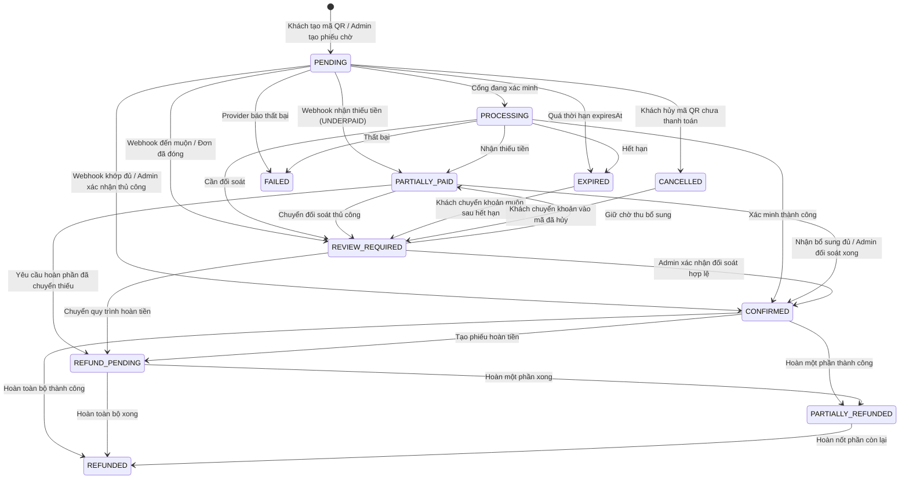
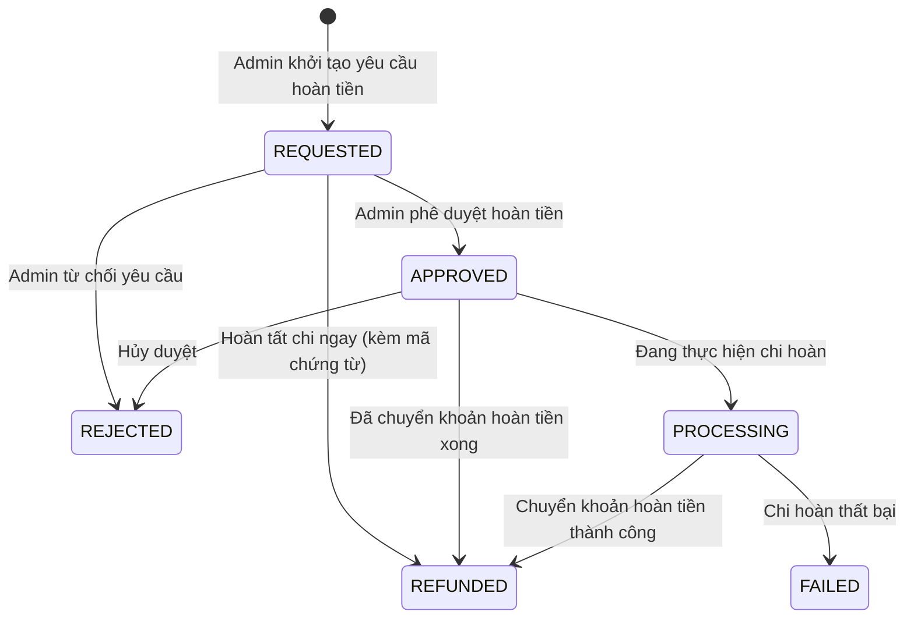
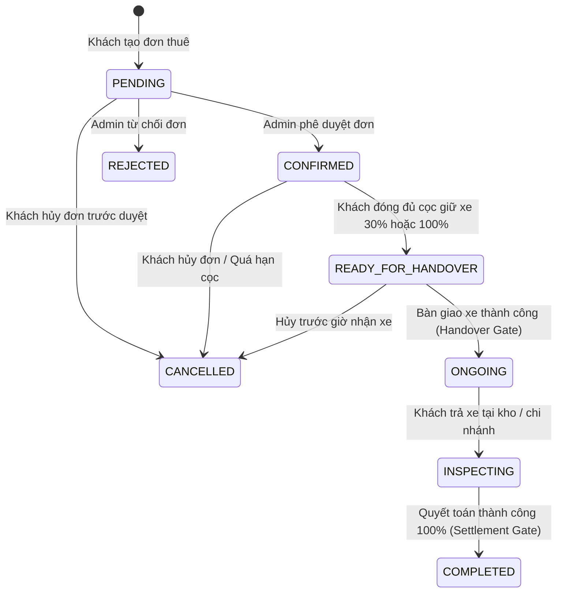
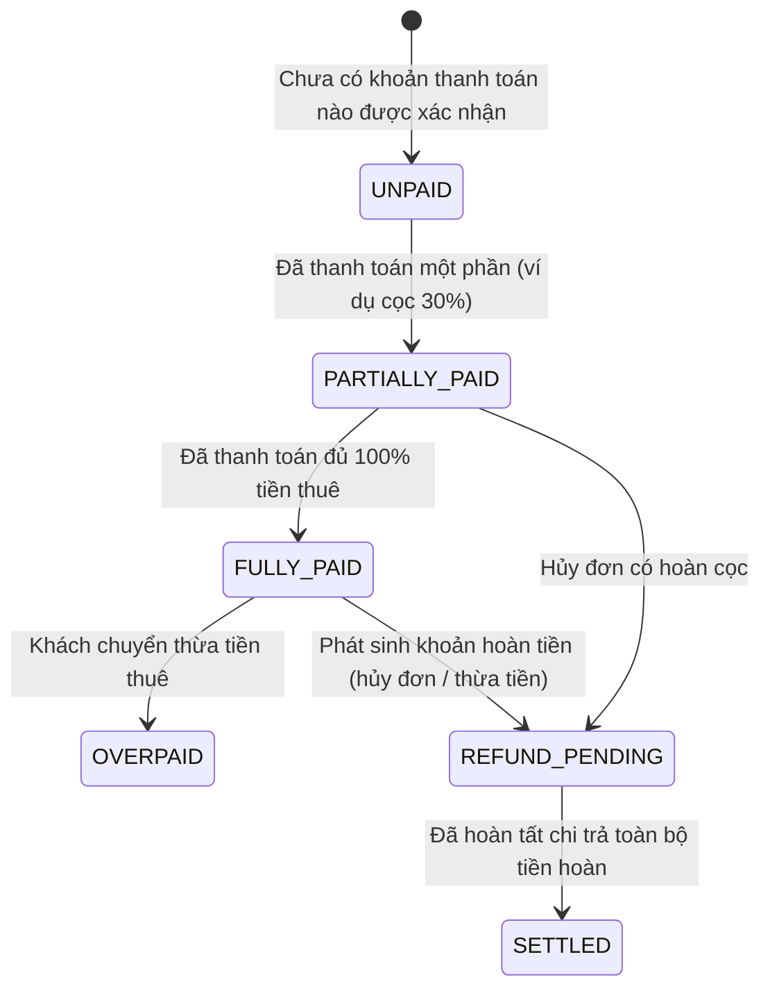
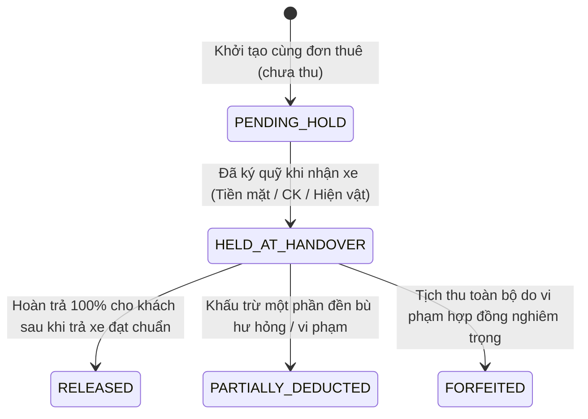

# MA TRẬN MÁY TRẠNG THÁI THANH TOÁN, HOÀN TIỀN & ĐƠN THUÊ — NORI VEHICLE RENTAL

# PHIÊN BẢN KIẾN TRÚC 2.7.1

Tài liệu này định nghĩa hệ thống **4 máy trạng thái trực giao (4 Orthogonal State Machines)** của NORI Vehicle Rental:

1. **Giao dịch Thanh toán (`Payment.status`)**
2. **Yêu cầu Hoàn tiền (`Refund.status`)**
3. **Vòng đời Đơn thuê (`Booking.status`)**
4. **Tổng hợp Tài chính Đơn thuê (`FinancialSummary.paymentStatusSummary`)**
5. **Ký quỹ Bảo đảm Tài sản (`AssetCollateral.status`)**

---

## 1. Sơ đồ trạng thái Giao dịch Thanh toán (`Payment.status`)

---

## 2. Sơ đồ trạng thái Hoàn tiền (`Refund.status`)

---

## 3. Sơ đồ trạng thái Vòng đời Đơn thuê (`Booking.status`)

---

## 4. Sơ đồ trạng thái Tổng hợp Tài chính Đơn thuê (`paymentStatusSummary`)

Được tính toán động qua `calculateBookingFinancialSummary()`:

---

## 5. Sơ đồ trạng thái Ký quỹ Bảo đảm Tài sản (`AssetCollateral.status`)

Khoản tiền bảo đảm xe được theo dõi độc lập với doanh thu dịch vụ thuê xe:

---

## 6. Ma trận Chốt chặn Chuyển trạng thái & Bất biến Tài chính (Financial Invariants)

| Chuyển trạng thái                | Điều kiện tiên quyết (Prerequisites)                                | Chốt chặn tài chính (Financial Gate)                                                                                             |
| :------------------------------- | :------------------------------------------------------------------ | :------------------------------------------------------------------------------------------------------------------------------- |
| `PENDING → CONFIRMED`            | Xe còn trống lịch, khách cung cấp đủ CCCD/GPLX                      | Đơn được phê duyệt, gửi link thanh toán cọc giữ xe (30% hoặc 100%)                                                               |
| `CONFIRMED → READY_FOR_HANDOVER` | Đã nhận đủ tiền cọc giữ xe quy định theo `paymentOption`            | `totalRentalPaid >= reservationDepositRequired`                                                                                  |
| `READY_FOR_HANDOVER → ONGOING`   | Đúng ngày bắt đầu thuê (`today >= startDate`), ký biên bản bàn giao | `totalRemainingRentalObligation === 0` (hoặc duyệt công nợ tại quầy) VÀ Đã xác nhận ký quỹ tài sản                               |
| `ONGOING → INSPECTING`           | Xe đã được trả về chi nhánh/kho, hoàn thành biên bản kiểm tra xe    | Ghi nhận số km, tình trạng xăng/pin và hư tổn phát sinh nếu có                                                                   |
| `INSPECTING → COMPLETED`         | Biên bản kiểm tra xe hoàn tất không còn tranh chấp                  | `totalRemainingRentalObligation === 0` VÀ `remainingExtraFeeDue === 0` VÀ `pendingRefundAmount === 0` VÀ đã xử lý ký quỹ tài sản |
| `PENDING/CONFIRMED → CANCELLED`  | Khách hoặc Admin thực hiện hủy đơn                                  | Tự động hủy (`CANCELLED`) các mã thanh toán `PENDING`/`PROCESSING` chưa thu                                                      |
| `Bất kỳ → REJECTED`              | Admin từ chối đơn                                                   | Tự động hủy toàn bộ giao dịch thanh toán đang treo                                                                               |

---

## 7. Quy tắc Chống sự kiện đến sai thứ tự (Out-of-Order / Stale Event Guard)

Được kiểm soát trong `isPaymentEventStale(currentStatus, incomingStatus)` tại [`src/lib/rental-rules.ts`](../src/lib/rental-rules.ts):

- Khi `Payment` đã đạt `CONFIRMED`, mọi sự kiện muộn báo `PENDING`, `PROCESSING`, `FAILED`, `EXPIRED`, `CANCELLED` đều bị bỏ qua an toàn (`ignoredStaleEvent: true`) và ghi nhận trong `payment_events`.
- Khi `Payment` đã ở trạng thái `REFUNDED`, không có bất kỳ sự kiện Webhook hay thao tác Admin nào được phép đưa ngược về `CONFIRMED` hoặc `PENDING`.
- Khách hàng chỉ được phép chuyển `PENDING → CANCELLED` cho mã thanh toán do chính mình tạo trước khi có xác nhận thu tiền.
