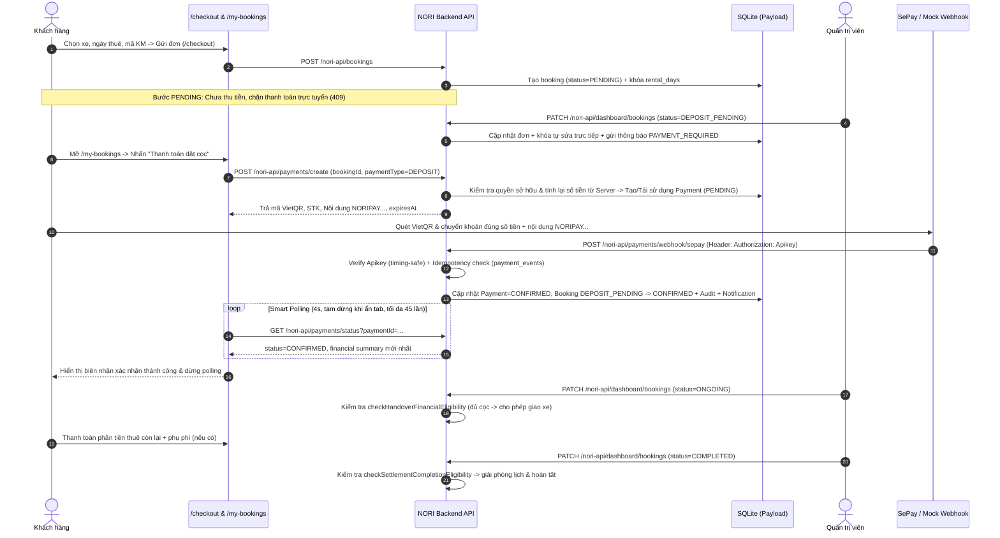
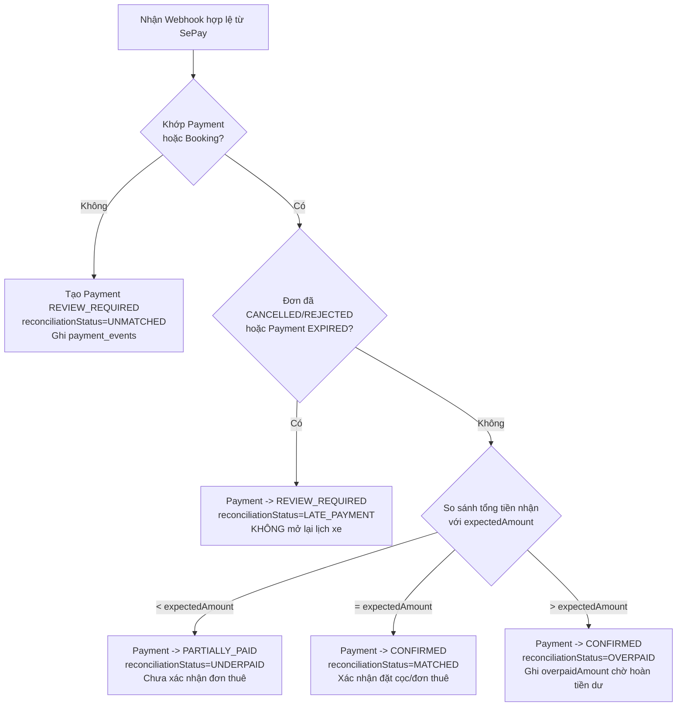

# Luồng Nghiệp vụ Thanh toán Trực tuyến — NORI Vehicle Rental

## 1. Luồng tổng thể từ Đặt xe → Duyệt đơn → Thanh toán VietQR/Webhook → Bàn giao → Quyết toán

## 2. Luồng xử lý Ngoại lệ (Underpaid / Overpaid / Late Payment / Unmatched)

## 3. Luồng Hoàn tiền (Refund Workflow)

1. Admin (có quyền `payments.update`) tạo yêu cầu hoàn tiền qua `POST /nori-api/dashboard/payments/refund` (`action: 'create'`).
2. Hệ thống kiểm tra:
   - Không vượt quá số dư thực nhận còn có thể hoàn (`totalVerifiedReceived - alreadyRefunded - pendingRefund`).
   - Bắt buộc có lý do kiểm toán (`reason`).
   - Chống tạo trùng hoàn tiền đồng thời (`withBookingWriteLock` + kiểm tra yêu cầu đang mở trùng số tiền/giao dịch).
3. Chuyển trạng thái qua `approve` → `complete` (kèm `providerRefundId` chứng từ chuyển khoản hoàn tiền).
4. Khi `complete` (`status = REFUNDED`):
   - Cộng dồn `refundedAmount` trên giao dịch gốc (`PARTIALLY_REFUNDED` hoặc `REFUNDED`).
   - Tự động cập nhật doanh thu ròng trên `/dashboard/payments` và `/dashboard/reports`.
   - Ghi `audit_logs` và gửi thông báo `REFUND_COMPLETED` cho khách hàng.
