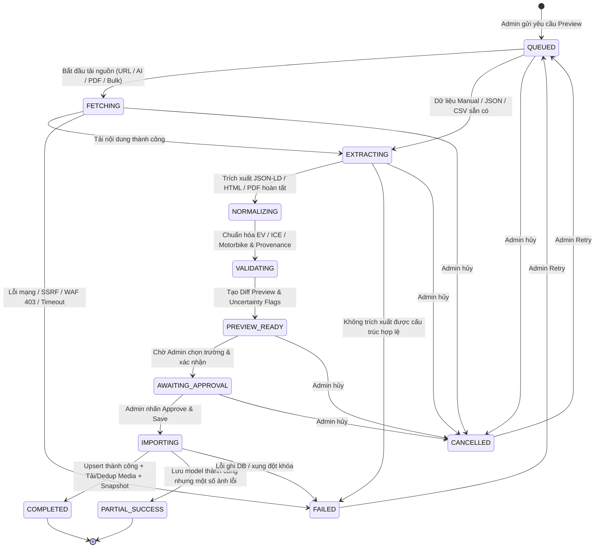

# HƯỚNG DẪN SMART VEHICLE IMPORT & ĐẶC TẢ API — NORI ADMIN

> **Phạm vi**: Tài liệu hướng dẫn quản trị viên (`SUPER_ADMIN` / nhân sự có quyền `models`) sử dụng hệ thống **Smart Vehicle Import** với **5 phương thức nhập liệu**, cơ chế **Preview-Before-Save**, khóa trường dữ liệu (`lockedFields`), quy trình duyệt/xuất bản, hoàn tác (`Rollback`), đồng bộ lại từ hãng, máy trạng thái Job bền vững và đặc tả đầy đủ nhóm endpoint `/nori-api/dashboard/catalogue-import/*`.

---

## 1. Tổng quan Kiến trúc & Máy Trạng thái Job (`VehicleImportJobs`)

Mọi tác vụ nhập liệu catalogue đều được lưu bền vững trong collection `vehicle-import-jobs` (bảng `vehicle_import_jobs` — không phụ thuộc hàng đợi ngoài như Redis), đảm bảo có thể theo dõi tiến trình, tạm dừng để Admin duyệt diff, hủy ngang, thử lại hoặc khôi phục sau khi server khởi động lại.

### 1.1. Máy Trạng thái 12 Trạng thái (`ImportJobStatus`)

- **Khôi phục khi khởi động lại server**: Nếu tiến trình bị ngắt giữa chừng ở trạng thái `FETCHING`, `EXTRACTING` hoặc `IMPORTING`, cơ chế recovery tự động chuyển các job treo quá ngưỡng thời gian sang `FAILED` (`errorCode: RECOVERED_AFTER_RESTART`) để Admin nhấn **Retry** an toàn.

---

## 2. Năm Phương thức Nhập liệu (5 Import Methods)

| STT | Mã phương thức (`method`) | Nguồn đầu vào | Khi nào sử dụng | Lưu ý quan trọng |
| :-: | :--- | :--- | :--- | :--- |
| **1** | `URL` *(Official URL Import)* | Đường dẫn `https://` trang sản phẩm chính thức của hãng tại Việt Nam | Khi trang hãng cho phép truy cập chuẩn HTTP (VD: Toyota VN, Mitsubishi VN) | Kiểm tra SSRF + Allowlist domain hãng; nếu gặp WAF `403` / TLS cũ, chuyển sang Phương thức 3 hoặc 4 |
| **2** | `AI_SEARCH` *(AI Smart Search)* | Tên dòng xe / từ khóa + năm (VD: `"Honda CR-V 2025 Vietnam"`) | Khi muốn AI hỗ trợ định vị nguồn hãng và trích xuất nháp có kiểm soát | Yêu cầu `OPENAI_API_KEY` server-side; trả về `UNAVAILABLE` nếu thiếu cấu hình; **không bao giờ tự bịa thông số nếu không có URL nguồn xác thực** |
| **3** | `BULK` *(Bulk URL / CSV / JSON)* | Danh sách nhiều URL, tệp/chuỗi CSV hoặc JSON theo schema NORI | Khi nhập hàng loạt nhiều dòng xe hoặc cập nhật dữ liệu đã chuẩn hóa sẵn | Có thể chạy `dry-run` từng dòng, kiểm soát giới hạn đồng thời (`concurrency cap`) |
| **4** | `PDF_BROCHURE` *(PDF Brochure Import)* | Tải lên tệp PDF Brochure chính thức của hãng (tối đa **25 MB**) | **Khuyến nghị tối ưu** cho các hãng chặn bot WAF `403` (Ford, VinFast, Mercedes-Benz) hoặc lỗi TLS (Hyundai) | Trích xuất văn bản & bảng thông số kèm `pageRef` + `evidenceSnippet`; thông số mơ hồ gắn cờ `UNVERIFIED` |
| **5** | `MANUAL` *(Manual Structured Entry)* | Biểu mẫu có cấu trúc trên Dashboard | Khi biên tập viên tự nhập trực tiếp thông số đã đối chiếu từ tài liệu giấy/nội bộ | Vẫn đi qua bước `Normalizing` & `Validating` (EV/ICE/Motorbike) và tạo `rollbackSnapshot` |

---

## 3. Quy trình Vận hành Từng bước cho Admin

### Bước 1: Tạo Preview (Chưa ghi vào `VehicleModels`)
1. Đăng nhập trang quản trị NORI tại `/dashboard` với tài khoản có quyền `models` (`create`/`update`).
2. Truy cập mục **Smart Vehicle Import** trong phân hệ Quản lý Dòng xe.
3. Chọn 1 trong 5 phương thức nhập, nhập dữ liệu nguồn và chọn **Chính sách xung đột (`conflictPolicy`)**:
   - `SKIP_EXISTING`: Bỏ qua hoàn toàn các trường đã có dữ liệu.
   - `MERGE_EMPTY`: Chỉ điền bổ sung các trường đang trống trên hệ thống.
   - `OVERWRITE_UNLOCKED`: Ghi đè các trường mới từ nguồn **ngoại trừ** các trường nằm trong danh sách `lockedFields`.
4. Nhấn **Tạo bản xem trước (Preview)** → hệ thống tạo job và trả về màn hình **Diff Preview**.

### Bước 2: Kiểm tra Diff Preview, Cờ Không chắc chắn & Khóa trường
Tại màn hình **Preview-Before-Save**:
- **Bảng đối chiếu (Field-by-Field Diff)**: Hiển thị cột *Trường dữ liệu*, *Giá trị hiện tại trên NORI*, *Giá trị mới trích xuất*, *Nguồn (`sourceUrl` / `pageRef`)*, *Độ tin cậy (`confidence`)* và trạng thái *Khóa (`locked`)*.
- **Cờ cảnh báo (`uncertaintyFlags`)**: Những thông số có độ tin cậy thấp hoặc nhiều phiên bản chồng chéo được gắn cờ vàng để Admin sửa trực tiếp trong ô `overrides` hoặc bỏ tick chọn.
- **Khóa trường (`lockedFields`)**:
  - Admin có thể tick khóa các trường như `listedPrice`, `referenceRentPrice`, `shortDescription`, `cover` trực tiếp trên model.
  - Các trường đã khóa sẽ **bị từ chối ghi đè** ở backend ngay cả khi chọn `OVERWRITE_UNLOCKED`.

### Bước 3: Phê duyệt, Lưu Nháp hoặc Xuất bản & Tải Media
- Chọn danh sách các trường muốn áp dụng (`selectedFields`), quyết định tải và khử trùng lặp ảnh từ nguồn (`downloadMedia: true/false`), và chọn trạng thái xuất bản:
  - Lưu ở trạng thái `DRAFT` / `UNVERIFIED` (`visible = false`) để kiểm duyệt thêm.
  - Hoặc đánh dấu `VERIFIED` và bật `visible = true` để hiển thị công khai trên `/vehicles/[slug]`.
- Sau khi lưu, hệ thống tự động gọi `invalidateNoriCaches` để làm mới trang công khai tức thì và ghi `audit_logs` (`vehicle-model.import`).

### Bước 4: Đồng bộ lại từ Hãng (Manufacturer Re-Sync) & Hoàn tác (Rollback)
- **Manufacturer Sync**: Khi hãng ra phiên bản nâng cấp hoặc đổi màu sắc mới, Admin chọn dòng xe có sẵn `importSourceUrl` và chạy lại Preview → chỉ cập nhật các trường không bị khóa.
- **One-Click Rollback**: Trước mỗi lần ghi đè/tạo mới, hệ thống chụp toàn bộ trạng thái trước đó của `VehicleModels` vào `vehicle-import-jobs.rollbackSnapshot`. Nếu phát hiện sai sót sau khi lưu:
  - Mở lịch sử Import Job → nhấn **Hoàn tác (Rollback)** (`POST /nori-api/dashboard/catalogue-import/jobs/[id]/rollback`).
  - Hệ thống phục hồi nguyên trạng các trường cũ, làm mới cache và ghi nhật ký `vehicle-model.import_rollback`.
  - *(Lưu ý: Các xe thực tế `Vehicles` và đơn `Bookings` hoàn toàn không bị ảnh hưởng).*

---

## 4. Đặc tả API (`/nori-api/dashboard/catalogue-import/*`)

Mọi endpoint đều bắt buộc thực thi lớp bảo vệ chuẩn của NORI:
- `assertOrigin(request)` cho toàn bộ phương thức ghi (`POST`, `PATCH`, `DELETE`).
- `assertRateLimit()` chống spam tác vụ tải/AI.
- `requireAdmin({ permission: ['models', ...] })` và `overrideAccess: false` khi gọi Payload Local API.
- `createRequestLogger()` gắn mã truy vết `X-NORI-Request-Id`.

| Method & Endpoint | Chức năng | Request Body / Query chính | Response tiêu biểu |
| :--- | :--- | :--- | :--- |
| `GET /nori-api/dashboard/catalogue-import/jobs` | Lấy danh sách các job import gần đây, trạng thái concurrency & tình trạng cấu hình AI | Query: `?page=1&status=&method=` | `{ items, totalDocs, page, totalPages, activeCount, maxConcurrency, aiAvailable, aiReason }` |
| `POST /nori-api/dashboard/catalogue-import/preview` | Chạy pipeline Fetch → Extract → Normalize → Diff (chưa ghi `vehicle-models`) | JSON hoặc `multipart/form-data` (`file` PDF ≤ 25 MB): `{ method, url?, urls?, query?, brand?, modelName?, modelYear?, variant?, market?, modelNames?, csvText?, jsonPayload?, targetModelId?, conflictPolicy?, dataGroups? }` | `{ job, preview, diff, uncertaintyFlags, existingModelMatch, mediaCandidates, bulkItems? }` |
| `POST /nori-api/dashboard/catalogue-import/sync-check` | Kiểm tra đồng bộ lại thông số một dòng xe hiện hữu từ nguồn hãng | `{ targetModelId, url?, conflictPolicy? }` | Cấu trúc tương đồng `POST /preview` (`{ job, preview, diff, uncertaintyFlags, existingModelMatch, mediaCandidates }`) |
| `GET /nori-api/dashboard/catalogue-import/jobs/[id]` | Truy vấn tiến trình, chi tiết diff và tóm tắt snapshot của 1 job | Path param: `id` | `{ job }` |
| `POST /nori-api/dashboard/catalogue-import/jobs/[id]/approve` | Phê duyệt diff, tải & dedup ảnh, ghi upsert vào `vehicle-models` và lưu `rollbackSnapshot` | `{ publishMode?: 'DRAFT' \| 'VERIFIED_HIDDEN' \| 'PUBLISH', verificationStatus?, visible?, selectedFields?, overrides?, conflictPolicy?, lockFields?, downloadMedia?, selectedMediaUrls?, targetModelId? }` | `{ job, model: { id, slug, name, verificationStatus, visible, revisionNumber }, mediaReport }` |
| `POST /nori-api/dashboard/catalogue-import/jobs/[id]/cancel` | Hủy job đang ở trạng thái chờ/preview/đang chạy trước khi ghi DB | `{}` | `{ job }` |
| `POST /nori-api/dashboard/catalogue-import/jobs/[id]/retry` | Khởi chạy lại job bị `FAILED` hoặc `CANCELLED` (giới hạn số lần thử lại) | `{}` | `{ job }` |
| `POST /nori-api/dashboard/catalogue-import/jobs/[id]/rollback` | Khôi phục `vehicle-models` về trạng thái trước import từ `rollbackSnapshot` | `{}` | `{ job, restoredModel }` |
| `PATCH /nori-api/dashboard/catalogue-import/models/[id]/locks` | Cập nhật danh sách trường bị khóa (`lockedFields`) trên một `VehicleModels` | `{ lockedFields: string[] }` | `{ id, lockedFields, revisionNumber }` |
