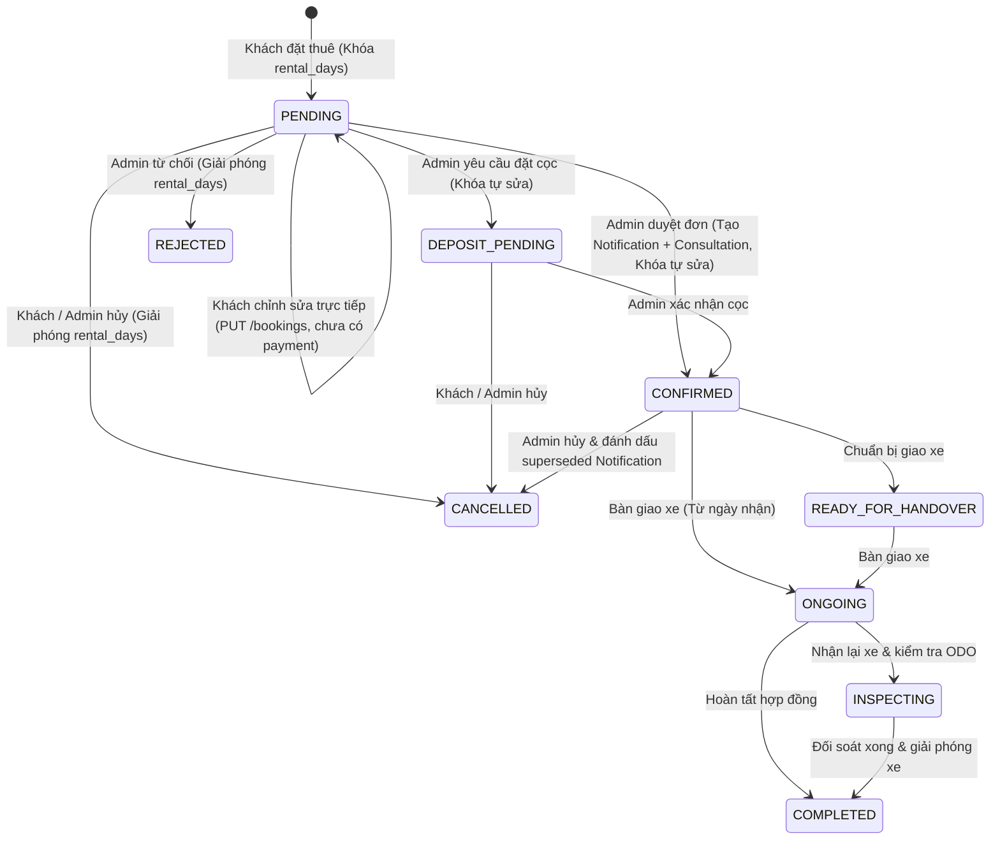
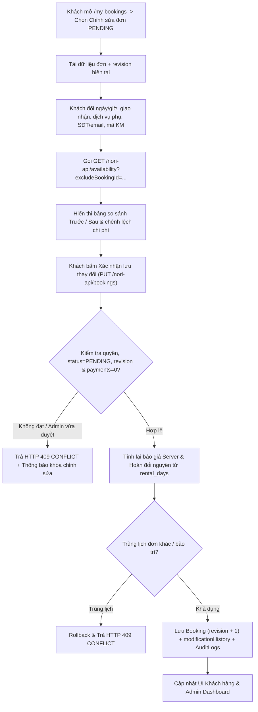
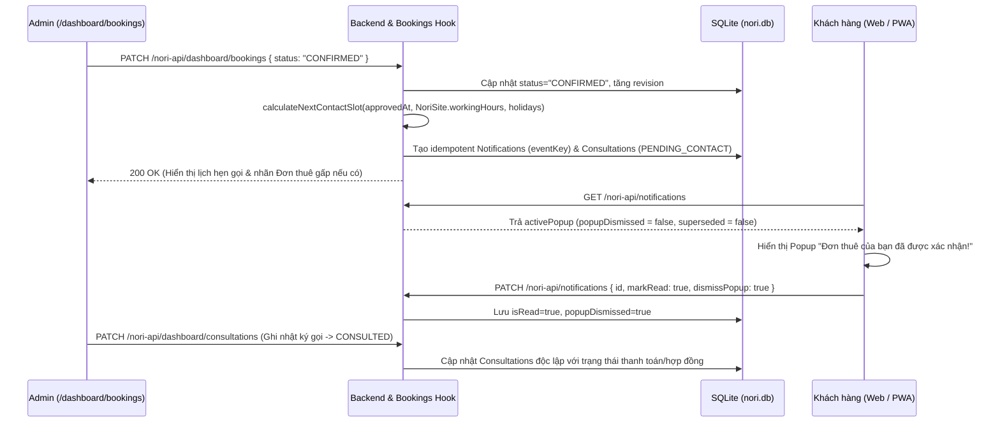
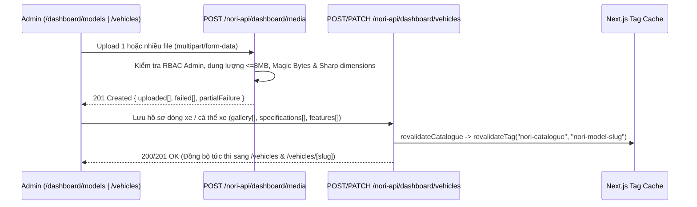

# ĐẶC TẢ YÊU CẦU HỆ THỐNG NORI (SYSTEM SPECIFICATION)

- **Tên dự án**: NORI — Dịch vụ Cho thuê xe Linh hoạt & Tìm mua xe Tự tin
- **Phiên bản tài liệu**: 2.8.0 (Nâng cấp Module 3.8 — PG18 Logical Replication, Encrypted Backup, Smart Vehicle Import, 10 OEM Adapters, VehicleImportJobs State Machine)
- **Kiến trúc công nghệ**: Next.js 16.4.6 (App Router), React 19.3.1, Payload CMS 4.0.0-beta.8, SQLite (`@payloadcms/db-sqlite`) + PostgreSQL (`@payloadcms/db-postgres`, Neon Production + Local PG 18), Drizzle ORM, `118` bảng, Tailwind CSS 4.
- **Trạng thái thực thi**: Xem số liệu kiểm thử mới nhất tại [docs/TEST_REPORT.md](./TEST_REPORT.md) và [docs/PROJECT_STATUS.md](./PROJECT_STATUS.md).

---

## 1. Yêu cầu Kiến trúc & Giao diện (Architecture & UI Requirements)

- **`SPEC-01` — Thiết kế Mobile-First & Responsive Đa màn hình**:
  - Giao diện đáp ứng liền mạch từ màn hình nhỏ nhất `320px` đến màn hình lớn `1920px` qua 11 breakpoints (`320px`, `360px`, `375px`, `390px`, `412px`, `428px`, `640px`, `768px`, `1024px`, `1280px`, `1440px`).
  - **Sticky Header đa nền tảng**: Cố định thanh điều hướng `z-40`, thu gọn thanh tiện ích khi cuộn trang, đổ bóng mờ sang trọng, menu mobile khóa cuộn trang nền.
  - Trên thiết bị di động (<768px): Cố định thanh Bottom Navigation (5 mục: Khám phá, Xe, Yêu thích, Đơn thuê, Tài khoản), hỗ trợ safe area (`env(safe-area-inset-bottom)`).
  - Trang chi tiết xe có thanh đặt xe cố định chân trang (Sticky Booking CTA) và thanh tab chi tiết dính dưới header.
  - Bộ lọc tìm kiếm trên di động hiển thị dạng Bottom Sheet có hỗ trợ thao tác vuốt và chip lọc đang kích hoạt.
- **`SPEC-02` — Khả năng tiếp cận & Tiêu chuẩn WCAG 2.2 AA**:
  - Độ tương phản chữ đạt tối thiểu `4.5:1` cho nội dung thông thường và `3:1` cho tiêu đề lớn.
  - Vùng chạm tương tác tối thiểu `44×44px` cho các nút bấm chính.
  - Hỗ trợ đầy đủ điều hướng bàn phím (`Tab`, `Shift+Tab`, `Escape`, `Enter`, `Space`) và focus ring rõ ràng (`outline-focus`).
  - Hỗ trợ `prefers-reduced-motion` tự động ngắt animation và chuyển đổi carousel sang chế độ tĩnh.
  - `0` lỗi vi phạm khi quét tự động bằng công cụ `@axe-core/playwright`.
- **`SPEC-02.1` — Hero Banner Carousel Tự Động Thông Minh**:
  - Carousel 5 slide đại diện cho 5 phân khúc: Ô tô phổ thông, Xe sang, Xe máy, Bán tải, Xe điện xanh.
  - Tự động chuyển đổi sau 6 giây, tạm dừng khi hover/touch/focus, nút Play/Pause toggle chuẩn ARIA.
  - Hỗ trợ vuốt chạm trên mobile, không gây giật nhấp nháy, không nhảy cuộn trang, bảo toàn dữ liệu form tìm kiếm.
- **`SPEC-02.2` — Thẻ Danh Mục Phương Tiện Có Ảnh Thực Tế**:
  - Thay thế danh mục icon thô bằng thẻ danh mục có ảnh chụp chất lượng cao, nhãn phân khúc, số lượng xe khả dụng và liên kết lọc tương ứng.
- **`SPEC-02.3` — Chuẩn Hóa Dropdown & Searchable Select**:
  - Component `SearchableSelect` thay thế hoàn toàn dropdown mặc định thô của trình duyệt, tích hợp ô tìm kiếm nhanh, điều hướng bàn phím và đóng khi bấm Escape/ngoài vùng.
- **`SPEC-02.4` — Hệ Thống 8 Tabs Trang Chi Tiết Phương Tiện**:
  - 8 nhóm nội dung: 1. Tổng quan & Thiết kế, 2. Thông số kỹ thuật, 3. Công nghệ & An toàn, 4. Xe thực tế & ODO, 5. Giá & Chính sách, 6. Lịch khả dụng (Calendar), 7. Đánh giá, 8. Liên hệ & Hỗ trợ.
  - Triệt tiêu scrollbar thô với class `.no-scrollbar`, thanh tab bám dính dưới header, chuyển tab tức thì không tải lại trang.

---

## 2. Yêu cầu Đồng bộ Dữ liệu (Data Synchronization Requirements)

- **`SPEC-03` — Đồng bộ Tức thì giữa Admin và Khách hàng (Desktop, Mobile, PWA)**:
  - Khi Admin thêm, sửa, ẩn xe hoặc thay đổi giá, thông số, ảnh: Payload hooks (`revalidateCatalogue`, `revalidateDeletedCatalogue`) tự động kích hoạt `revalidateTag` bóc tách slug phụ thuộc và xóa tag cache Next.js (`nori-catalogue-v3`, `nori-model-${slug}`).
  - Khách hàng tải lại hoặc chuyển trang sẽ thấy ngay dữ liệu mới nhất mà không cần build lại máy chủ.
- **`SPEC-04` — Hỗ trợ Dynamic Slug ngoài Build-time**:
  - Tuyến đường `src/app/(frontend)/vehicles/[slug]/page.tsx` khai báo `export const dynamicParams = true`.
  - Mọi dòng xe mới được tạo trên Admin sau thời điểm build sản xuất đều được Next.js tự động render động theo yêu cầu (On-Demand SSR) mà không bị lỗi HTTP 404.
- **`SPEC-05` — Xác thực Giá & Khả dụng Backend Tuyệt đối**:
  - Mọi thao tác tạo đơn thuê (`POST /nori-api/bookings`) hoặc tính giá (`GET /nori-api/availability`) đều thực hiện tính toán lại toàn bộ trên Backend dựa theo đơn giá xe trong DB, phụ phí, thời điểm cuối tuần/ngày lễ và mã khuyến mãi.
  - Từ chối ngay lập tức (`HTTP 400`) mọi nỗ lực giả mạo tổng tiền (`totalPrice`) hoặc tiền cọc (`depositAmount`) từ phía Client.

---

## 3. Yêu cầu Nghiệp vụ & Kiểm soát Giao dịch (Business & Concurrency)

- **`SPEC-06` — Kiểm soát Đặt xe Trùng lịch Đồng thời (Double-Booking Race Condition)**:
  - Sử dụng SQLite Transaction và bảng khóa ngày `rental_days`.
  - Khi 2 người dùng gửi request đặt cùng một xe trên cùng một khoảng ngày, chỉ duy nhất 1 giao dịch được xác nhận (`HTTP 201`), giao dịch còn lại lập tức bị từ chối với mã lỗi `HTTP 409 CONFLICT`.
- **`SPEC-07` — Chống Thanh toán Trùng lặp (Payment Idempotency Guard)**:
  - API `/nori-api/dashboard/payments` kiểm tra lịch sử thanh toán trong vòng **30 giây**.
  - Nếu phát hiện giao dịch có cùng `bookingId`, `paymentType` và `amount`, hệ thống từ chối với mã lỗi `HTTP 409 DUPLICATE_PAYMENT`.
- **`SPEC-08` — Vòng đời Đơn thuê xe (9 trạng thái)**:
  - `PENDING` → `DEPOSIT_PENDING` / `CONFIRMED` / `REJECTED` → `READY_FOR_HANDOVER` → `ONGOING` → `INSPECTING` → `COMPLETED` / `DISPUTED`.
  - Hủy đơn (`CANCELLED`) chỉ cho phép khi ở trạng thái `PENDING` hoặc `DEPOSIT_PENDING` và tự động giải phóng ngày khóa trên lịch.
- **`SPEC-09` — Vòng đời Yêu cầu Mua xe (8 trạng thái)**:
  - `NEW` → `CONTACTED` → `TEST_DRIVE_SCHEDULED` → `DEPOSIT_PENDING` → `CONTRACT_SIGNED` → `DELIVERED` → `COMPLETED`.
  - Khóa xe `RESERVED` khi ký hợp đồng và chuyển `SOLD` khi bàn giao xe. Chặn bán xe nếu xe đang có đơn thuê giữ lịch trong tương lai.

---

## 4. Yêu cầu Bảo mật & Phân quyền (Security & RBAC)

- **`SPEC-10` — Phân quyền Quản trị Tập trung (Centralized RBAC)**:
  - 13 route Dashboard (`/dashboard/*`) và API tương ứng (`/nori-api/dashboard/*`) chỉ cho phép tài khoản Admin (`admins` collection) có cookie `payload-token` hợp lệ.
  - Phân cấp 2 vai trò quản trị: `SUPER_ADMIN` (toàn quyền, quản lý nhân viên, cấu hình hệ thống) và `OPERATOR` (kiểm tra quyền theo từng hành động cụ thể `[module, action]`).
  - Khách hàng (`users`) bị từ chối `HTTP 403` trên toàn bộ khu vực quản trị.
- **`SPEC-11` — Bảo mật PWA & Service Worker Allowlist**:
  - Service Worker chỉ cache tài nguyên công khai an toàn (JS, CSS, static images, offline fallback).
  - Nghiêm cấm cache dữ liệu API, cookie xác thực, hoặc các trang nhạy cảm (`/account`, `/checkout`, `/dashboard`, `/login`, `/register`, `/reset-password`).
  - Tự động dọn dẹp sạch cache (`CLEAR_CACHES`) khi người dùng đăng xuất.
- **`SPEC-12` — Cách ly Dữ liệu Bản nháp Giỏ hàng (Checkout Draft)**:
  - Khóa lưu trữ bản nháp `sessionStorage` gắn kèm định danh tài khoản (`userId`), xóa sạch khi đăng xuất nhằm chống rò rỉ dữ liệu giữa các phiên sử dụng trên cùng thiết bị.

---

## 5. Yêu cầu Hiệu năng & Chỉ số Trải nghiệm Web (Performance & Core Web Vitals)

- **`SPEC-13` — Khắc phục Triệt để Layout Shift (CLS ≤ 0.1000)**:
  - Chuẩn hóa kích thước Skeleton trước khi Hydration khớp 100% với layout thực tế (ví dụ: `VehicleDetailSkeleton` hai cột `min-h-[1200px]`).
  - Khởi tạo giá fallback và cờ `isDemo` ngay tại SSR để tránh nhấp nháy nhãn/giá.
  - Điểm đo thực tế tại trang chi tiết Toyota Fortuner trên production build: **CLS = `0.0038`** (giảm từ `0.1327`).
- **`SPEC-14` — Tốc độ Tải trang & Tương tác (LCP & INP)**:
  - LCP thực tế trên máy chủ sản xuất đạt `< 600ms` (ngưỡng chuẩn < 2500ms).
  - INP (Interaction to Next Paint) đạt `< 50ms` (ngưỡng chuẩn < 200ms).
  - Đảm bảo hiệu năng mượt mà ngay cả khi giả lập mạng chậm và CPU suy giảm 4 lần (Throttled Mobile: CLS = `0.0003`).

---

## 6. Yêu cầu Quản trị Dữ liệu & Triển khai (Data & Operations)

- **`SPEC-15` — Sao lưu & Khôi phục Trực tuyến SQLite**:
  - Hỗ trợ sao lưu an toàn `VACUUM INTO` qua script `scripts/backup-db.mjs` mà không làm gián đoạn hệ thống.
  - Kiểm tra tính toàn vẹn `PRAGMA integrity_check` tự động trên tệp sao lưu.
  - Cung cấp script phục hồi `scripts/restore-db.mjs`.
- **`SPEC-16` — Minh bạch Dữ liệu DEMO & Giới hạn Thương mại**:
  - Toàn bộ 21 xe trong kho hiện tại gắn cờ `isDemo` rõ ràng trên giao diện; nhãn `"Ảnh Catalogue – không phải hình ảnh của cá thể xe đang cho thuê."` hiển thị tách biệt với ảnh cá thể xe thực tế.
  - Cổng thanh toán và dịch vụ gửi SMS/Email đang ở chế độ mô phỏng an toàn (Sandbox), thông báo minh bạch cho người dùng trước khi tiến hành tích hợp thương mại thực tế.

---

## 7. Yêu cầu Nghiệp vụ Mở rộng v2.3 (Booking Edit, Post-Approval Consultation & Dynamic Fleet)

- **`SPEC-17` — Chỉnh sửa Đơn thuê Chờ duyệt & Khóa Đồng thời (Optimistic Locking)**:
  - Chỉ cho phép khách hàng sở hữu đơn ở trạng thái `PENDING` và chưa phát sinh bản ghi `payments` thực hiện `PUT /nori-api/bookings`.
  - Hoán đổi nguyên tử các bản ghi giữ ngày `rental_days` (loại trừ chính `bookingKey` đang sửa qua `excludeBookingId`, kiểm tra xung đột với mọi đơn khác & lịch bảo trì), tính lại báo giá từ máy chủ, hiển thị bảng đối chiếu Trước / Sau và lưu `modificationHistory` + `AuditLogs`.
  - Kiểm tra `revision` và trạng thái tại thời điểm lưu: nếu Admin vừa duyệt đơn đồng thời, trả `HTTP 409 CONFLICT` kèm hướng dẫn liên hệ nhân viên hỗ trợ.
- **`SPEC-18` — Thông báo Popup Sau Duyệt & Quy trình Nhân viên Liên hệ Tư vấn**:
  - Khi đơn chuyển sang `CONFIRMED`, hook `afterChange` sinh idempotent 01 bản ghi `notifications` (`eventKey` duy nhất) và 01 hồ sơ `consultations`.
  - Popup `"Đơn thuê của bạn đã được xác nhận!"` hiển thị đúng một lần trên mỗi sự kiện duyệt (có thể xem lại qua Chuông thông báo trên Header), nêu rõ xác nhận đơn chưa đồng nghĩa đã thanh toán, tự ẩn nếu đơn bị hủy trước khi khách đọc (`superseded = true`).
  - Tự động tính ngày làm việc kế tiếp (`calculateNextContactSlot`) theo múi giờ `Asia/Ho_Chi_Minh`, ngày làm việc và danh sách ngày nghỉ lễ cấu hình từ Admin; gắn nhãn `Đơn thuê gấp` nếu giờ nhận xe diễn ra trước khung liên hệ dự kiến.
- **`SPEC-19` — Hero Carousel Quản trị từ CMS (`NoriSite.heroSlides`)**:
  - Đồng bộ 5 slide phương tiện sắc nét giữa `/dashboard/content` và trang chủ `/`; hỗ trợ crossfade mượt, tạm dừng/tiếp tục, vuốt cảm ứng, `visibilitychange`, `prefers-reduced-motion`, fallback khi ảnh lỗi hoặc 0 slide hoạt động, và giữ nguyên dữ liệu ô tìm kiếm `<SearchBar />`.
- **`SPEC-20` — Tải đa ảnh Bảo mật & Biểu mẫu Phương tiện Thích ứng (`CAR` / `MOTORBIKE` / `PICKUP` / `EV`)**:
  - API `/nori-api/dashboard/media` kiểm tra chữ ký nhị phân (magic bytes JPEG/PNG/WebP/AVIF), kích thước ảnh qua `sharp`, quét chuỗi thực thi nhúng, hỗ trợ tải nhiều ảnh một lần và chặn xóa ảnh đang được tham chiếu (`HTTP 409`).
  - Không gian quản trị dòng xe 10 tab và trang chi tiết `/vehicles/[slug]` tự động thích ứng danh mục con, góc chụp, nhóm thông số (ẩn thông số động cơ đốt trong trên xe thuần điện, ẩn bộ lọc `"Nội thất"` mặc định trên xe máy) và chỉ hiển thị tính năng `EQUIPPED`.

---

## 8. Sơ đồ Nghiệp vụ & Kiến trúc (Mermaid Diagrams)

### 8.1. Sơ đồ Trạng thái Đơn thuê & Quyền Chỉnh sửa (Booking State Diagram)

### 8.2. Sơ đồ Hoạt động Chỉnh sửa Đơn thuê Chờ duyệt (Activity Diagram)

### 8.3. Sơ đồ Tuần tự Duyệt đơn, Thông báo Popup & Tư vấn (Sequence Diagram)

### 8.4. Sơ đồ Tuần tự Tải ảnh Bảo mật & Đồng bộ Phương tiện (Media & Vehicle Sequence)

---

## 9. Yêu cầu Nghiệp vụ Mở rộng Module 3.7 — Đa Chi Nhánh & Đa Địa Điểm (`v2.7.0`)

- **`SPEC-21` — Quản lý Chi nhánh, Kho xe & Định danh Phương tiện Duy nhất**:
  - Hỗ trợ trạng thái `ACTIVE`, `INACTIVE`, `TEMPORARILY_CLOSED`, `ARCHIVED`; cấm xóa cứng chi nhánh khi đã phát sinh xe, nhân viên, đơn thuê hoặc điều chuyển; cảnh báo đơn tương lai trước khi tạm ngừng mà không làm mất/hủy tự động đơn đã xác nhận.
  - Phân biệt tuyệt đối `managingBranch` (chi nhánh quản lý) và `currentBranch` / `currentWarehouse` (vị trí vật lý hiện tại); tuyệt đối không nhân bản bản ghi phương tiện.
- **`SPEC-22` — Động cơ Timeline Vị trí Phương tiện P0 (`evaluateVehicleLocationTimeline`)**:
  - Tính vị trí vật lý dự kiến của xe theo trình tự thời gian từ các đơn giữ chỗ, lịch điều chuyển đã duyệt và lịch bảo dưỡng; tự động ngăn đặt xe sai chi nhánh hoặc xung đột tuyến một chiều.
- **`SPEC-23` — Điều chuyển Phương tiện Liên Chi nhánh Nguyên tử (`VehicleTransfers`)**:
  - 9 trạng thái (`DRAFT`, `PENDING_APPROVAL`, `APPROVED`, `IN_TRANSIT`, `ARRIVED`, `COMPLETED`, `EXCEPTION`, `REJECTED`, `CANCELLED`) kèm Optimistic Locking (`revision`), ghi nhận ODO & nhật ký vị trí (`VehicleLocationHistory`), rollback nguyên tử khi lỗi giữa chừng, cấm hủy sau khi xuất kho (`IN_TRANSIT`) và cấm xác nhận hoàn tất trùng lặp.
- **`SPEC-24` — Phân quyền RBAC Theo Chi nhánh & Chống Leo thang Quyền**:
  - 8 vai trò chức danh (`SUPER_ADMIN`, `SYSTEM_ADMIN`, `BRANCH_MANAGER`, `RENTAL_STAFF`, `WAREHOUSE_STAFF`, `DELIVERY_STAFF`, `ACCOUNTANT`, `OPERATOR`) trên 20 phân hệ và phạm vi `ALL` / `ASSIGNED`; kiểm soát đồng thời tại API, Payload Collection Access, Export CSV và thu hồi quyền tức thì (`REVOKED`).
- **`SPEC-25` — Điểm Giao Nhận Đã Xác Minh & Giao Nhận Tận Nơi (`ServiceLocations`, `DeliveryZones`, `DeliveryJobs`)**:
  - Chỉ hiển thị điểm giao nhận đã xác minh (`verified = true`, `status = ACTIVE`); chặn phân công trùng khung giờ cho cùng nhân viên giao nhận (`409 DELIVERY_STAFF_TIME_CONFLICT`); lỗi giao hàng (`FAILED`) không đẩy sai trạng thái đơn thuê.
- **`SPEC-26` — Phân cấp Định giá 5 Tầng, Thuê Một Chiều & Khuyến mãi Theo Chi nhánh**:
  - Thứ tự ưu tiên `VEHICLE_BRANCH` > `MODEL_BRANCH` > `BRANCH_DEFAULT` > `GLOBAL_DEFAULT` > `vehicle.pricePerDay`; kiểm tra quy tắc tuyến một chiều (`OneWayRentalRules`) và số ngày tối thiểu; đóng băng snapshot giá vĩnh viễn trên đơn đã tạo; hỗ trợ mã khuyến mãi toàn hệ thống hoặc theo danh sách chi nhánh (`SPECIFIC_BRANCHES`).
- **`SPEC-27` — Báo cáo Đa Chi Nhánh Không Đếm Trùng & CSV Theo Phạm vi**:
  - Phân bổ doanh thu đơn một chiều theo `revenueSplitMode` (`PICKUP_BRANCH`, `RETURN_BRANCH`, `SPLIT_50_50`, `CUSTOM_PERCENT`) bảo đảm `sum(branch.netRevenue) + unassigned.netRevenue === systemTotal.netRevenue` đến từng VNĐ.
- **`SPEC-28` — Nâng cấp Schema Additive-Only & Bảo toàn Dữ liệu Hiện hữu**:
  - Migration `20261120_020000_multi_branch_management` chỉ thêm bảng/cột/index mới (lũy kế an toàn), nâng từ `88` lên `109` bảng và bổ sung `12` composite indexes, bảo toàn 100% 21 xe DEMO hiện có ở trạng thái `UNALLOCATED` (không bịa địa chỉ chi nhánh thật).

---

## 10. Yêu cầu Nghiệp vụ Mở rộng Module 3.8 — Replication, Backup & Smart Vehicle Import (`v2.8.0`)

- **`SPEC-29` — Replication & Encrypted Backup (PostgreSQL 18 Logical Replication)**:
  - Dual-adapter: Payload CMS hoạt động với cả `@payloadcms/db-sqlite` (local dev) và `@payloadcms/db-postgres` (Neon Production + Local PG 18), `push: false` trên cả hai adapter.
  - Neon PostgreSQL Production → Local PostgreSQL 18 `nori_replica`: one-way Logical Replication (`wal_level = logical`, `PUBLICATION nori_pub`, `SUBSCRIPTION nori_sub`), direct non-pooler TLS connection, `REPLICA IDENTITY DEFAULT` trên tất cả bảng có `PRIMARY KEY`.
  - Database phân tách: `nori_replica` (read-only replica, Antigravity SQL/ERD tooling), `nori_development` (dev, có migration rights), `nori_readonly` (Antigravity queries).
  - Encrypted Daily Backup: `pg_dump` + AES-256-GCM + SHA-256 manifest, Windows Task Scheduler `NORI-Daily-Backup-2359` (`State=Ready`, `StartWhenAvailable=True`), `23:59 Asia/Ho_Chi_Minh`, giữ lại `30d/12w/12m`.
  - Media Backup: `pnpm db:media:backup --verify --json` xác minh `81` files (`19,184,067` bytes), `0` missing, `0` checksum mismatch.
  - CLI commands: `pnpm db:sync:status`, `pnpm db:sync:check`, `pnpm db:backup`, `pnpm db:backup:verify`, `pnpm db:restore`, `pnpm db:media:backup`.
  - `nori_replica` là read-only — ứng dụng **không bao giờ ghi** vào replica; Antigravity `nori_readonly` chỉ dùng để query/ERD.
  - Kiểm thử: `pnpm test:db:replica` — `20/20 PASS` (`DB-01..22`, `132.91s`, dual PG 18.6 disposable clusters).

- **`SPEC-30` — Smart Vehicle Import (5 phương thức, 10 OEM Adapters + Generic, VehicleImportJobs State Machine)**:
  - **5 phương thức import**: URL/SYNC (tự động fetch từ trang OEM), AI Smart Search (AI đề xuất model theo tên), Bulk (danh sách URL/CSV/JSON), PDF Brochure (trích xuất từ brochure PDF chính thức), Manual (nhập tay toàn bộ trường).
  - **10 OEM Adapters + Generic**: Toyota, Honda, Ford, Mitsubishi, Mazda, Hyundai, Mercedes-Benz, VinFast, Yamaha, Kawasaki; Generic fallback cho domain không có adapter chuyên biệt. Kết nối thực tế có thể bị WAF 403/TLS/timeout — adapter phát hiện tự động và fallback PDF/JSON.
  - **Preview-Before-Save**: Mọi import đều hiển thị diff trước/sau, trường bị `lockedFields` không được phép ghi đè từ import.
  - **VehicleImportJobs State Machine** (12 trạng thái trong `src/lib/vehicle-import/job-manager.ts`): `QUEUED`, `FETCHING`, `EXTRACTING`, `NORMALIZING`, `VALIDATING`, `PREVIEW_READY`, `AWAITING_APPROVAL`, `IMPORTING`, `COMPLETED`, `PARTIAL_SUCCESS`, `FAILED`, `CANCELLED` (khi phục hồi tiến trình treo sau khởi động lại máy chủ, trạng thái chuyển `FAILED` kèm `errorCode: 'RECOVERED_AFTER_RESTART'`).
  - **Approval/Draft/Publish/Rollback**: Admin có quyền `models` duyệt job → `verificationStatus` (`VERIFIED`/`DRAFT`) + `visible`, một-click Rollback; double-rollback bị từ chối với HTTP `409` (`"Tiến trình này đã được Rollback trước đó."`).
  - **Concurrency cap**: tối đa 3 job đồng thời; job thứ 4 trả `429 CONCURRENCY_LIMIT_REACHED`.
  - **Demo separation**: Import chỉ cập nhật `vehicle_models` (Catalogue), **không** tạo hoặc chỉnh sửa bản ghi đội xe `vehicles` (`isDemo`).
  - **Bảo mật**: SSRF defense-in-depth (`HTTPS_REQUIRED`, `DOMAIN_NOT_ALLOWLISTED`, `SSRF_PRIVATE_IP`, `SSRF_LOCAL_HOST`, `IP_LITERAL_FORBIDDEN`, `TOO_MANY_REDIRECTS`), giới hạn tệp/magic-byte/pixel (`PAYLOAD_TOO_LARGE`, `INVALID_PDF_SIZE`), HTML/XSS sanitization, `assertOrigin` CSRF (`403 FORBIDDEN`), Audit Logging, external API cost controls.
  - **Kiểm thử**: `tests/vehicle-import.test.mjs` — `5` subtests PASS trong `pnpm test` (`374/375 PASS`, `1 skip`); `tests/e2e/vehicle-import.spec.ts` — E2E-01..15 `PASS`.
  - **Catalogue enrichment**: `21/21` models enriched (`11` VERIFIED, `10` NEEDS_BROCHURE_CHECK), `pnpm catalogue:validate`: `ok=true`, `files=12`, `media=67`.
  - **API**: `GET /nori-api/dashboard/catalogue-import/jobs`, `POST /preview`, `POST /sync-check`, `GET /jobs/[id]`, `POST /jobs/[id]/approve`, `POST /jobs/[id]/cancel`, `POST /jobs/[id]/retry`, `POST /jobs/[id]/rollback`, `PATCH /models/[id]/locks`.
