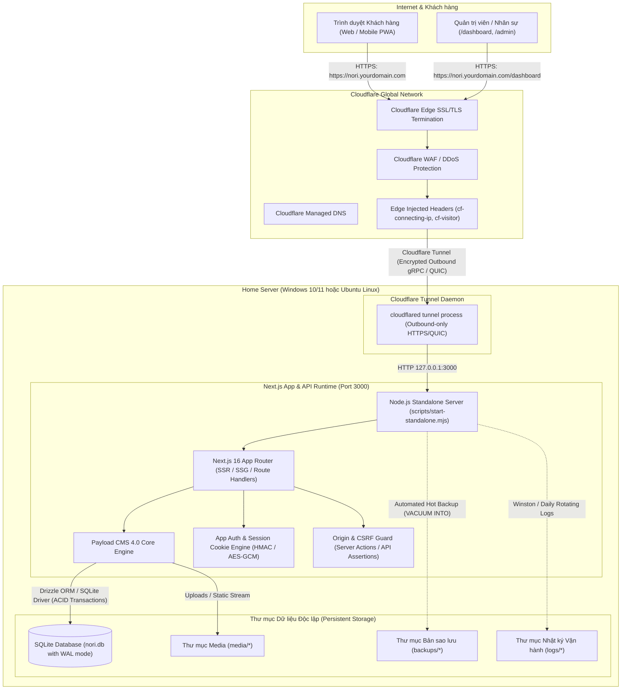

# NORI Vehicle Rental — System Architecture & Self-Hosting Topology

Tài liệu thiết kế kiến trúc hệ thống phục vụ việc triển khai NORI trên môi trường **Home Server**, định tuyến an toàn ra Internet thông qua **Cloudflare Tunnel**, bảo đảm tính toàn vẹn dữ liệu SQLite và cách ly tài nguyên.

---

## 1. Tổng quan cấu trúc hệ thống (High-Level Topology)

---

## 2. Luồng xử lý Request qua Cloudflare Tunnel

1. **Khách hàng gửi yêu cầu**:
   - Truy cập `https://nori.yourdomain.com` (hoặc domain ngẫu nhiên của Quick Tunnel).
2. **Cloudflare Edge xử lý**:
   - Chấm dứt TLS tại Edge với chứng chỉ SSL/TLS miễn phí của Cloudflare.
   - Thêm các tiêu đề HTTP chuẩn hóa:
     - `cf-connecting-ip`: Địa chỉ IP thực tế của client.
     - `cf-visitor`: `{"scheme":"https"}`.
     - `x-forwarded-proto`: `https`.
     - `x-forwarded-host`: Tên miền công khai.
3. **Định tuyến qua Tunnel Daemon (`cloudflared`)**:
   - Home Server **không cần mở bất kỳ port nào trên Router (No Port Forwarding, No DDNS, No Public Static IP)**.
   - Daemon `cloudflared` chủ động duy trì kết nối outbound an toàn đến 4 trạm Cloudflare Edge gần nhất thông qua giao thức QUIC/HTTP2.
   - Khi có request từ Cloudflare Edge, `cloudflared` proxy nội bộ về `http://127.0.0.1:3000`.
4. **Xử lý tại Node.js Server**:
   - Module `src/lib/session-cookie.ts` tự động phát hiện `cf-visitor: {"scheme":"https"}` hoặc `x-forwarded-proto: https` để kích hoạt cờ `Secure; HttpOnly; SameSite=Lax` cho cookie phiên.
   - Module `src/lib/api-utils.ts` đối chiếu `ALLOWED_ORIGINS` và kiểm tra rate limiting dựa trên `cf-connecting-ip`.
   - Next.js bảo vệ Server Actions thông qua `experimental.serverActions.allowedOrigins` trong `next.config.ts`.
5. **Truy vấn Dữ liệu & Render**:
   - Trang tĩnh (Catalogue, Giới thiệu) được phản hồi ngay từ Next.js Cache / ISR.
   - Các thao tác đặt xe, hủy xe, duyệt đơn được bao bọc trong SQLite Transaction với khóa ngày nguyên tử.

---

## 3. Quản lý Cơ sở Dữ liệu SQLite trong môi trường Production

SQLite là công nghệ lưu trữ quan hệ không cần cài đặt daemon server độc lập, mang lại hiệu năng đọc/ghi vượt trội khi được tối ưu đúng:

### 3.1. Chế độ WAL (Write-Ahead Logging)

- Khi khởi động server, `src/payload.config.ts` thiết lập `PRAGMA journal_mode = WAL;`.
- WAL cho phép các truy vấn **Đọc (Readers)** không bao giờ chặn các truy vấn **Ghi (Writers)**, và ngược lại.
- Tránh triệt để tình trạng khóa bảng kéo dài (`database is locked`).

### 3.2. PRAGMA & Busy Timeout

- `PRAGMA busy_timeout = 10000;`: Chờ tối đa 10 giây nếu có giao dịch khác đang ghi, thay vì lập tức quăng lỗi `SQLITE_BUSY`.
- `PRAGMA foreign_keys = ON;`: Bắt buộc ràng buộc toàn vẹn khóa ngoại trên toàn bộ 109 bảng.
- `PRAGMA synchronous = NORMAL;`: Tối ưu hiệu năng I/O trên ổ cứng SSD/NVMe mà vẫn an toàn trước sự cố sập nguồn.

### 3.3. Cơ chế Khóa Giao dịch & Idempotency Key

- Mọi đơn đặt xe mới đều có `idempotencyKey` ngẫu nhiên được sinh từ Client và đối chiếu tại Server để chặn double-submit do người dùng nhấn nút nhiều lần.
- Đặt xe và điều chuyển xe sử dụng bảng khóa ngày toàn cục `rental_days`:
  - `lock_type`: `BOOKING` hoặc `TRANSFER`.
  - Khóa nguyên tử qua ràng buộc duy nhất `(vehicle_id, date)` ngăn chặn tình trạng đặt trùng xe (double-booking) tại tầng cơ sở dữ liệu.

---

## 4. Tách biệt Vùng Lưu trữ Bền vững (Persistent Storage Boundary)

Để việc cập nhật source code thông qua `git pull` không bao giờ ảnh hưởng hoặc ghi đè lên dữ liệu vận hành thực tế, kiến trúc NORI phân tách hoàn toàn mã nguồn và dữ liệu:

| Thành phần        | Đường dẫn mặc định (Project Root) | Đường dẫn khuyến nghị (Home Server Độc lập)                       | Biến môi trường điều khiển         |
| :---------------- | :-------------------------------- | :---------------------------------------------------------------- | :--------------------------------- |
| **Cơ sở dữ liệu** | `./data/nori.db`                  | `C:\NORI\data\nori.db` (Win) hoặc `/var/lib/nori/nori.db` (Linux) | `DATABASE_URL` hoặc `DATABASE_URI` |
| **Tệp tải lên**   | `./data/media`                    | `C:\NORI\data\media` (Win) hoặc `/var/lib/nori/media` (Linux)     | `MEDIA_DIR`                        |
| **Bản sao lưu**   | `./backups`                       | `C:\NORI\backups` (Win) hoặc `/var/backups/nori` (Linux)          | `BACKUP_DIR`                       |
| **Nhật ký logs**  | `./logs`                          | `C:\NORI\logs` (Win) hoặc `/var/log/nori` (Linux)                 | `LOG_DIR`                          |

Module trung tâm `src/lib/env.ts` tự động phát hiện đường dẫn tương đối hoặc tuyệt đối, tự động tạo thư mục nếu chưa tồn tại và kiểm tra quyền ghi trước khi tiến trình khởi động.

---

## 5. Kiến trúc Xác thực & Phân quyền Hai Tầng (Dual Auth Architecture)

Hệ thống duy trì hai phạm vi xác thực cách ly tuyệt đối:

1. **Khách hàng (`users`)**:
   - Sử dụng cho khách thuê xe công khai trên Website và PWA.
   - Phiên đăng nhập được quản lý bằng JWT / HMAC Cookie (`nori_user_token`).
   - Tuyệt đối không có quyền truy cập vào Payload Admin (`/admin`) hoặc Admin Dashboard (`/dashboard`).
2. **Nhân viên & Quản trị viên (`admins`)**:
   - Được quản lý bởi hệ thống phân quyền đa chi nhánh (8 vai trò: `SUPER_ADMIN`, `SYSTEM_ADMIN`, `BRANCH_MANAGER`, `RENTAL_STAFF`, `WAREHOUSE_STAFF`, `DELIVERY_STAFF`, `ACCOUNTANT`, `OPERATOR`).
   - Bảo vệ bằng Session Cookie riêng biệt và kiểm tra trạng thái tài khoản `account_status === 'ACTIVE'`.
   - Nếu tài khoản bị đánh dấu `REVOKED`, mọi phiên đang mở lập tức bị từ chối truy cập.
