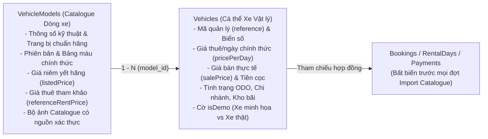

# TIÊU CHUẨN CATALOGUE DÒNG XE CHÍNH THỨC (VEHICLE CATALOGUE STANDARDS) — NORI

> **Mục tiêu**: Chuẩn hóa cấu trúc dữ liệu, quy tắc kiểm định thông số theo thị trường Việt Nam (`VN`), quy luật phân biệt xe điện (**EV**), xe động cơ đốt trong (**ICE**) và **Xe máy**, đồng thời bảo vệ ranh giới bất biến giữa **Catalogue dòng xe (`VehicleModels`)** và **Kho xe thực tế (`Vehicles`)**.

---

## 1. Phân tách Cốt lõi: Catalogue (`VehicleModels`) vs Kho xe (`Vehicles`)

### Nguyên tắc bảo vệ Dữ liệu Vận hành NORI:
1. **Không bao giờ ghi đè giá vận hành thực tế**: Việc cập nhật hoặc import lại `VehicleModels` (thông số hãng, brochure, giá niêm yết hãng) **không được phép** sửa đổi `pricePerDay`, `salePrice`, `depositAmount`, `weekendSurcharge`, `holidaySurcharge`, `operationStatus` trên bảng `Vehicles` hay các đơn thuê đang tồn tại (`Bookings`, `RentalDays`, `Payments`).
2. **Phân tách `isDemo` rõ ràng**:
   - Trong `Vehicles`, cờ `isDemo` phân biệt xe mẫu phục vụ trình diễn/kiểm thử (`isDemo = true`, như 21 xe mẫu khởi tạo ban đầu) với xe vận hành thương mại thật của doanh nghiệp (`isDemo = false`).
   - Môi trường Production thương mại sử dụng `NORI_DISABLE_DEMO_SEED=1` để ngăn tạo mới dữ liệu mẫu tự động.
3. **Khóa trường quản trị (`lockedFields`)**: Admin có thể khóa từng trường trên `VehicleModels` (ví dụ `listedPrice`, `referenceRentPrice`, `shortDescription`, `cover`) để các lần Smart Import hoặc đồng bộ lại từ hãng không ghi đè chỉnh sửa thủ công của đội ngũ vận hành.

---

## 2. Tiêu chuẩn Định danh & Phân loại (`VehicleModels`)

### 2.1. Định danh & Nguồn xác thực thị trường Việt Nam (`VN`)
- **Tên hiển thị (`name`) & Tên thương mại (`officialName`)**: Ghi đúng tên phân phối chính thức tại thị trường Việt Nam (ví dụ `Toyota Fortuner`, `officialName: Toyota Fortuner 2.8AT 4x4 Legender`).
- **Định danh ổn định (`slug`)**: Kebab-case duy nhất (`toyota-fortuner`, `vinfast-vf-8`, `honda-sh160i`), dùng làm khóa tra cứu URL (`/vehicles/[slug]`) và đồng bộ `data-sync`. Không đổi `slug` tùy tiện khi làm giàu dữ liệu để bảo toàn liên kết SEO và đơn hàng.
- **Thương hiệu (`brand`) & Đời xe (`modelYear`)**: Bắt buộc khớp thị trường Việt Nam (`1990 <= modelYear <= 2035`), gắn kèm `versionName` / `generation` nếu hãng nâng cấp giữa vòng đời (facelift).
- **Trạng thái xác minh (`verificationStatus`)**:
  - `VERIFIED`: Đã đối chiếu từ website hãng chính thức hoặc PDF brochure chính thức của nhà sản xuất/nhà phân phối tại VN.
  - `UNVERIFIED`: Dữ liệu trích xuất có phần chưa chắc chắn (ví dụ AI hoặc bảng PDF thiếu ngữ cảnh phiên bản), hiển thị cảnh báo để Admin kiểm tra trước khi duyệt.
  - `DRAFT`: Bản nháp chưa sẵn sàng công khai (`visible = false`).

### 2.2. Hệ thống 3 Danh mục & 17 Phân hạng Kiểu dáng (`subCategory`)

| Danh mục (`category`) | Các giá trị `subCategory` hợp lệ (`VehicleModels.ts`) |
| :--- | :--- |
| **`CAR`** *(Ô tô)* | `HATCHBACK`, `SEDAN`, `SUV`, `CUV`, `MPV`, `COUPE`, `SPORTS`, `ELECTRIC_CAR` |
| **`MOTORBIKE`** *(Xe máy)* | `MANUAL_BIKE`, `SCOOTER`, `CLUTCH_BIKE`, `BIG_BIKE`, `ELECTRIC_BIKE` |
| **`PICKUP`** *(Bán tải)* | `STANDARD_PICKUP`, `WORK_PICKUP`, `PREMIUM_PICKUP`, `PERFORMANCE_PICKUP` |

---

## 3. Quy tắc Chuẩn hóa Theo Loại Phương tiện (EV vs ICE vs Motorbike)

Hệ thống chuẩn hóa (`normalizer.ts`) và đội ngũ biên tập phải tuân thủ nghiêm ngặt quy tắc tương thích thông số để tránh hiển thị dữ liệu vô nghĩa (ví dụ "dung tích xi-lanh" cho xe điện hay "số túi khí/số ghế 5 chỗ" cho xe máy):

| Nhóm thông số (`specifications.group`) | Ô tô Động cơ Đốt trong (ICE / Hybrid) | Ô tô Điện (`ELECTRIC_CAR` / `Điện (EV)`) | Xe máy Xăng (`MOTORBIKE` ICE) | Xe máy Điện (`ELECTRIC_BIKE`) |
| :--- | :--- | :--- | :--- | :--- |
| **`OVERVIEW`** | Chỗ ngồi, Hộp số, Dẫn động, Nhiên liệu | Chỗ ngồi, Hộp số (1 cấp), Dẫn động, Điện (EV) | Loại xe, Truyền động, Tiêu thụ nhiên liệu | Loại xe, Động cơ điện, Chuẩn chống nước |
| **`ENGINE`** | Dung tích xi-lanh (cc), Công suất (HP), Mô-men xoắn (Nm), Tiêu chuẩn khí thải | Công suất mô-tơ (kW/HP), Mô-men xoắn — **Ẩn/Loại bỏ dung tích xi-lanh & bình xăng** | Dung tích xi-lanh (cc), Tỉ số nén, Hệ thống phun xăng (PGM-FI / Fi) | **Không nhập dung tích xi-lanh ICE** — Chuyển sang nhóm `EV` |
| **`EV`** *(Chuyên biệt Xe điện)* | Không áp dụng | Dung lượng pin (kWh), Quãng đường (km WLTP/NEDC), Công suất sạc nhanh DC (kW), Thời gian sạc 10–70% / 10–80% | Không áp dụng | Loại pin (LFP), Dung lượng (kWh/Ah), Quãng đường/lần sạc, Thời gian sạc, Tốc độ tối đa |
| **`DIMENSIONS`** | Dài × Rộng × Cao, Chiều dài cơ sở, Khoảng sáng gầm, Dung tích bình xăng (L) | Dài × Rộng × Cao, Chiều dài cơ sở, Khoảng sáng gầm, Dung tích cốp (không có bình xăng) | Dài × Rộng × Cao, Độ cao yên (mm), Trọng lượng bản thân (kg), Dung tích bình xăng (L) | Dài × Rộng × Cao, Độ cao yên (mm), Trọng lượng (kg), Dung tích cốp (L) |
| **`CHASSIS`** | Treo trước/sau, Phanh trước/sau, Kích cỡ lốp | Treo trước/sau, Phanh tái sinh + đĩa, Kích cỡ lốp | Giảm xóc trước/sau, Phanh ABS/CBS, Cỡ lốp | Giảm xóc, Phanh đĩa/tang trống, Cỡ lốp |
| **`PICKUP`** | Chỉ áp dụng cho danh mục `PICKUP` (Kích thước thùng hàng, Tải trọng, Khả năng lội nước, Khóa vi sai) | Áp dụng nếu là bán tải điện | Không áp dụng | Không áp dụng |
| **`MOTORBIKE`** | Không áp dụng | Không áp dụng | Áp dụng (Chiều cao yên, Cốp xe, Bình xăng, Hộp số) | Áp dụng (Chiều cao yên, Cốp xe, Chìa khóa SmartKey) |

### Quy tắc kiểm tra bắt buộc (Validation Rules):
1. **Không bịa đặt thông số thiếu**: Nếu hãng hoặc brochure không công bố một thông số (ví dụ khoảng sáng gầm hoặc mô-men xoắn), hệ thống đánh dấu thiếu hoặc `UNVERIFIED`, **tuyệt đối không nội suy hay tự điền giá trị ước lượng**.
2. **Trang bị (`features`)**: Phân rõ 4 nhóm (`COMFORT`, `SAFETY`, `DRIVER_ASSIST`, `TECHNOLOGY`) với 4 trạng thái chuẩn: `EQUIPPED`, `NOT_EQUIPPED`, `UNVERIFIED`, `NOT_APPLICABLE`.
3. **Phiên bản & Màu sắc (`variants[].colors[]`)**:
   - Giá niêm yết (`listedPrice`) và giá thuê tham khảo (`referenceRentPrice`) lưu ở dạng số nguyên VNĐ (`>= 0`).
   - Mỗi màu xe nên gắn mã `hex` tham khảo, `sourceUrl` và `image` đúng phiên bản/màu sắc đó.

---

## 4. Tiêu chuẩn Bộ ảnh Catalogue (`gallery` & `cover`)

- **Phân loại `gallery[].kind` bắt buộc**:
  - `OVERVIEW`: Góc 3/4 trước/sau tổng thể xe.
  - `EXTERIOR`: Ngoại thất (đầu xe, đuôi xe, mâm lốp, cụm đèn).
  - `INTERIOR`: Khoang lái, vô-lăng, màn hình, hàng ghế (áp dụng cho `CAR` & `PICKUP`).
  - `ENGINE`: Khoang động cơ, mô-tơ điện, pin, hoặc cụm động cơ xe máy.
  - `FEATURE`: Chi tiết công nghệ, bảng đồng hồ, cốp, thùng bán tải, tiện ích.
- **Metadata bắt buộc cho ảnh chính thức**: `mediaCategory = 'CATALOGUE_OFFICIAL'` (hoặc `'CATALOGUE_REFERENCE'`), `sourceUrl`, `sourceName`, `license`, `verified = true`, `altText` mô tả rõ ràng phục vụ truy cập (Accessibility).
- **Tránh trùng lặp & Rác dữ liệu**: Mỗi ảnh được tính `SHA-256` (`sourceSha256`) để tránh lưu 2 bản sao giống hệt nhau giữa các dòng xe hoặc các lần import lại.
