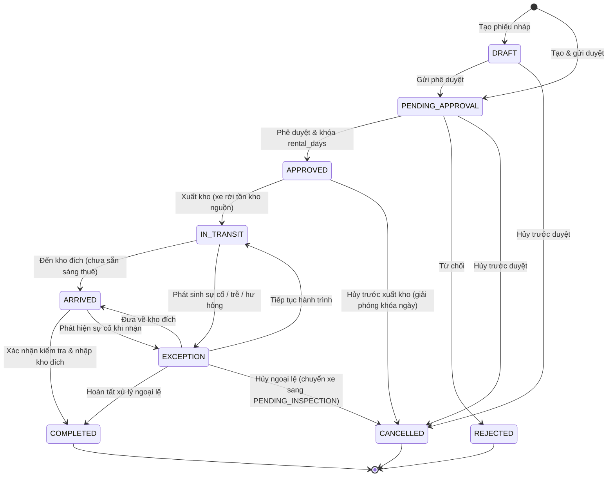
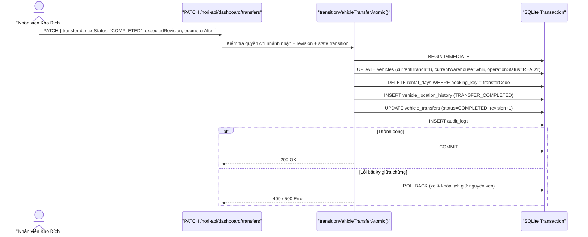

# NORI Vehicle Rental — Vehicle Transfer Workflow (Quy trình điều chuyển phương tiện)

## 1. Máy trạng thái (State Machine)

---

## 2. Quy tắc toàn vẹn nghiệp vụ (TR-01 → TR-12)

1. **Chặn điều chuyển bất hợp lệ**: Không cho phép tạo phiếu nếu xe đang `RENTED`, `SOLD`, `IN_TRANSIT`, hoặc `MAINTENANCE` (trừ quy trình ngoại lệ), hoặc kho đích hết sức chứa (khi `allowOverCapacity = false`), hoặc trùng lịch `bookings` / `rental-days` / `vehicle-transfers` khác.
2. **Khóa lịch toàn cục khi `APPROVED`**: Ghi các bản ghi `rental_days` (`lockType = 'TRANSFER'`, khóa `vehicleId:day`) trong SQLite transaction. Mọi đơn thuê mới chồng chéo sẽ bị chặn ngay lập tức.
3. **Xuất kho (`IN_TRANSIT`)**: Cập nhật `vehicles.operationStatus = 'IN_TRANSIT'`, `currentWarehouse = null`, `nextExpectedBranch = toBranch`, ghi `vehicle-location-history (TRANSFER_DEPARTURE)`. Xe **không được tính vào tồn kho vật lý** của cả kho xuất lẫn kho nhận!
4. **Cấm hủy trực tiếp sau khi xuất kho (TR-10)**: Từ `IN_TRANSIT` không được chuyển sang `CANCELLED`; bắt buộc qua quy trình `EXCEPTION` để bảo toàn dấu vết vị trí thực tế.
5. **Xe đến nơi (`ARRIVED`, TR-06)**: Ghi nhận `TRANSFER_ARRIVAL` nhưng **chưa chuyển xe thành `READY` tại kho đích** cho đến khi nhân viên chi nhánh nhận hoàn tất đối chiếu và xác nhận `COMPLETED`.
6. **Hoàn tất nguyên tử (`COMPLETED`, TR-07 / TR-08 / TR-11)**:
   - Thực hiện trong SQLite `BEGIN IMMEDIATE ... COMMIT` transaction.
   - Cập nhật đồng thời `vehicles.currentBranch = toBranch`, `currentWarehouse = toWarehouse`, `operationStatus = 'READY'` (hoặc `'PENDING_INSPECTION'`), giải phóng `rental_days`, ghi `TRANSFER_COMPLETED` và tăng `revision`.
   - Nếu xảy ra lỗi giữa transaction, toàn bộ thay đổi được `ROLLBACK` nguyên tử.
   - Chặn xác nhận hoàn tất 2 lần (double-complete) bằng cả kiểm tra trạng thái terminal lẫn optimistic locking `expectedRevision`.
7. **Cảnh báo trễ lịch (TR-12)**: Cập nhật `scheduledArrivalAt` tự động đối chiếu các đơn thuê tương lai của xe đó và gắn `delayedWarning = true` cùng danh sách `affectedBookingKeys`.

---

## 3. Sequence Diagram: Atomic Transfer Completion

