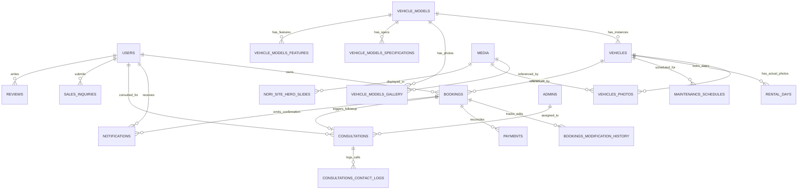

# TÀI LIỆU CƠ SỞ DỮ LIỆU NORI (DATABASE DOCUMENTATION)

- **Hệ quản trị CSDL**: SQLite (`file:./nori.db`) qua `@payloadcms/db-sqlite` (Drizzle ORM, `idType: 'uuid'`).
- **Tính toàn vẹn**: `PRAGMA integrity_check = 'ok'`, `PRAGMA foreign_key_check = []`.
- **Migration mới nhất**: `src/migrations/20261118_050000_upgrade_bookings_notifications_hero_vehicles.ts` (bổ sung idempotent các bảng & cột mới, bảo toàn 100% dữ liệu hiện hữu).

---

## 1. Danh mục Bảng & Thực thể Chính

| Bảng (`nori.db`)                                                                                     | Collection / Global    | Mục đích & Trường trọng tâm                                                                                                                                                                              |
| :--------------------------------------------------------------------------------------------------- | :--------------------- | :------------------------------------------------------------------------------------------------------------------------------------------------------------------------------------------------------- |
| `admins`                                                                                             | `Admins`               | Tài khoản quản trị (`admin_role`: `SUPER_ADMIN` / `OPERATOR`, `permissions` JSON RBAC).                                                                                                                  |
| `users`                                                                                              | `Users`                | Tài khoản khách hàng ứng dụng (`role: CUSTOMER`, `status`, `driver_license_number`, `id_card_number`).                                                                                                   |
| `vehicle_models` + bảng phụ (`_gallery`, `_specifications`, `_features`, `_highlights`, `_variants`) | `VehicleModels`        | Catalogue dòng xe (`slug` unique, `official_name`, `model_line`, `version_name`, `generation`, `usage_purpose`, `short_description`, đa ảnh `photo_type`/`is_primary`/`sort_order`, tính năng `status`). |
| `vehicles` + `vehicles_photos`                                                                       | `Vehicles`             | Cá thể xe thực tế (`reference` unique, `license_plate`, `operation_status`, `odometer`, `is_demo`, đa ảnh thực tế `photo_type`/`is_primary`/`sort_order`).                                               |
| `maintenance_schedules`                                                                              | `MaintenanceSchedules` | Lịch bảo trì/sửa chữa theo khoảng ngày (`start_date`, `end_date`, `status`).                                                                                                                             |
| `rental_days`                                                                                        | `RentalDays`           | Khóa ngày thuê `key = vehicleId:YYYY-MM-DD` unique chống đặt trùng và hỗ trợ hoán đổi nguyên tử khi sửa đơn chờ duyệt.                                                                                   |
| `bookings` + `bookings_modification_history` + `bookings_status_history`                             | `Bookings`             | Đơn thuê xe kèm snapshot tài chính, `revision` (optimistic locking), `return_location`, `customer_email`, `expected_contact_date`, `is_urgent_approval`, và lịch sử chỉnh sửa chi tiết trước/sau.        |
| `notifications`                                                                                      | `Notifications`        | Thông báo khách hàng sau duyệt đơn (`event_key` unique idempotent, `type`, `popup_dismissed`, `is_read`, `superseded`, `payment_confirmed`).                                                             |
| `consultations` + `consultations_contact_logs`                                                       | `Consultations`        | Hồ sơ theo dõi nhân viên liên hệ tư vấn sau duyệt đơn (`consultation_key` unique, `expected_contact_date`, `is_urgent`, `assigned_staff_id`, `status`, nhật ký cuộc gọi).                                |
| `sales_inquiries`                                                                                    | `SalesInquiries`       | Yêu cầu tư vấn mua xe / lái thử (`vehicle_id` FK, `status_history`).                                                                                                                                     |
| `promotions`                                                                                         | `Promotions`           | Mã giảm giá (`code` unique, `discount_type`, `discount_value`, `min_days`, `used_count`, `active`).                                                                                                      |
| `payments`                                                                                           | `Payments`             | Sổ thu chi đặt cọc / tiền thuê / hoàn tiền (`reference` unique, `booking_id`, `payment_type`, `status`).                                                                                                 |
| `reviews`                                                                                            | `Reviews`              | Đánh giá xác thực từ đơn thuê đã `COMPLETED` (`booking_id` unique).                                                                                                                                      |
| `posts` + `_posts_v`                                                                                 | `Posts`                | Bài viết tin tức & cẩm nang hỗ trợ Draft / Publish.                                                                                                                                                      |
| `nori_site` + `nori_site_hero_slides` + `nori_site_holidays` + `_nori_site_v`                        | `NoriSite`             | Global CMS quản trị Hero Carousel (`hero_slides`), giờ hành chính & ngày nghỉ lễ (`holidays`), thông tin liên hệ và chính sách.                                                                          |
| `media`                                                                                              | `Media`                | Thư viện tệp hình ảnh đã xác thực magic-byte, bảo vệ khóa tham chiếu `beforeDelete`.                                                                                                                     |
| `audit_logs`                                                                                         | `AuditLogs`            | Nhật ký kiểm toán bất biến (append-only) cho cả thao tác quản trị và chỉnh sửa đơn thuê.                                                                                                                 |

---

## 2. Sơ đồ Thực thể Liên kết (ERD — Mermaid)

