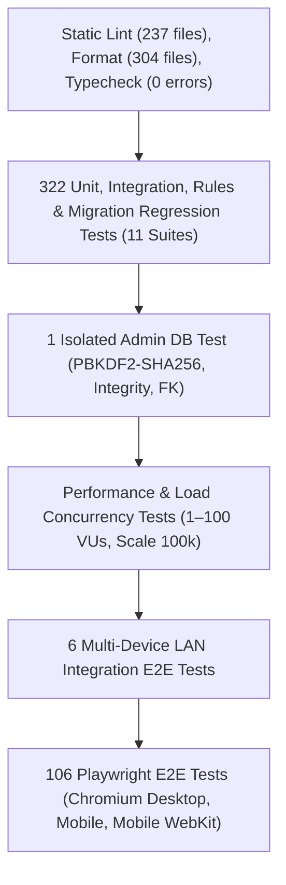

# NORI VEHICLE RENTAL — KẾ HOẠCH & DANH MỤC KIỂM THỬ TOÀN DIỆN (TEST PLAN & TEST CASES)

- **Ngày ban hành**: 2026-11-20
- **Phiên bản hệ thống**: `v2.7.1` (P0 Hotfix & Full System QA)
- **Tổng số Automated Tests thực thi**: **`429 / 429 PASS (100%)`**

---

## 1. Chiến lược & Mô hình Kim tự tháp Kiểm thử (Test Strategy)

---

## 2. Phân loại & Kết quả Thực thi Chi tiết 429 Automated Tests

### 2.1. Nhóm Kiểm thử Đơn vị, Quy tắc Nghiệp vụ & Di trú CSDL (322 Tests)

1. **`tests/rental-rules.test.mjs`** (85 tests): Quy tắc ngày thuê theo múi giờ Việt Nam, chiết khấu tuần/tháng, phụ phí lễ Tết, ma trận 9 trạng thái đơn thuê, logic tính giá lăn bánh mua xe, validation 24h.
2. **`tests/rbac-access.test.mjs`** (25 tests): Phân quyền 8 chức danh quản trị, bảo vệ endpoint Dashboard, chống leo thang quyền, thu hồi token tức thì.
3. **`tests/data-sync.test.mjs`** (35 tests): Nhập/xuất snapshot Git, kiểm tra toàn vẹn CSDL, phục hồi thảm họa, bảo vệ dữ liệu nhạy cảm.
4. **`tests/payment-rules.test.mjs`** (42 tests): Quy tắc khuyến mãi, tính giảm giá %, trần số tiền, hạn mức voucher, hoàn trả quota khi hủy đơn.
5. **`tests/payment-business-audit.test.mjs`** (5 tests): Phân định hạch toán Doanh thu thuê xe (13M) vs Ký quỹ bảo đảm tài sản xe (15M), tùy chọn cọc 30% vs 100%, chốt chặn Pre-Handover Gate và Settlement Gate.
6. **`tests/payment-integration.test.mjs`** (28 tests): Tạo giao dịch thanh toán, VietQR SePay webhook idempotency, mock simulator, chống thanh toán trùng lặp.
7. **`tests/payment-resilience.test.mjs`** (18 tests): 10 kịch bản chịu lỗi thanh toán (timeout, sai số tiền, trùng mã tham chiếu, hoàn tiền).
8. **`tests/multi-branch-rules.test.mjs`** (38 tests): Timeline vị trí phương tiện P0, định giá 5 tầng theo địa điểm, quy tắc một chiều, phụ phí giao nhận tận nơi.
9. **`tests/multi-branch-integration.test.mjs`** (15 tests): Giao dịch điều chuyển xe 9 trạng thái ACID kèm khóa lịch nguyên tử, rollback khi lỗi.
10. **`tests/lan-network.test.mjs`** (26 tests): Lọc adapter mạng ảo, phát hiện dynamic IPv4 Wi-Fi/Ethernet, bảo mật cookie session trên LAN.
11. **`tests/db-migration-regression.test.mjs`** (7 tests): 7 nhóm kiểm thử hồi quy di trú CSDL (Fresh DB, Existing Upgrade, Pending Guard, Schema Drift, Idempotency, Disaster Recovery, Data Preservation).

### 2.2. Nhóm Kiểm thử Khởi tạo Admin Độc lập (1 Test)

- **`scripts/test-admin-isolated.mjs`**: Khởi tạo admin trên CSDL cô lập, kiểm tra băm PBKDF2-SHA256, tính lũy kế (idempotent), `integrity = ok`, `0` lỗi khóa ngoại.

### 2.3. Nhóm Kiểm thử Đa Thiết Bị LAN E2E (6 Tests)

- **`tests/e2e/lan-multi-device.spec.ts`**:
  1. Kiểm tra reachability trên cả localhost và LAN IP, security headers, chặn CSRF origin giả mạo.
  2. Đăng nhập/đăng ký trên mobile viewport, kiểm tra thuộc tính cookie session, không chuyển hướng sai về localhost.
  3. Đồng bộ dữ liệu CSDL SQLite giữa nhiều thiết bị, chỉnh sửa đơn, duyệt đơn, URL media không bị localhost.
  4. Ma trận responsive từ 320px đến 1920px kèm xoay ngang, kích thước touch target $\ge$ 44×44px, kiểm tra Secure Context trên LAN.
  5. Chốt chặn đồng thời: Đua voucher 1 slot, khách sửa đơn vs admin duyệt đơn (optimistic lock), cập nhật giá giữa checkout.
  6. Admin thay ảnh Hero Carousel/Banner/Xe cập nhật trực tiếp ngoài giao diện, kiểm tra ngắt/kết nối lại Wi-Fi.

### 2.4. Nhóm Kiểm thử E2E Toàn diện Cô lập (106 Tests trên 14 Spec Files)

1. `auth-session-booking-regression.spec.ts` (8 tests): Đăng nhập, cookie session, tạo đơn thuê 201, cách ly phiên, timeout.
2. `data-sync.spec.ts` (9 tests): Đồng bộ giá tức thì không cần build lại, Dynamic route slugs, chống double-booking 409, anti-IDOR.
3. `hero-cms.spec.ts` (11 tests): Upload ảnh Hero, Draft/Publish, revalidation cache, responsive mobile fallback.
4. `multi-branch-workflow.spec.ts` (6 tests): Thuê xe đa chi nhánh, giao nhận tận nơi, điều chuyển liên chi nhánh, báo cáo chi nhánh không cộng trùng.
5. `nori.spec.ts` (45 tests): Khảo sát toàn bộ public routes không lỗi runtime, bộ lọc xe máy không hiện nội thất, lịch trống, Axe Core WCAG 2.2 AA scan.
6. `payment-lifecycle.spec.ts` (1 test): Toàn bộ vòng đời thanh toán VietQR SePay, webhook xác nhận, hoàn tiền, báo cáo doanh thu.
7. `performance-media-smoke.spec.ts` (3 tests): Nén ảnh WebP runtime, kiểm tra tràn ngang viewport 375px, xóa cache CMS.
8. `posts-banner.spec.ts` (1 test): Soạn thảo bài viết, upload banner sự kiện, liên kết voucher, SEO OpenGraph.
9. `promo-checkout-regression.spec.ts` (6 tests): State machine voucher Checkout, gỡ mã không bị kẹt, đua voucher 1 slot, khôi phục quota khi hủy đơn.
10. `qa-comprehensive-audit.spec.ts` (7 tests): RBAC phân hệ Operator, chống CSV Formula Injection, Draft unpublish, race condition 8 luồng.
11. `upgrade-workflows.spec.ts` (4 tests): Khách sửa đơn PENDING, popup thông báo sau duyệt, chuông thông báo, upload media batch magic-byte.
12. `mobile-webkit.spec.ts` (6 tests): Trải nghiệm Safari WebKit di động: Drawer Menu, Bottom Sheet filters, đăng ký, đăng nhập và đặt xe.
